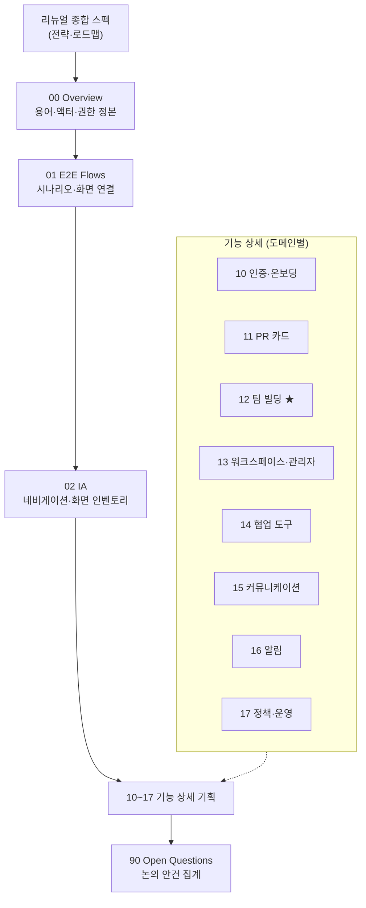
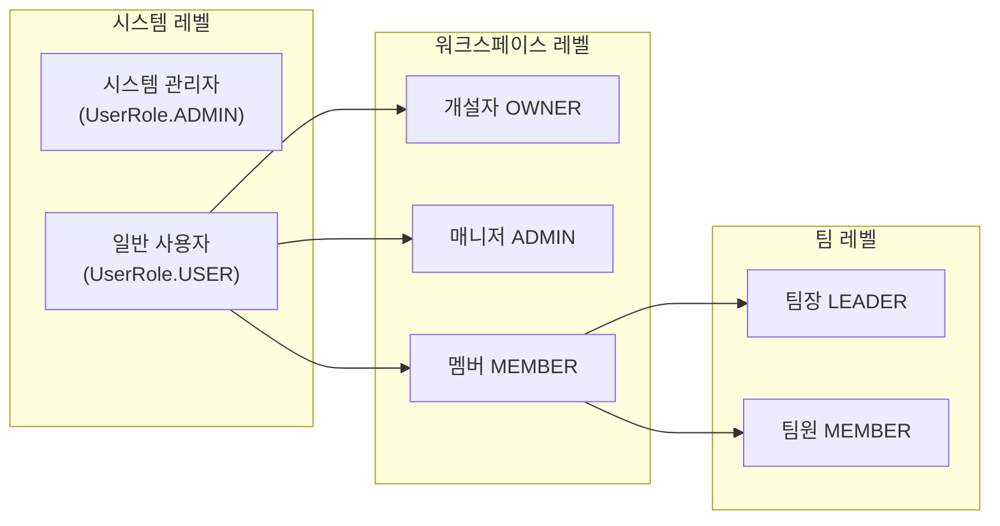

# 00. Overview — 문서 맵 · 용어 · 액터/권한 정본

> Pick Team MVP 2.0 상세 기획 문서 세트의 진입점.
> 상위 전략 문서: [`../pick-team-renewal-spec.md`](../pick-team-renewal-spec.md) (포지셔닝·감사·로드맵)
> 이 문서는 모든 하위 문서가 공유하는 **용어·액터·권한·표기 규약의 정본(single source of truth)** 이다. 다른 문서와 충돌하면 이 문서가 이긴다.

---

## 1. 문서 맵과 읽는 법



| 문서 | 범위 | 성격 |
|---|---|---|
| [00-overview.md](00-overview.md) | 용어집, 액터·권한 모델, 문서 템플릿, 다이어그램 스타일 가이드 | **정본** |
| [01-e2e-flows.md](01-e2e-flows.md) | 페르소나별 E2E 시나리오, 시나리오 분기, 화면 연결 맵 | **설계 기준점** |
| [02-information-architecture.md](02-information-architecture.md) | 새 IA·네비게이션·레이아웃 원칙, 화면 인벤토리, URL 체계 | 설계 기준점 |
| [10-auth-onboarding.md](10-auth-onboarding.md) | 가입·로그인·OAuth·초대·온보딩 | 기능 상세 |
| [11-profile-pr-card.md](11-profile-pr-card.md) | 자기 PR 카드 v2, 공개 범위·동의 | 기능 상세 |
| [12-team-building.md](12-team-building.md) | 팀 빌딩 세션·갤러리·지원/스카우트·매칭 | 기능 상세 ★핵심 |
| [13-workspace-admin.md](13-workspace-admin.md) | 워크스페이스 관리, 강사 대시보드 | 기능 상세 |
| [14-collab-tools.md](14-collab-tools.md) | 칸반·일정·게시판·공지 | 기능 상세 |
| [15-communication.md](15-communication.md) | 채팅·화상회의 | 기능 상세 |
| [16-notifications.md](16-notifications.md) | 알림 센터·수신 설정·웹푸시 | 기능 상세 |
| [17-policy-operations.md](17-policy-operations.md) | 신고/차단, 개인정보, 운영·보안 사고 대응 | 기능 상세 |
| [90-open-questions.md](90-open-questions.md) | 전 문서 ⚠️ 항목 집계, 논의 안건 | 리뷰용 |

**읽는 순서**: 처음 읽는 사람은 종합 스펙 §1(Executive Summary) → 00 → 01 → 관심 기능 문서. 리뷰어는 90부터 역으로 들어가도 된다.

---

## 2. 용어집

코드 식별자와 화면 표기를 분리해 정의한다. 화면 표기(한국어)가 UI 문구의 기준이다.

### 2.1 공간·구조

| 용어 | 화면 표기 | 정의 | 코드 대응 |
|---|---|---|---|
| Workspace | 워크스페이스 | 교육 과정(기수) 단위의 최상위 공간. 강사가 개설하고 수강생이 초대로 합류 | `Workspace` |
| Team | 팀 | 워크스페이스 안에서 프로젝트를 수행하는 소그룹. 팀 빌딩의 결과물 | `Team` |
| Team Space | 팀 스페이스 | 팀 전용 협업 공간(칸반·일정·게시판·공지 탭의 묶음) | `TeamSpacePage` |
| Card Gallery | 멤버 카드 | 워크스페이스 멤버들의 PR 카드를 모아 보는 화면 | 신규 |

### 2.2 팀 빌딩 도메인 (전부 신규)

| 용어 | 화면 표기 | 정의 |
|---|---|---|
| PR Card | PR 카드 | 멤버가 자신을 소개하는 구조화된 프로필 카드. 희망 역할·강점·가용 시간·협업 스타일 포함. "자기 PR 작성" 벤치마크(프로그래머스 BE4+ 운영 문서)를 제품화한 것 |
| Team Building Session | 팀 빌딩 | 워크스페이스 관리자가 개설하는 기간제 팀 결성 이벤트. 모집 기간·팀 정원·구성 방식을 정의 |
| Application | 지원 | 멤버가 모집 중인 팀에 합류를 요청하는 행위 |
| Scout | 스카우트 | 팀(팀장 또는 팀원)이 특정 멤버에게 합류를 제안하는 행위 |
| Unassigned | 미배정 | 세션 마감 시점에 어느 팀에도 속하지 않은 멤버 상태 |
| Match Score | 매칭 점수 | 규칙 기반으로 계산되는 멤버↔팀 적합도. 항상 **추천 사유**와 함께 표시 |
| Recommendation Reason | 추천 사유 | 매칭 점수의 근거를 사람이 읽을 수 있는 문장으로 표시한 것 (예: "백엔드 희망 + 저녁 시간대 일치") |

### 2.3 협업 도메인 (기존, 재정의 포함)

| 용어 | 화면 표기 | 정의 | 코드 대응 |
|---|---|---|---|
| Kanban | 칸반 보드 | 팀 태스크 관리 보드. 완료는 **승인 워크플로**(요청→승인)를 거침 | `Kanban`, `KanbanTask` |
| Approval | 완료 승인 | 태스크 완료 요청을 팀장/관리자가 확인·승인하는 절차 | 기존 API 존재 |
| Schedule | 일정 | 팀 캘린더의 항목. MVP 2.0에서 개인 일정 추가 | `Schedule` |
| Announcement | 공지 | 워크스페이스/팀 공지사항 | `Announcement` |
| Bulletin | 게시판 | 팀 게시판(글+댓글+첨부) | `Post`, `Comment` |
| DM / 그룹 채팅 | 채팅 | SSE 기반 비동기 메신저 | `ChatRoom` |
| Video Channel | 화상회의 | LiveKit 기반 화상회의 채널 | `VideoChannel` |

### 2.4 사용하지 않는 용어 (금지어)

- ~~채널/프로젝트 룸~~ → "팀"으로 통일 (기존 기능 명세서 Epic 3의 용어 혼란 종결)
- ~~팀 짜기/팀 구성 페이지~~ → "팀 빌딩"으로 통일
- ~~관리자~~ 단독 사용 금지 → 반드시 "시스템 관리자 / 워크스페이스 관리자 / 팀장" 중 하나로 구체화 (「다음 발표를 위해 개선할 것들」의 액터 모호성 피드백 계승)

---

## 3. 액터 정의와 권한 모델 (정본)

### 3.1 액터 계층

역할은 3계층이며 **서로 독립적으로 부여**된다 (계정 역할이 워크스페이스 역할을 결정하지 않는다).



| 계층 | 역할 (코드) | 화면 표기 | 전형적 인물 | 핵심 권한 요약 |
|---|---|---|---|---|
| 시스템 | `UserRole.ADMIN` | 시스템 관리자 | 서비스 운영자(본인) | `/api/admin/**`, 신고 처리, 계정 제재 |
| 시스템 | `UserRole.USER` | 사용자 | 모든 가입자 | 기본값 |
| 워크스페이스 | `MemberRole.OWNER` | 개설자 | 강사·과정 운영 책임자 | 워크스페이스 삭제, 비밀번호, 매니저 임명 + 매니저 권한 전부 |
| 워크스페이스 | `MemberRole.ADMIN` | 매니저 | 보조 강사·운영진 | 멤버 관리(강퇴·차단), 팀 빌딩 세션 개설·운영, 대시보드, 공지 |
| 워크스페이스 | `MemberRole.MEMBER` | 멤버 | 수강생 | PR 카드, 팀 빌딩 참여, 팀 활동 |
| 팀 | `TeamRole.LEADER` | 팀장 | 팀 대표 수강생 | 팀 정보 수정, 완료 승인, 팀장 위임(신설), 팀 삭제, 멤버 정리 |
| 팀 | `TeamRole.MEMBER` | 팀원 | 팀 소속 수강생 | 팀 스페이스 이용 전반 |

상태 값(기존 유지): `WorkspaceMember.MemberStatus` = ACTIVE/BANNED/LEFT, `TeamMember.TeamStatus` = ACTIVE/LEFT.

### 3.2 계층 간 통합 규칙 (신설 — 기존 코드에 없던 정의)

기존 구현은 세 계층이 각자 따로 검증되고 연계 규칙이 없다(예: FE에서 OWNER 판정은 `workspace.owner.id` 비교, ADMIN 판정은 `members[].role` 참조로 소스가 분열 — `WorkspaceSettingsModal.tsx`). MVP 2.0의 규칙:

1. **감독권과 참여권의 분리.** 워크스페이스 개설자/매니저는 모든 팀의 **집계 정보**(진행도, 승인 대기, 멤버 구성)를 대시보드에서 열람할 수 있다. 그러나 팀 스페이스 **내부 콘텐츠**(채팅, 게시판 글쓰기, 칸반 조작)에는 팀 멤버로 참여했을 때만 접근한다.
   - ✅ **결정 (2026-07-04, 통합 안건 A)**: 강사의 팀 내부 콘텐츠(채팅·게시판) 열람권은 **집계 정보까지만**. 내용 열람 불가. 수강생 프라이버시 우선
2. **완료 승인의 주체 규칙.** 팀 내 승인은 팀장이 1차 주체. 워크스페이스 매니저 이상은 대시보드에서 승인 큐를 보고 **개입 승인** 가능(승인자 기록 남김). 상세는 [13](13-workspace-admin.md)·[14](14-collab-tools.md).
3. **권한 판정 소스 단일화.** 모든 워크스페이스 권한 판정은 `WorkspaceMember.role` 하나를 소스로 한다. `workspace.owner` 비교 로직은 폐기(개설자도 role=OWNER인 멤버 레코드로 표현). 팀장 판정은 `TeamMember.teamRole`로 단일화(`team.leader` DTO 가공 필드 폐기).
4. **BANNED의 파급.** 워크스페이스 차단 시 해당 워크스페이스의 모든 팀에서 자동 제외(LEFT 처리)되고, PR 카드는 해당 워크스페이스 스코프에서 비공개된다.
5. **백엔드 강제 원칙.** 모든 권한 규칙은 서버에서 검증한다. 현행 `Account-Id` 헤더/파라미터 신원 수신(7개 컨트롤러)은 전면 폐기하고 JWT `@AuthenticationPrincipal`로 통일 — UI 분기는 편의일 뿐 보안 경계가 아니다.

### 3.3 페르소나 (01 문서에서 사용하는 인물)

| 페르소나 | 액터 매핑 | 한 줄 정의 |
|---|---|---|
| **강사 K** | 워크스페이스 개설자 | 부트캠프 기수를 운영하며 팀 편성과 진행 관리를 책임진다. 도입 결정자 |
| **수강생 S** | 워크스페이스 멤버 | 처음 만나는 동기들 사이에서 맞는 팀을 찾고 싶다. 핵심 사용자 |
| **팀장 L** | 팀장 (수강생 중 선출) | 결성된 팀의 실행을 이끈다. 파워 유저 |
| **운영자 O** | 시스템 관리자 | 서비스 전체 운영·신고 처리. (당분간 개발자 본인) |

---

## 4. 공통 문서 템플릿 (10~17 적용)

기능 문서는 아래 8개 섹션을 이 순서로 갖춘다. 해당 없음이면 "해당 없음"과 사유 한 줄.

```markdown
# NN. 문서명

## 1. 목적과 배경         ← 무엇을 왜. 현재 상태(As-Is)와 근거 인용(파일 경로/Notion 페이지) 필수
## 2. 액터와 권한          ← 00 §3의 명칭만 사용. 이 기능에서의 권한 매트릭스
## 3. 유저 스토리          ← "~로서, ~하고 싶다, ~하기 위해" + 수용 기준
## 4. 화면 구성            ← 텍스트 와이어프레임 + mermaid(00 §6 스타일 가이드 준수).
                             화면마다 ID 부여(02 화면 인벤토리와 일치)
## 5. 인터랙션·상태·엣지 케이스 ← 상태 머신, 빈 상태, 에러, 동시성, 권한 거부 시 동작
## 6. 데이터·API 요구사항   ← [재활용]/[변경]/[신규] 태그로 기존 자산 구분. 엔티티·엔드포인트 수준
## 7. 성공 지표            ← 이 기능이 잘 됐는지 측정할 1~3개 지표
## 8. ⚠️ 논의 필요 항목    ← 표 형식: ID(문서번호-D#) / 질문 / 선택지·추천안 / 영향도
```

**표기 규약**:
- `⚠️ D-표기`: 사람 확인·논의가 필요한 결정. 각 문서 §8에 모으고 본문에는 `(⚠️ NN-D1)` 인라인 참조. 90 문서가 전량 집계한다.
- `[재활용]` 기존 구현 그대로 사용 / `[변경]` 기존 수정 / `[신규]` 새로 만듦 — §6에서 필수.
- 화면 ID: `SCR-<영역>-<번호>` (예: `SCR-TB-01` 팀 빌딩 세션 홈). 정의는 02 문서 인벤토리가 정본.
- 우선순위: 로드맵 마일스톤(M0~M3)으로 표기, 종합 스펙 §6과 일치시킨다.

---

## 5. 설계 원칙 (전 문서 공통)

1. **팀 빌딩이 시작점** — 모든 여정은 "팀이 없는 상태"에서 출발하는 것을 1급 시나리오로 다룬다.
2. **결성 → 협업 무단절** — 팀 확정 시 팀 스페이스(칸반·게시판 자동 생성 [재활용])가 즉시 준비된 상태여야 한다.
3. **설명 가능성** — 매칭·추천·자동화는 항상 사유를 함께 보여준다. 블랙박스 금지.
4. **관리자(강사) 가시성** — 강사가 "지금 어떤 상태인가"를 한 화면에서 알 수 있어야 한다.
5. **'충분히 좋은' 경계** — 채팅·화상회의는 수리·안정화까지만. 전문 툴과 품질 경쟁하지 않는다.
6. **프라이버시 기본값** — 성향·프로필 데이터는 워크스페이스 스코프 공개가 기본. 전역 공개는 없다.
7. **빈 상태도 설계 대상** — 모든 화면은 "아무것도 없을 때"와 "에러일 때"의 모습을 정의한다 (`alert()` 전면 금지, 토스트/인라인 에러로 대체).

---

## 6. 다이어그램 스타일 가이드 (mermaid)

> 렌더링 기준 환경: **GitHub 웹 + VSCode 내장 Markdown 프리뷰**. 두 환경에서 깨지는 기능은 채택하지 않는다.
> 조사 결론: GitHub가 인라인 렌더링하는 다이어그램 도구는 mermaid가 유일하다(PlantUML·D2·Graphviz 미지원) — mermaid 단독 채택.

### 6.1 공통 헤더 (모든 다이어그램 첫 줄)

색을 고정하지 않는 `neutral` 테마를 표준으로 한다. GitHub 라이트/다크 모드 자동 전환과 충돌하지 않는다.

```text
%%{init: {"theme": "neutral", "flowchart": {"curve": "basis", "htmlLabels": true}} }%%
```

색 구분이 꼭 필요할 때만 classDef를 쓰되, 아래 4종 의미 팔레트로 제한한다(라이트 기준 대비 확보, GitHub는 흰 배경 iframe에 렌더):

```text
classDef screen   fill:#DBEAFE,stroke:#3B82F6,color:#1E3A5F   %% 화면
classDef action   fill:#D1FAE5,stroke:#10B981,color:#064E3B   %% 행동/성공
classDef decision fill:#FEF3C7,stroke:#F59E0B,color:#78350F   %% 분기/주의
classDef admin    fill:#F5F3FF,stroke:#7C3AED,color:#4C1D95,stroke-dasharray:4 2  %% 관리자 전용/모달
```

### 6.2 유형별 선택 기준

| 표현 대상 | 문법 | 규칙 |
|---|---|---|
| 사용자 플로우 | `flowchart` | 노드 15개 미만 유지(초과 시 분할), 좌→우 흐름은 `LR`·단계 심화는 `TD`, 엣지 라벨은 분기점에만 2~4글자 |
| 상태 머신 | `stateDiagram-v2` | classDef가 복합 상태·`[*]`에 안 먹으므로 스타일 대신 구조(복합 상태 묶기, `note`)로 표현 |
| 화면 연결 맵 | `flowchart` + `subgraph` | subgraph = 영역 묶음. 모달·관리자 전용은 점선(classDef admin) |
| 시나리오 상호작용 | `sequenceDiagram` | `autonumber` 필수, `participant X as 한글명`, 분기는 `alt/else` |

### 6.3 금지·주의 목록

| 구분 | 항목 | 사유/대안 |
|---|---|---|
| 금지 | `flowchart-elk`, `layout: elk` | GitHub 미설치 — 렌더 실패. 방향 조정·분할로 대체 |
| 금지 | `click` 이벤트·하이퍼링크 | GitHub CSP 차단. 본문 링크로 대체 |
| 금지 | frontmatter형 config(`--- config: ---`) | GitHub 미지원. `%%{init}%%`만 사용 |
| 금지 | 노드 라벨 50자 초과, 단일 다이어그램 노드 15개 초과 | 레이아웃 붕괴. `<br/>` 분리·다이어그램 분할 |
| 주의 | 한글 라벨 | 폭 계산이 ASCII 기준이라 오차 — 한 줄 7~12자, 초과 시 `<br/>` |
| 주의 | 특수문자(괄호·콜론 등) 포함 라벨 | 반드시 `"..."`로 감싼다. subgraph 제목에는 `[`·`"` 금지 |
| 주의 | themeVariables 색 고정 | GitHub 테마 정책 변경 시 대비 깨질 수 있음 — 기본은 neutral, classDef만 국소 사용 |

### 6.4 검증 절차

작성한 다이어그램은 커밋 전에 mermaid-cli(`mmdc`) 또는 mermaid.live에서 문법 검증한다. CJK+`<br/>` 조합은 구버전 렌더러에서 파싱 오류 사례가 있으므로 실제 렌더 확인 필수. (전체 문서 일괄 검증은 Phase E에서 수행)

---

## 부록: 기존 기획 → 신규 문서 커버리지 매핑

기존 Notion 「파이널 프로젝트 기능 명세서」 Epic 1~5와 메인 페이지 5대 기능이 새 문서 체계 어디에서 다뤄지는지의 추적표. 재문서화 누락 검증용.

| 기존 기획 항목 | 신규 문서 | 처분 |
|---|---|---|
| Epic 1 — 인증(가입·로그인·간편 로그인) | [10](10-auth-onboarding.md) | 재문서화 + 초대 여정 완성 |
| Epic 1 — 프로필(MBTI·성향 태그·마이페이지) | [11](11-profile-pr-card.md) | PR 카드 v2로 재설계 |
| Epic 2 — 워크스페이스 생성·초대·멤버 관리·권한 | [13](13-workspace-admin.md), [10](10-auth-onboarding.md) | 재문서화 + 역할 변경·대시보드 신설 |
| Epic 2 — 팀 구성(수동 DnD / 자동 랜덤) | [12](12-team-building.md) | 세션·지원/스카우트 체계로 재설계. DnD는 CLOSING 수동 배치로 흡수, 랜덤은 폴백으로 격하 |
| Epic 3 — 채널/룸 생성·입장·초대·공지 고정·멤버 목록 | [12 부록](12-team-building.md)(자유 팀 생성), [14](14-collab-tools.md)(팀 개요·공지) | "채널/룸" 용어 폐기 → "팀"으로 통일 (00 §2.4) |
| Epic 4 — 채팅(첨부·방 생성·스레드) | [15](15-communication.md) | 재문서화. 스레드는 컷(15-D1) |
| Epic 4 — 화상회의(화면 공유·제어판) | [15](15-communication.md) | 재문서화 + 보안 수리, 기능 동결 |
| Epic 4 — 캘린더·D-Day | [14](14-collab-tools.md) | 뷰 확장 + 개인 일정 신설. D-Day는 14-D1 |
| Epic 4 — 칸반·진행도 그래프 | [14](14-collab-tools.md) | 승인 워크플로 1급 승격. 그래프는 14-D2(제외 추천) |
| Epic 4 — 투표·사다리·주사위 | — | 제거 확정 (14-D6, 90 §6) |
| Epic 4 — 게시판 댓글 | [14](14-collab-tools.md) | 재문서화 [재활용] |
| Epic 5 — 알림 센터·일정 5분 전 알림·멘션 | [16](16-notifications.md) | 실동작 설계로 재정의 |
| Epic 5 — 카카오톡 알림(목업) | — | 제거 확정 (기업회원 한정 — 「기술력 체크」 §2) |
| Epic 5 — 차단·신고·강퇴 | [17](17-policy-operations.md), [13](13-workspace-admin.md) | 차단 재문서화 + 신고 신설 |
| 메인 페이지 5대 기능: 워크스페이스 / 칸반·캘린더 / 메신저 / 성향 기반 팀원 추천 / 화상회의 | 13 / 14 / 15·16 / **11·12** / 15 | 전 항목 커버. 성향 추천이 문서 2개를 가진 유일한 항목 — 제품 엣지의 반영 |

## 변경 이력

| 날짜 | 내용 |
|---|---|
| 2026-07-04 | 최초 작성 |
