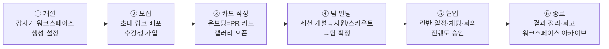
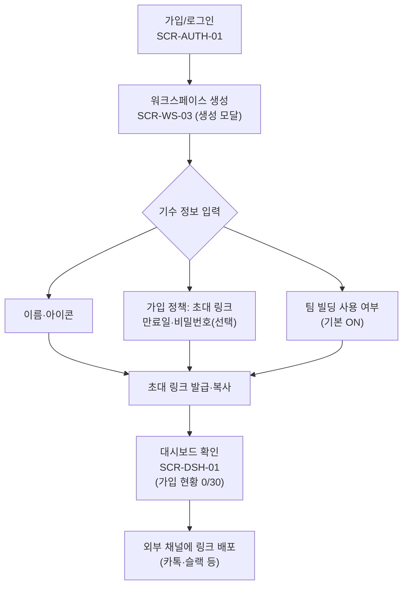
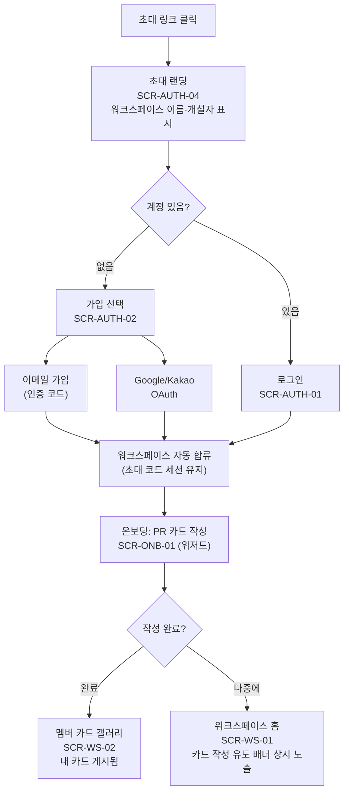
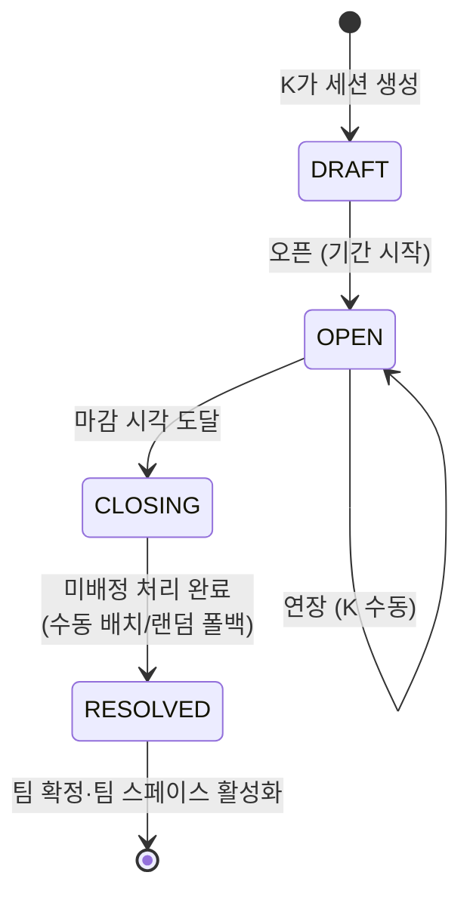
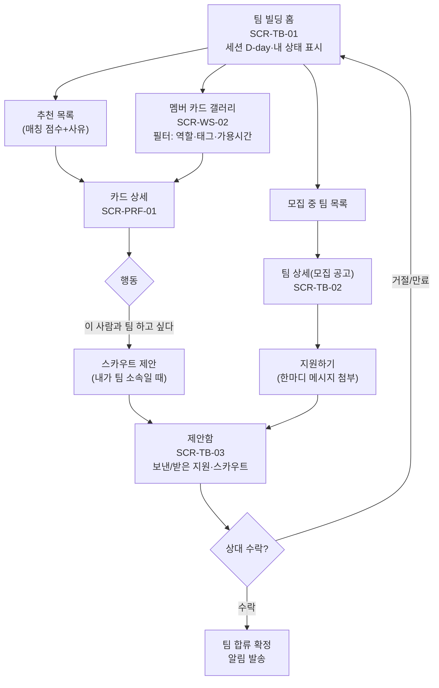
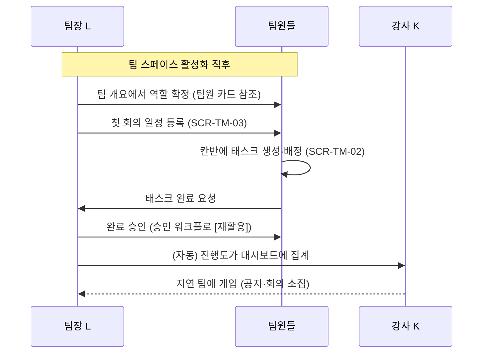
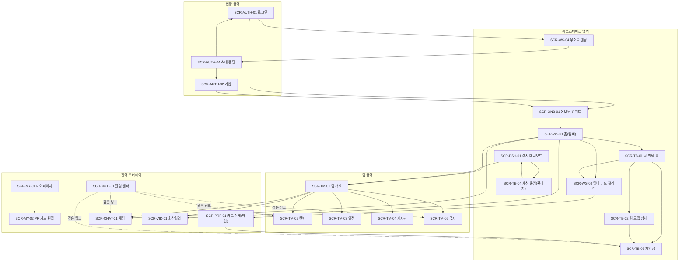

# 01. E2E Flows — 사용 시나리오와 화면 연결

> 이 문서는 MVP 2.0의 **여정 정본**이다. 기능 문서(10~17)의 모든 플로우는 여기 정의된 시나리오·화면 ID와 일치해야 한다.
> 기존 레이아웃·플로우를 전제하지 않는다. 근거가 되는 현재 구현은 As-Is로만 인용한다.
> 액터·용어는 [00-overview.md](00-overview.md) §2·§3을 따른다. 화면 ID 정의는 [02-information-architecture.md](02-information-architecture.md)가 정본.

---

## 1. 전체 여정 지도 (기수 라이프사이클)

Pick Team의 단위 수명은 "기수(워크스페이스)"다. 하나의 기수는 아래 6단계를 순서대로 지난다. 각 단계가 다음 단계의 입력을 만든다는 점이 설계의 뼈대다.

| 단계 | 주도 액터 | 핵심 화면 | 성공 조건 |
|---|---|---|---|
| ① 개설 | 강사 K | SCR-WS-03, SCR-DSH-01 | 초대 링크 발급 완료 |
| ② 모집 | 강사 K → 수강생 S | SCR-AUTH-04 → SCR-AUTH-02 | 기수 인원 가입 완료 |
| ③ 카드 작성 | 수강생 S | SCR-ONB-01 → SCR-WS-02 | 카드 작성률 목표(예: 90%) 도달 |
| ④ 팀 빌딩 | 강사 K(개설) + 수강생 S(참여) | SCR-TB-01~04 | 미배정자 0명 |
| ⑤ 협업 | 팀장 L·팀원 | SCR-TM-01~05 | 팀별 주간 활성 유지 |
| ⑥ 종료 | 강사 K | SCR-DSH-01 | 아카이브 처리 (⚠️ 01-D4) |

> As-Is 대비 가장 큰 변화: 기존 구현에는 ③·④ 단계가 사실상 없다(온보딩 부재, 팀 빌딩 라우트 단절 — 종합 스펙 §3.3). 기존 사용자는 가입 직후 빈 워크스페이스에 방치된다.

---

## 2. 시나리오 F1 — 강사 K: 기수 개설과 세팅

**목표**: 개강 전날, K는 30분 안에 기수 공간을 만들고 초대 링크를 수강생 단톡방에 뿌린다.

**단계별 요구사항**:

1. **생성 입력 최소화**: 필수는 이름 하나. 나머지(아이콘·비밀번호·정원)는 생성 후 설정에서. As-Is의 `CreateWorkspaceModal`은 유지 가능한 골격 [재활용].
2. **초대 링크 신설 요건**: 만료일 설정, 재발급(기존 링크 무효화), 사용 횟수 확인. As-Is는 고정 URL로 만료·재생성 불가(`WorkspaceSettingsModal.tsx` 초대 탭) — 링크가 한번 유출되면 회수 불가능하므로 [변경] 필수. 상세: [10](10-auth-onboarding.md).
3. **팀 빌딩 사용 여부 스위치**: OFF면 팀 빌딩 메뉴가 숨고 자유 팀 생성 모드로 동작(§7 F6-d). 부트캠프 외 용도(스터디 등)의 수용 장치.
4. **개설 직후 대시보드가 홈**: K에게는 가입 현황(N/정원)·카드 작성률·팀 빌딩 상태가 즉시 보이는 SCR-DSH-01이 기본 진입점이다. 멤버에게 보이는 SCR-WS-01과 다르다 (02 §3 참조).

---

## 3. 시나리오 F2 — 수강생 S: 초대 가입과 온보딩

**목표**: S는 단톡방에서 링크를 눌러 5분 안에 "내 카드가 갤러리에 걸린 상태"까지 도달한다.

**단계별 요구사항**:

1. **초대 랜딩(SCR-AUTH-04) 신설**: 링크를 누르면 "어디에 초대받았는지"를 먼저 보여주고 가입/로그인으로 분기한다. As-Is는 초대 코드 처리가 로그인·OAuth 콜백의 TODO로 방치되어 이 여정 전체가 끊겨 있다(`OAuthCallbackPage.tsx:98,124`, `AuthPage.tsx:87`) — 이 문서의 최우선 수리 지점.
2. **초대 코드는 인증 과정을 관통해 보존**: 가입 방식(이메일/OAuth)과 무관하게, 인증 완료 시점에 자동 합류까지 이어져야 한다. 상세 상태 보존 방식은 [10](10-auth-onboarding.md).
3. **온보딩 = PR 카드 작성**: 별도의 제품 투어를 만들지 않는다. 첫 진입에서 카드 위저드(SCR-ONB-01)가 곧 온보딩이다. 필수 입력은 2개(희망 역할, 주간 가용 시간)로 최소화하고 나머지는 선택 — 이탈 방지. 상세: [11](11-profile-pr-card.md).
4. **건너뛰기 허용, 대신 상시 리마인드**: 강제 작성은 이탈을 만든다. 건너뛴 사용자에게는 홈 배너 + 팀 빌딩 참여 시점 재요구(카드 없이 지원 불가 — ⚠️ 01-D1)로 회수한다.
5. **성향 데이터 동의**: 카드 작성 시작 시점에 수집·공개 범위 동의를 받는다(가입 시점 아님). 상세: [17](17-policy-operations.md).

---

## 4. 시나리오 F3 — 팀 빌딩 (제품의 심장)

**목표**: 세션 기간(예: 1주) 안에 전원이 팀을 확정하고, 마감 시 미배정자 0명으로 수렴한다.

### 4.1 세션 라이프사이클 (강사 K 관점)

- **DRAFT**: 팀 정원(최소~최대), 기간, 구성 방식(지원+스카우트 / 지원만), 팀 슬롯 사전 정의 여부를 설정. 멤버에게 비공개.
- **OPEN**: 전 멤버에게 알림. 팀 생성(모집 개시)·지원·스카우트가 가능해진다.
- **CLOSING**: 신규 지원·스카우트 차단. K가 미배정자를 처리하는 단계 — 수동 배치(DnD [재활용] `AdminTeamPage`) 또는 랜덤 폴백.
- **RESOLVED**: 전원 배정. 각 팀의 팀 스페이스가 활성화되고(칸반·게시판 자동 생성 [재활용]) 결과가 전체 공지된다.

### 4.2 수강생 S의 팀 찾기 (3갈래 진입)

**핵심 규칙** (상세와 근거는 [12-team-building.md](12-team-building.md)):

1. **팀의 씨앗**: 세션 중 누구든 팀을 개설(모집 공고 등록)할 수 있다. 개설자가 잠정 팀장. (⚠️ 01-D2: 팀 개설 권한을 전원에게 줄지, 강사 사전 승인제로 할지)
2. **지원과 스카우트는 대칭**: 개인→팀(지원), 팀→개인(스카우트). 둘 다 수락으로만 성립. 강제 배정은 CLOSING 단계의 강사 권한뿐.
3. **동시 제안 허용, 성립은 하나**: 여러 팀에 지원 가능하되 하나가 성립되면 나머지는 자동 철회.
4. **추천은 항상 사유와 함께**: "백엔드 희망 + 저녁 가용 + 목표온도 근접" 식. 점수만 던지지 않는다.
5. **미배정 안전망**: 마감 후 강사의 수동 배치 또는 랜덤 폴백. 어떤 경우에도 "팀 없는 수강생"이 남지 않게 한다.

### 4.3 결성 직후 (F3→F4 전환)

팀 확정 알림 → 팀 스페이스 첫 진입 시 **팀 개요(SCR-TM-01)** 에 팀원 카드 요약이 자동 표시된다("우리는 이런 사람들"). 첫 회의 일정 제안·역할 확정 체크리스트가 빈 상태 대신 노출 — 결성 직후의 어색한 공백을 제품이 흡수한다.

---

## 5. 시나리오 F4 — 팀장 L: 협업 정착

**목표**: 결성 첫 주 안에 팀이 "칸반에 태스크가 있고, 일정이 잡혀 있는" 상태가 된다.

- 칸반 완료 승인 API는 이미 존재 [재활용] — MVP 2.0은 이를 팀 개요·강사 대시보드에 **보이게** 만드는 것이 핵심 ([13](13-workspace-admin.md), [14](14-collab-tools.md)).
- 채팅·화상회의는 팀 스페이스에서 원클릭 진입(기존 기능 수리 후 유지, [15](15-communication.md)).

---

## 6. 시나리오 F5 — 강사 K: 운영·감독 루프

K의 반복 루틴은 "대시보드 확인 → 이상 팀 개입"이다. 주 2~3회, 회당 10분을 가정한다.

| 대시보드 위젯 (SCR-DSH-01) | 보이는 것 | 개입 행동 |
|---|---|---|
| 가입·카드 현황 | 가입 N/정원, 카드 작성률 | 미작성자 리마인드 발송 |
| 팀 빌딩 현황 | 팀별 충원 상태, 미배정자 목록 | 연장, 수동 배치, 스카우트 유도 |
| 진행도 보드 | 팀별 칸반 완료율·승인 대기 수 | 승인 큐 처리, 지연 팀 공지 |
| 이상 신호 | 7일 무활동 팀, 탈퇴/차단 이력 | 면담·팀 재조정 (⚠️ 01-D3: 재조정 플로우 범위) |

---

## 7. 시나리오 F6 — 예외·분기 여정

| ID | 여정 | 처리 원칙 | 상세 문서 |
|---|---|---|---|
| F6-a | 초대 없이 직접 가입한 사용자 | 무소속 랜딩(SCR-WS-04): "초대 코드 입력" 또는 "워크스페이스 만들기" 2택. 방치 금지 | [10](10-auth-onboarding.md) |
| F6-b | 팀장 탈퇴 | 위임 필수 플로우 신설(후임 지명 → 수락 → 탈퇴). As-Is는 예외 던지고 끝(`TeamService.java:230-231`) | [14](14-collab-tools.md) |
| F6-c | 멤버 차단(BANNED) | 팀 자동 제외 + 카드 비공개 + 재가입 차단. 00 §3.2 규칙 4 | [13](13-workspace-admin.md), [17](17-policy-operations.md) |
| F6-d | 팀 빌딩 OFF 워크스페이스 | 자유 팀 생성/참여(As-Is `TeamActionModal` 개선판). 팀 빌딩 메뉴 숨김 | [12](12-team-building.md) §부록 |
| F6-e | 세션 중 팀 해체/이탈 | OPEN 중에는 자유 이탈(제안 상태 초기화). RESOLVED 후에는 팀장 위임·강사 재조정 경로만 | [12](12-team-building.md) |
| F6-f | 계정 삭제 | 소프트 삭제→30일 유예 [재활용] + PR 카드 즉시 비공개, 팀 이력은 익명화 보존 (⚠️ 01-D5) | [17](17-policy-operations.md) |
| F6-g | 알림 놓침 (오프라인 기간) | 알림 센터(SCR-NOTI-01)가 미확인 이벤트의 단일 회수 지점. 배지 카운트 | [16](16-notifications.md) |

---

## 8. 화면 연결 맵 (전역)

읽는 법: 실선은 주 동선, 점선은 알림 딥링크. 관리자 전용(SCR-DSH-01, SCR-TB-04)은 멤버 네비게이션에 노출되지 않는다. 전체 화면 인벤토리·URL은 [02](02-information-architecture.md).

---

## 9. 시나리오 분화 매트릭스

동일 화면이 조건에 따라 어떻게 갈라지는지의 요약. 기능 문서는 각 분기의 상세를 정의해야 한다.

| 분기 축 | 갈래 | 갈라지는 지점 | 결과 차이 |
|---|---|---|---|
| 가입 경로 | 초대 링크 / 직접 가입 | SCR-AUTH-04 유무 | 자동 합류+온보딩 vs 무소속 랜딩(SCR-WS-04) |
| 인증 수단 | 이메일 / Google / Kakao | SCR-AUTH-02 | 이메일만 인증 코드 단계. 초대 코드 보존은 3자 공통 |
| 역할 | 멤버 / 매니저·개설자 | 워크스페이스 진입 시 | 기본 진입점: SCR-WS-01 vs SCR-DSH-01. 네비 항목 차등 |
| 팀 빌딩 모드 | 세션 ON / OFF | 워크스페이스 설정 | TB 메뉴·갤러리 강조 vs 자유 팀 생성 |
| 팀 구성 방식 | 매칭 추천 / 갤러리 탐색 / 모집 공고 / 스카우트 / 수동 배치 / 랜덤 폴백 | SCR-TB-01 이후 | §4.2 — 전부 "수락"으로 수렴, 강제는 강사 폴백뿐 |
| 카드 작성 여부 | 작성 / 건너뜀 | SCR-ONB-01 | 갤러리 노출·팀 빌딩 참여 가능 vs 리마인드 배너 (⚠️ 01-D1) |
| 세션 단계 | OPEN / CLOSING / RESOLVED | SCR-TB-01 | 행동 가능 범위가 단계별로 축소 (§4.1) |

---

## 10. ⚠️ 논의 필요 항목

> ✅ **2026-07-04 일괄 결정**: 아래 전 항목이 추천안대로 확정됨. 결정 기록: [90-open-questions.md](90-open-questions.md). (D1=지원·스카우트 불가, D2=전원 허용, D3=강사 수동 이동만, D4=읽기 전용 전환, D5=익명화 보존, D6=집계만)

| ID | 질문 | 선택지와 추천안 | 영향 |
|---|---|---|---|
| 01-D1 | 카드 미작성자의 팀 빌딩 참여를 막을 것인가? | (a) 지원·스카우트 수신 불가(추천 — 카드 없는 매칭은 무의미하고 작성 유인이 됨) (b) 열람만 제한 (c) 제한 없음 | 11, 12 |
| 01-D2 | 세션 중 팀 개설(모집 공고) 권한 | (a) 전원 허용(추천 — 자발성 극대화, 팀 난립은 정원 규칙으로 억제) (b) 강사 승인제 (c) 강사가 슬롯 사전 생성 | 12 |
| 01-D3 | 결성 후 팀 재조정(멤버 이동)을 제품 기능으로 지원할 범위 | (a) 강사 수동 이동만(추천 — MVP) (b) 이적 요청 플로우까지 | 12, 13 |
| 01-D4 | 기수 종료 시 아카이브 동작 정의 | (a) 읽기 전용 전환(추천) (b) 일정 기간 후 삭제 (c) 명시적 동작 없음 | 13, 17 |
| 01-D5 | 계정 삭제 시 팀 이력(칸반 담당 등) 처리 | (a) 익명화 보존(추천 — 팀 기록 무결성) (b) 완전 삭제 | 17 |
| 01-D6 | 강사의 팀 내부 콘텐츠(채팅·게시판) 열람권 | 00 §3.2-1에서 이관. (a) 집계만(추천) (b) 게시판까지 열람 (c) 전체 열람+고지 | 13, 15, 17 |

---

## 변경 이력

| 날짜 | 내용 |
|---|---|
| 2026-07-04 | 최초 작성 |
