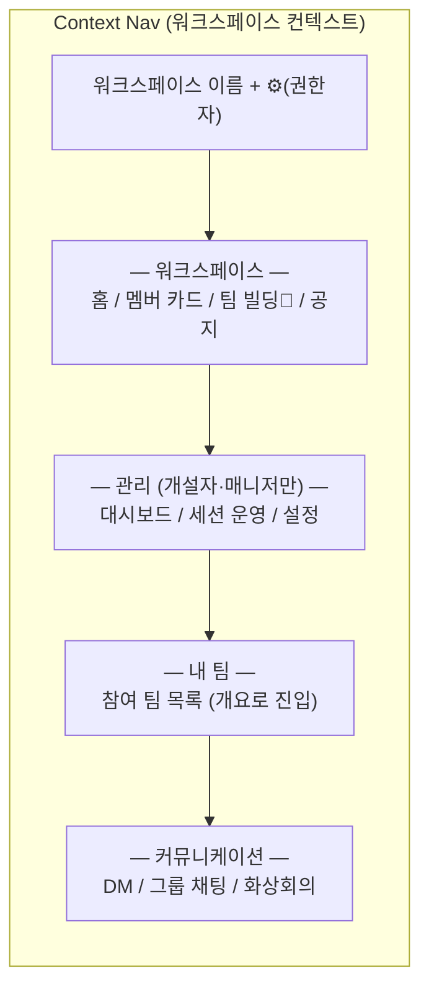

# 02. Information Architecture — 네비게이션 · 화면 인벤토리 · URL 체계

> 기존 레이아웃을 전제하지 않고 재설계한 IA의 정본. 화면 ID·URL은 이 문서가 기준이며, 모든 기능 문서와 목업이 이를 참조한다.
> As-Is 인용은 근거 제시용이다. 액터 명칭은 [00](00-overview.md) §3, 여정은 [01](01-e2e-flows.md)을 따른다.

---

## 1. IA 설계 원칙

1. **컨텍스트는 2계층뿐**: "워크스페이스 안이냐, 그 안의 팀 안이냐". 네비게이션은 이 두 겹만 표현하고 그 이상 중첩하지 않는다.
2. **역할이 진입점을 바꾼다**: 같은 워크스페이스라도 멤버는 홈(SCR-WS-01), 개설자·매니저는 대시보드(SCR-DSH-01)가 기본 진입점.
3. **팀 빌딩은 단계에 따라 네비 위상이 변한다**: 세션 OPEN 중에는 최상단 강조(배지·D-day), RESOLVED 후에는 일반 메뉴로 강등, 세션 OFF 워크스페이스에서는 숨김.
4. **모든 목록에는 빈 상태가 설계되어 있다**: "없음"은 다음 행동 제안과 함께 표시한다 (00 §5-7).
5. **알림은 단일 회수 지점**: 어떤 이벤트든 알림 센터에서 원클릭으로 해당 화면에 도달한다(딥링크 규약 §5).

---

## 2. 전역 레이아웃

### 2.1 데스크톱 (기준 뷰포트 ≥1024px)

```
┌────────────────────────────────────────────────────────────────┐
│ Global Header: [로고] ─────────────── [🔔 알림] [아바타 ▾]      │ h-14
├──┬──────────────┬──────────────────────────────────────────────┤
│WS│  Context Nav │  Content                                     │
│레│  (워크스페이스 │                                              │
│일│   컨텍스트     │  각 화면(SCR-*)이 렌더되는 영역               │
│  │   네비게이션)  │                                              │
│w-│  w-60        │                                              │
│16│              │                                              │
└──┴──────────────┴──────────────────────────────────────────────┘
```

- **WS 레일** [개편]: 가입한 워크스페이스 아이콘 세로 목록 + 생성/참여 버튼. As-Is `WorkspaceSidebar` 구조 유지하되, 워크스페이스별 미확인 알림 배지 추가. 멀티 워크스페이스(핵심 피처 ①)의 물리적 표현이므로 유지가 타당.
- **Context Nav** [신규 재설계]: As-Is `TeamProjectSidebar`(팀/DM/그룹채팅/화상회의 목록 나열)를 대체. 구성은 §2.3.
- **Global Header** [개편]: 로고(현재 워크스페이스 홈), 알림 벨(미확인 배지, 클릭 시 드롭다운 프리뷰 + "모두 보기"→SCR-NOTI-01), 아바타 드롭다운(마이페이지/내 PR 카드/계정 설정/로그아웃).

### 2.2 반응형 규칙

| 뷰포트 | WS 레일 | Context Nav | 비고 |
|---|---|---|---|
| ≥1024px | 고정 표시 | 고정 표시 | 기준 |
| 768~1023px | 고정 표시 | 오버레이 드로어(햄버거) | 콘텐츠 우선 |
| <768px | Context Nav 드로어 안에 워크스페이스 스위처 통합 | 드로어 | As-Is의 `ml-64` 하드코딩 폐기. 모바일은 열람·알림·채팅 대응 수준 (⚠️ 02-D1) |

### 2.3 Context Nav 구성 (역할·상태 반응형)



- `팀 빌딩🔴`: 세션 OPEN 중 D-day 배지. OFF 워크스페이스에서는 항목 자체가 없음.
- `— 관리 —` 섹션은 개설자·매니저에게만 렌더. 서버 권한 검증과 별개의 편의 분기(00 §3.2 규칙 5).
- 팀 항목 클릭 → 팀 개요(SCR-TM-01). 팀 내부 탭(칸반·일정·게시판·공지)은 콘텐츠 영역 상단 탭으로 표현 — 네비 계층 2겹 원칙(§1-1) 준수.

---

## 3. 화면 인벤토리 (정본)

상태: `신규` 새로 만듦 / `개편` 기존 화면 재설계 / `유지` 소폭 수리 / `제거` 삭제.

### 3.1 인증·온보딩 — 상세 [10](10-auth-onboarding.md)

| ID | 화면 | URL | 상태 | As-Is 대응 |
|---|---|---|---|---|
| SCR-AUTH-01 | 로그인 | `/login` | 유지 | `LoginPage` |
| SCR-AUTH-02 | 가입 | `/signup` | 유지 | `SignupPage` (3단계 이메일 인증) |
| SCR-AUTH-03 | 비밀번호 재설정 | `/reset-password` | 유지 | `ForgotPasswordPage` |
| SCR-AUTH-04 | 초대 랜딩 | `/invite/:code` | **신규** | 없음 (초대 코드 처리 TODO 방치) |
| SCR-ONB-01 | 온보딩 위저드 (PR 카드) | `/ws/:wsId/onboarding` | **신규** | 없음 |
| SCR-WS-04 | 무소속 랜딩 | `/welcome` | 개편 | `EmptyWorkspacePage` |

### 3.2 워크스페이스 — 상세 [11](11-profile-pr-card.md), [13](13-workspace-admin.md)

| ID | 화면 | URL | 상태 | As-Is 대응 |
|---|---|---|---|---|
| SCR-WS-01 | 워크스페이스 홈 (멤버) | `/ws/:wsId` | 개편 | `HomePage` — 팀 목록 나열에서 "내 상태 요약(내 팀·팀 빌딩 D-day·최근 공지)+카드 작성 배너" 중심으로 재편 |
| SCR-WS-02 | 멤버 카드 갤러리 | `/ws/:wsId/members` | **신규** | `HomePage`의 멤버 미리보기 모달을 흡수·승격 |
| SCR-PRF-01 | 카드 상세 (타인) | `/ws/:wsId/members/:accountId` | 개편 | `UserProfilePage` — demo 데이터 폐기, 워크스페이스 스코프로 이동 |
| SCR-WS-03 | 워크스페이스 설정 | `/ws/:wsId/settings` (풀페이지화) | 개편 | `WorkspaceSettingsModal` — 탭 구조 계승(초대/프로필/멤버/차단/보안/위험), 초대 탭에 만료·재발급 추가 |
| SCR-DSH-01 | 강사 대시보드 | `/ws/:wsId/dashboard` | **신규** | 없음 |

### 3.3 팀 빌딩 — 상세 [12](12-team-building.md)

| ID | 화면 | URL | 상태 | As-Is 대응 |
|---|---|---|---|---|
| SCR-TB-01 | 팀 빌딩 홈 | `/ws/:wsId/team-building` | **신규** | `TeamFormationHubPage`(라우트 단절 상태) 대체 |
| SCR-TB-02 | 팀 모집 상세 | `/ws/:wsId/team-building/teams/:teamId` | **신규** | 없음 |
| SCR-TB-03 | 제안함 (지원·스카우트) | `/ws/:wsId/team-building/inbox` | **신규** | 없음 |
| SCR-TB-04 | 세션 운영 (관리자) | `/ws/:wsId/team-building/manage` | **신규** | `AdminTeamPage` DnD를 CLOSING 단계 수동 배치로 흡수 [재활용] |

### 3.4 팀 스페이스 — 상세 [14](14-collab-tools.md)

| ID | 화면 | URL | 상태 | As-Is 대응 |
|---|---|---|---|---|
| SCR-TM-01 | 팀 개요 | `/ws/:wsId/team/:teamId` | **신규** | 없음 — 팀원 카드 요약·진행도·다음 일정·바로가기. 결성 직후 빈 공백 흡수 (01 §4.3) |
| SCR-TM-02 | 칸반 | `.../team/:teamId/kanban` | 유지 | `TeamKanbanBoard` (컴포넌트 분해는 M3) |
| SCR-TM-03 | 일정 | `.../team/:teamId/calendar` | 개편 | `TeamCalendar` — 월간 단일 → 월/주/리스트 뷰 |
| SCR-TM-04 | 게시판 | `.../team/:teamId/board` | 유지 | `TeamBulletinBoard` |
| SCR-TM-05 | 팀 공지 | `.../team/:teamId/announcements` | 유지 | 공지 탭 |
| SCR-TM-06 | 팀 설정 | `.../team/:teamId/settings` | **신규** | As-Is는 드롭다운+`prompt()`뿐 — 이름·설명·비밀번호·팀장 위임·삭제를 정식 화면으로 |

### 3.5 커뮤니케이션·전역 — 상세 [15](15-communication.md), [16](16-notifications.md)

| ID | 화면 | URL | 상태 | As-Is 대응 |
|---|---|---|---|---|
| SCR-CHAT-01 | 채팅 | `/ws/:wsId/chat/:chatId` | 유지 | `ChatPage` (SSE) |
| SCR-VID-01 | 화상회의 | `/ws/:wsId/video/:channelId` | 유지 | `VideoConferencePage` (쿼리 파라미터 → 경로 파라미터로 정리) |
| SCR-NOTI-01 | 알림 센터 | `/notifications` | 개편 | `NotificationsPage` — 목업 전면 폐기, 실데이터 |
| SCR-MY-01 | 마이페이지 | `/me` | 유지 | `MyPage` |
| SCR-MY-02 | 내 PR 카드 편집 | `/me/card` | 개편 | `ProfileEditPage` — 카드 v2 구조로 재편 |
| SCR-MY-03 | 계정 설정 | `/me/settings` | 유지 | `AccountSettingsPage` — 알림 수신 설정 탭 추가([16](16-notifications.md)) |
| SCR-SYS-01 | 신고 처리 콘솔 (시스템 관리자) | `/admin/reports` | **신규** | 없음 — [17](17-policy-operations.md) §4.1. `/api/admin/**` 권한 체계 재활용 |

### 3.6 제거 목록

| 대상 | 사유 |
|---|---|
| `NotificationsPage` 하드코딩 목업 + "카카오톡 알림" UI | 실데이터 SCR-NOTI-01로 대체. 목업 잔재는 신뢰도 훼손 |
| `UserProfilePage`의 `demoUsers` | SCR-PRF-01로 대체 |
| `TeamFormationHubPage`의 주사위·사다리 배정 | 랜덤 폴백 하나로 흡수 (전략 §5.2). 투표 팀 구성은 지원/수락 플로우가 대체 |
| `ChatPageNew.tsx` | 라우터 미등록 구버전 데드코드 |
| 팀 삭제 `prompt()` 확인 | SCR-TM-06 정식 플로우로 대체 |

---

## 4. URL 체계 규약

```
/login /signup /reset-password /invite/:code /welcome /notifications
/me /me/card /me/settings
/ws/:wsId                          ← 역할별 리다이렉트: 멤버→홈, 개설자·매니저→/dashboard
/ws/:wsId/{members|team-building|dashboard|settings|onboarding}
/ws/:wsId/team/:teamId/{kanban|calendar|board|announcements|settings}
/ws/:wsId/chat/:chatId
/ws/:wsId/video/:channelId
```

- 워크스페이스 스코프 자원은 반드시 `/ws/:wsId` 아래에 둔다 — PR 카드가 전역(`/users/:id`)에서 워크스페이스 스코프로 이동한 것이 대표 사례(프라이버시 원칙, 00 §5-6).
- 권한 없는 URL 직접 접근: 403 화면이 아니라 "권한이 필요한 페이지" 안내 + 홈 리다이렉트 버튼. 존재 여부를 숨겨야 하는 자원(비공개 팀 등)은 404로 응답 (⚠️ 02-D2).
- History 라우팅 유지. As-Is `apiClient`의 `window.location.hash` 리다이렉트 잔재는 함께 정리.

---

## 5. 알림 딥링크 규약

알림 유형별 착지 화면을 고정한다. 상세 이벤트 카탈로그는 [16](16-notifications.md).

| 이벤트 계열 | 착지 |
|---|---|
| 팀 빌딩(지원·스카우트·수락·세션 상태) | SCR-TB-03 제안함 (해당 항목 포커스) |
| 칸반(배정·완료 요청·승인) | SCR-TM-02 해당 태스크 |
| 공지·게시판 | SCR-TM-05 / SCR-TM-04 해당 글 |
| 채팅 멘션·새 메시지 | SCR-CHAT-01 해당 방 |
| 일정 리마인더 | SCR-TM-03 해당 일정 |

---

## 6. ⚠️ 논의 필요 항목

> ✅ **2026-07-04 일괄 결정**: 아래 전 항목이 추천안대로 확정됨. 결정 기록: [90-open-questions.md](90-open-questions.md). (D1=열람·알림·채팅 우선, D2=관리 403·비공개 404, D3=풀페이지, D4=최초만 대시보드)

| ID | 질문 | 선택지와 추천안 | 영향 |
|---|---|---|---|
| 02-D1 | 모바일 대응 수준 | (a) 열람+알림+채팅 대응, 편집·칸반은 데스크톱 우선(추천 — 솔로 개발 범위) (b) 전 기능 반응형 | 전 문서 |
| 02-D2 | 권한 없는 자원 접근 시 403 안내 vs 404 은닉의 경계 | 추천: 관리 화면은 403 안내, 비공개 팀·카드가 걸린 자원은 404 | 10, 12, 13 |
| 02-D3 | 워크스페이스 설정의 모달 유지 vs 풀페이지 전환 | 추천: 풀페이지(설정 항목이 초대 정책·세션 등으로 늘어 모달 한계) — 단 As-Is 모달 재사용성 대비 개발량 증가 | 13 |
| 02-D4 | 개설자·매니저의 기본 진입점을 대시보드로 강제할지 | 추천: 최초 진입만 대시보드, 이후 마지막 방문 화면 기억 | 13 |

---

## 변경 이력

| 날짜 | 내용 |
|---|---|
| 2026-07-04 | 최초 작성 |
