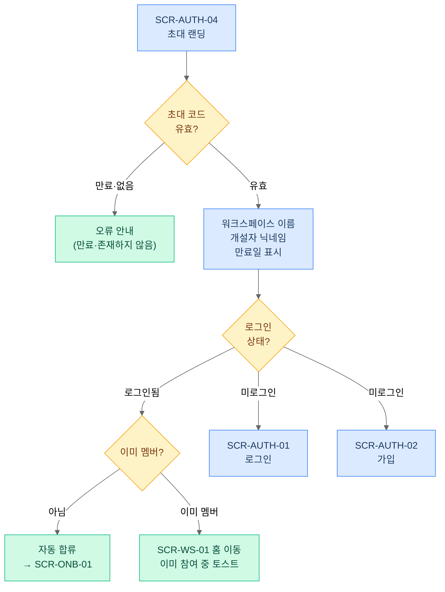
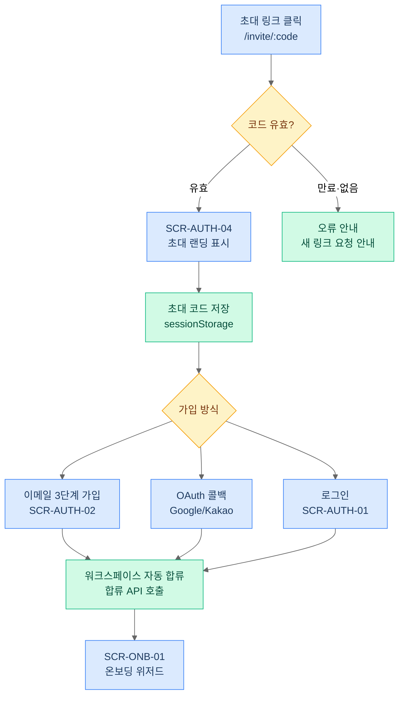

# 10. 인증·온보딩

> 가입·로그인·비밀번호 재설정·OAuth(Google/Kakao)·초대 링크 합류·온보딩 진입을 다룬다.
> 온보딩 위저드의 **진입·이탈 조건**은 이 문서 소관. 위저드 카드의 내용·필드 정의는 [11-profile-pr-card.md](11-profile-pr-card.md) 소관 — 중복 금지.
> 액터·용어는 [00-overview.md](00-overview.md) §2·§3 정본. 화면 ID·URL은 [02-information-architecture.md](02-information-architecture.md) §3.1 정본.

---

## 1. 목적과 배경

### 1.1 목적

가장 중요한 유입 경로(강사가 배포한 초대 링크 → 가입 → 워크스페이스 합류 → PR 카드 작성)가 현재 세 곳에서 끊겨 있다. 이 여정을 완전히 이어서, 수강생 S가 초대 링크 클릭부터 "내 카드가 갤러리에 게시된 상태"까지 5분 내 도달할 수 있도록 만드는 것이 이 문서의 목적이다.

### 1.2 As-Is — 결함과 근거

| 결함 | 위치 | 구체 내용 |
|---|---|---|
| 초대 랜딩 화면 없음 | FE 라우터 | `/invite/:code` 경로 미등록. 초대 링크 클릭 시 라우터 404 |
| 이메일 가입 후 초대 코드 미처리 | `AuthPage.tsx:87` | 가입 완료 후 초대 코드 연결 로직 없음(`// TODO: 워크스페이스 참여 API 호출`). 무소속 랜딩으로 이동 |
| OAuth 콜백 초대 코드 미처리 | `OAuthCallbackPage.tsx:95-124` | `sessionStorage.getItem('pendingInviteCode')` 읽기·삭제는 있으나 이후 자동 합류 API 호출 없음(`// TODO: 워크스페이스 참여 로직`) |
| 초대 링크 만료·재발급 불가 | `WorkspaceSettingsModal.tsx` 초대 탭 | 고정 URL(`/#/ws/:inviteCode`), 영구적, 회수 불가. "링크는 영구적이며 변경되지 않습니다" 문구가 현재 UI에 명시됨 |
| 비밀번호 재설정 코드 재사용 | `AuthServiceImpl.java:789` | 재설정 성공 후 `redisTemplate.delete(key)` 미호출(`// TODO: 비밀번호 재설정 완료 후 코드 무효화`). 동일 코드 재사용 가능 |

### 1.3 As-Is — 재활용 가능 자산

- `AuthController` `/api/auth/**`: login·logout·refresh·비밀번호 재설정 3종(`sendResetCode`/`verifyResetCode`/`resetPassword`)·이메일 인증 2종(`sendEmailCode`/`verifyEmailCode`) 완성 [재활용]
- OAuth Google/Kakao 자체 구현(Spring OAuth2 라이브러리 미사용), Redis 임시코드 5분 TTL [재활용]
- JWT Access 1h + RefreshToken DB 7일 구조 [재활용]
- 3단계 이메일 가입 플로우(`SignupPage`, 이메일 입력 → 코드 인증 → 계정 정보 입력) [재활용]
- `localStorage` JWT 저장 방식 [재활용, 보안 개선은 M3 범위]

---

## 2. 액터와 권한

| 액터 | 이 기능에서의 역할 | 주요 화면 |
|---|---|---|
| 미인증 방문자 | 가입·로그인·초대 링크 도달 | SCR-AUTH-01~04 |
| 사용자(UserRole.USER) | 로그인·비밀번호 재설정·온보딩 | SCR-AUTH-01, SCR-AUTH-03, SCR-ONB-01 |
| 워크스페이스 개설자(OWNER) | 초대 링크 v2 발급·재발급 | SCR-WS-03 초대 탭 (발급 UI는 [13](13-workspace-admin.md) 소관) |

권한 규칙: 미인증 상태에서 `/ws/**` 접근 시 로그인 화면(SCR-AUTH-01)으로 리다이렉트하되, **원래 목적지 URL은 `redirect` 쿼리 파라미터로 보존**한다. 단, `/invite/:code`는 미인증 상태에서도 접근 허용(초대 랜딩의 전제 조건).

---

## 3. 유저 스토리

| # | 스토리 | 수용 기준 |
|---|---|---|
| US-10-01 | 수강생 S로서, 초대 링크를 클릭했을 때 어느 워크스페이스에 초대받았는지를 확인하고 싶다 (워크스페이스 이름·개설자 표시). | SCR-AUTH-04에서 워크스페이스 이름·개설자 닉네임 노출. 만료된 링크는 오류 안내 |
| US-10-02 | 수강생 S로서, 초대 링크를 통해 이메일 또는 OAuth로 가입하더라도 해당 워크스페이스에 자동으로 합류되고 싶다. | 가입 방식과 무관하게, 인증 완료 시점에 워크스페이스 자동 합류 → 온보딩(SCR-ONB-01) 진입 |
| US-10-03 | 수강생 S로서, 이미 계정이 있다면 초대 링크에서 바로 로그인 후 합류하고 싶다. | SCR-AUTH-04에서 "로그인하기" 선택 → 로그인 완료 → 자동 합류 → SCR-ONB-01 |
| US-10-04 | 수강생 S로서, 가입 직후 PR 카드를 지금 당장 작성하지 않고 건너뛸 수 있되, 나중에 다시 유도받고 싶다. | SCR-ONB-01의 "나중에 하기" → SCR-WS-01 홈으로 이동 + 카드 작성 유도 배너 상시 노출 (⚠️ 01-D1 참조) |
| US-10-05 | 수강생 S로서, 초대 없이 직접 가입한 경우 워크스페이스에 참여하거나 만들 수 있는 안내를 받고 싶다. | 가입 후 소속 워크스페이스 없는 경우 SCR-WS-04(무소속 랜딩) 이동. 초대 코드 입력 또는 워크스페이스 만들기 2택 |
| US-10-06 | 강사 K로서, 배포한 초대 링크를 재발급(구 링크 무효화)하고 만료일·사용 횟수를 볼 수 있고 싶다. | 초대 링크 v2: 만료일·사용 횟수 표시, 재발급 시 구 링크 즉시 무효화. 발급 UI는 [13](13-workspace-admin.md) 소관 |

---

## 4. 화면 구성

### 4.1 SCR-AUTH-01 — 로그인 [`유지`]

**URL**: `/login`  
**As-Is**: `LoginPage` — 기존 구현 유지, 아래 변경 사항만 적용.

```
┌──────────────────────────────┐
│ Pick Team                    │
│                              │
│ [이메일]                      │
│ [비밀번호]          [로그인]   │
│                              │
│ 비밀번호를 잊으셨나요? →      │
│ ─────── 또는 ───────         │
│ [Google로 로그인]             │
│ [Kakao로 로그인]              │
│                              │
│ 계정이 없으신가요? 가입하기 →  │
└──────────────────────────────┘
```

**변경 사항**: `alert()` 오류 표시 → 인라인 오류 메시지. 초대 코드가 세션 스토리지에 있을 경우 로그인 완료 후 자동 합류 처리(§5.2).

### 4.2 SCR-AUTH-02 — 가입 [`유지`]

**URL**: `/signup`  
**As-Is**: `SignupPage` — 3단계 이메일 인증 플로우 유지.

```
단계 ①: 이메일 입력 + 코드 발송
단계 ②: 이메일 인증 코드 6자리 입력
단계 ③: 비밀번호·닉네임 입력 + 완료
```

**변경 사항**: 단계 ③ 완료 시 세션 스토리지의 초대 코드 확인 → 자동 합류 처리(§5.2). OAuth 가입은 `OAuthCallbackPage`가 담당.

### 4.3 SCR-AUTH-03 — 비밀번호 재설정 [`유지`]

**URL**: `/reset-password`  
**As-Is**: `ForgotPasswordPage` — 3종 API(`sendResetCode`/`verifyResetCode`/`resetPassword`) 완성.

```
단계 ①: 이메일 입력 + 재설정 코드 발송
단계 ②: 코드 6자리 입력 + 검증
단계 ③: 새 비밀번호 입력·확인 + 변경 완료
```

**변경 사항**: 재설정 성공 시 Redis에서 코드 삭제 추가(`AuthServiceImpl.java:789` TODO 해소). 코드 만료(5분) 시 인라인 오류 + 재발송 버튼.

### 4.4 SCR-AUTH-04 — 초대 랜딩 [`신규`]

**URL**: `/invite/:code`  
**As-Is**: 없음 (라우터 미등록).



**레이아웃**:

```
┌──────────────────────────────────────┐
│ Pick Team                            │
│                                      │
│ 🎉 [워크스페이스 이름]에 초대받았습니다  │
│                                      │
│ 개설자: [닉네임]                       │
│ 만료: [YYYY-MM-DD] 까지               │
│                                      │
│ [가입하고 참여하기]   [로그인하고 참여] │
│                                      │
│ 만료 시:                              │
│ ⚠ 이 초대 링크는 만료되었습니다.       │
│ 강사에게 새 링크를 요청해주세요.        │
└──────────────────────────────────────┘
```

### 4.5 SCR-ONB-01 — 온보딩 위저드 [`신규`]

**URL**: `/ws/:wsId/onboarding`  
**As-Is**: 없음. 온보딩 진입과 이탈 조건만 이 문서에서 정의. 위저드 카드 내용·필드는 [11](11-profile-pr-card.md) 소관.

**진입 조건**: 워크스페이스 합류 직후, 해당 워크스페이스에 PR 카드가 없는 사용자.  
**이탈 조건**: (a) 카드 저장 완료 → SCR-WS-02 멤버 카드 갤러리 이동 / (b) "나중에 하기" → SCR-WS-01 홈 이동 + 배너 상시 노출.  
**강제 여부**: 강제 아님. 건너뛰기 허용. 팀 빌딩 참여 시 카드 없으면 지원 불가 (⚠️ 01-D1).

```
┌────────────────────────────────────────────┐
│ 안녕하세요! [닉네임]님 👋                    │
│ [워크스페이스 이름]에 오신 것을 환영합니다.   │
│                                            │
│ 지금 PR 카드를 작성하면 팀원들이             │
│ 나를 발견할 수 있어요.                       │
│                                            │
│ ───── 위저드 카드 영역 (11 문서 소관) ─────  │
│                                            │
│ [지금 카드 작성하기]   [나중에 하기]          │
└────────────────────────────────────────────┘
```

### 4.6 SCR-WS-04 — 무소속 랜딩 [`개편`]

**URL**: `/welcome`  
**As-Is**: `EmptyWorkspacePage` 존재하나 단순 안내 수준.

```
┌─────────────────────────────────────────┐
│ Pick Team                               │
│                                         │
│ 아직 소속된 워크스페이스가 없습니다.       │
│                                         │
│ [초대 코드 입력하기]                      │
│  ┌─────────────────────┐               │
│  │ 초대 코드 입력...    │  [참여하기]    │
│  └─────────────────────┘               │
│                                         │
│ ─────────── 또는 ───────────           │
│                                         │
│ [새 워크스페이스 만들기]                  │
└─────────────────────────────────────────┘
```

**빈 상태 설계**: 초대 코드가 잘못된 경우 인라인 오류("유효하지 않은 초대 코드입니다"). `alert()` 사용 금지.

---

## 5. 인터랙션·상태·엣지 케이스

### 5.1 전체 인증 플로우 (초대 경유)



### 5.2 초대 코드 보존 메커니즘

초대 코드는 **`sessionStorage`의 `pendingInviteCode` 키**에 저장한다. 세션 스토리지를 선택한 이유: 탭을 닫으면 자동 삭제되어 의도치 않은 재합류 방지. URL state 파라미터로 OAuth redirect 시 코드가 덮어씌워지는 문제를 회피.

| 단계 | 동작 |
|---|---|
| SCR-AUTH-04 진입 시 | `sessionStorage.setItem('pendingInviteCode', code)` |
| 이메일 가입 완료(단계 ③) | `pendingInviteCode` 읽기 → 합류 API 호출 → 삭제 |
| OAuth 가입 (콜백) | `OAuthCallbackPage`에서 `pendingInviteCode` 읽기 → 합류 API 호출 → 삭제 |
| 로그인 완료 | `pendingInviteCode` 읽기 → 합류 API 호출 → 삭제 |
| 합류 API 실패 | 코드 보존, 오류 메시지 표시 후 재시도 허용 |

As-Is의 `OAuthCallbackPage.tsx:98` — `pendingInviteCode` 읽기는 이미 구현. 이후 합류 API 호출이 빠진 것(`// TODO`). 이 흐름을 완성하는 것이 M1 Epic 1.6의 수용 기준.

### 5.3 엣지 케이스

| 케이스 | 처리 |
|---|---|
| **만료된 초대 링크** | SCR-AUTH-04에서 `GET /api/workspaces/invite/:code` 응답 404/410 수신 시 오류 안내 표시("이 초대 링크는 만료되었습니다. 강사에게 새 링크를 요청해주세요."). 가입·로그인 버튼 비활성화 |
| **이미 멤버인 사용자의 초대 클릭** | 로그인 상태에서 SCR-AUTH-04 진입 → 이미 멤버 확인 → SCR-WS-01으로 직접 이동. "이미 참여 중인 워크스페이스입니다" 토스트 표시 |
| **BANNED 사용자의 재합류 시도** | 합류 API에서 403 반환. "이 워크스페이스에 참여할 수 없습니다" 인라인 오류. 세션 스토리지 코드 삭제 |
| **이메일 인증 코드 만료(5분)** | 인라인 오류 표시 + "코드 재발송" 버튼 활성화. 가입 단계 ② 또는 비밀번호 재설정 단계 ②에서 동일하게 처리 |
| **OAuth 계정 이메일 중복** | 동일 이메일로 이메일 계정이 이미 존재하는 경우, OAuth 콜백에서 409 수신 → "이미 이메일로 가입된 계정이 있습니다. 이메일로 로그인 후 OAuth 연동은 계정 설정에서 하실 수 있습니다" 안내. OAuth 계정 자동 병합 금지(보안) (⚠️ 10-D3) |
| **로그인 상태에서 초대 링크 클릭** | SCR-AUTH-04에서 "이 워크스페이스에 참여하기" 버튼 단일 표시(가입·로그인 버튼 대신). 클릭 시 바로 합류 API 호출 → SCR-ONB-01 |
| **비밀번호 재설정 코드 재사용** | `AuthServiceImpl.java:789` 해소: 재설정 성공 후 `redisTemplate.delete(key)` 호출. 이미 사용된 코드로 재설정 시도 시 400 + "이미 사용된 코드입니다" |

### 5.4 온보딩 이탈 후 리마인드

"나중에 하기" 선택 시: SCR-WS-01 홈에 카드 작성 유도 배너가 **카드 작성 완료 전까지** 상시 노출된다. 배너 클릭 → SCR-ONB-01 재진입. 팀 빌딩 세션이 OPEN 상태에서 카드 없이 지원 시도 시 재요구 (⚠️ 01-D1 참조).

### 5.5 초대 링크 v2 상태

| 속성 | As-Is | To-Be |
|---|---|---|
| 만료 | 없음(영구) | 개설자가 발급 시 만료일 지정 |
| 재발급 | 불가 | 재발급 시 구 링크 즉시 무효화 |
| 사용 횟수 | 미집계 | 발급 후 사용 횟수 표시 |
| 발급 UI | `WorkspaceSettingsModal` 초대 탭 (단순 복사) | SCR-WS-03 초대 탭 재설계 — 발급 UI 상세는 [13](13-workspace-admin.md) 소관 |

---

## 6. 데이터·API 요구사항

### 6.1 인증 엔드포인트

| 메서드·경로 | 태그 | 비고 |
|---|---|---|
| `POST /api/auth/login` | [재활용] | |
| `POST /api/auth/logout` | [재활용] | |
| `POST /api/auth/refresh` | [재활용] | |
| `POST /api/auth/email/request` | [재활용] | 이메일 인증 코드 발송 (`AuthController.java:222`) |
| `POST /api/auth/email/verify` | [재활용] | 이메일 인증 코드 검증 (`AuthController.java:245`) |
| `POST /api/auth/send-password-reset-email` | [재활용] | `AuthController.java:136` |
| `POST /api/auth/verify-reset-code` | [재활용] | `AuthController.java:163` |
| `POST /api/auth/reset-password` | [변경] | 성공 후 Redis 코드 삭제 추가 (`AuthServiceImpl.java:789` TODO 해소) |
| OAuth 콜백·임시코드 교환 (`OAuthController`) | [재활용] | Google/Kakao 자체 구현, Redis 임시코드 5분 TTL |

### 6.2 초대·합류 엔드포인트

| 메서드·경로 | 태그 | 비고 |
|---|---|---|
| `GET /api/workspaces/invite/:code` | [변경] | 초대 코드 유효성·워크스페이스 이름·개설자 닉네임·만료일 반환. As-Is는 단순 합류 처리만 |
| `POST /api/workspaces/:wsId/join` | [변경] | 초대 코드 + JWT 인증 필수. 합류 결과 및 이미 멤버 여부 반환 |
| `POST /api/workspaces/:wsId/invite/refresh` | [신규] | 초대 링크 재발급(구 코드 무효화). 개설자·매니저 전용 |

### 6.3 초대 링크 엔티티 변경 (워크스페이스)

현재 `Workspace.inviteCode` 필드는 고정 문자열. 다음 필드를 추가한다.

| 필드 | 타입 | 설명 |
|---|---|---|
| `inviteCodeExpiresAt` | `LocalDateTime` (nullable) | null이면 만료 없음 (하위 호환) |
| `inviteUsedCount` | `int` | 사용 횟수 집계 |
| `inviteActive` | `boolean` | 재발급 시 false로 전환 |

[변경] — Flyway 마이그레이션 스크립트 필요 (M0.3 선행 완료 후).

### 6.4 JWT / 토큰 규칙

- Access Token: 1h, `localStorage` 저장 [재활용]
- Refresh Token: 7일, DB 저장 [재활용]
- OAuth Redis 임시코드: 5분 TTL [재활용]
- 비밀번호 재설정 코드: 5분 TTL, **재설정 성공 시 즉시 삭제** [변경]

---

## 7. 성공 지표

| 지표 | 정의 | 목표 기준 |
|---|---|---|
| 초대 링크 합류 완료율 | 초대 링크 클릭 → 워크스페이스 합류 완료 전환율 | ≥ 80% |
| 온보딩 카드 작성 착수율 | 합류 후 SCR-ONB-01에서 "지금 카드 작성하기" 선택 비율 | ≥ 60% (⚠️ 01-D1 결정에 따라 변동) |
| 초대 링크 경유 가입 소요 시간 | 링크 클릭 → 합류 완료 시점 | 중앙값 ≤ 3분 |

---

## 8. ⚠️ 논의 필요 항목

> ✅ **2026-07-04 일괄 결정**: 아래 전 항목이 추천안대로 확정됨. 결정 기록: [90-open-questions.md](90-open-questions.md). (D1=속도 제한+큐, D2=기본 30일+무기한 옵션, D3=병합 금지, D4=랜딩에서 비밀번호 입력, D5=M3 후순위)

| ID | 질문 | 선택지와 추천안 | 영향도 |
|---|---|---|---|
| 10-D1 | Gmail SMTP 개강일 폭주 대응 (스펙 Q6) | (a) 발송 속도 제한 + 큐(추천 — 단순, 즉각 적용 가능) (b) SendGrid·AWS SES 전환 (c) 현행 유지(30인 기수라면 하루 한도 500건에 여유 있음) | 인증 전체. 개강일에 기수 전원이 동시 가입 시 일일 500건 한도 초과 가능성 검토 필요 |
| 10-D2 | 초대 링크 v2 만료일 기본값 (13-D3과 동일 안건 — 이 항목이 정본) | (a) 발급일+30일 + "무기한" 명시 선택 허용(추천 — 보안 기본값은 보수적으로, 운영 편의는 옵션으로) (b) 발급일+7일 (c) 만료 없음(As-Is 유지) | SCR-WS-03, 13 문서 |
| 10-D3 | OAuth·이메일 동일 이메일 계정 병합 정책 | (a) 병합 금지, 로그인 방식 분리(추천 — 보안 단순) (b) 로그인 후 계정 설정에서 수동 연동 허용 (c) OAuth 우선 자동 병합 | 인증, 17 문서 |
| 10-D4 | 초대 링크 비밀번호 가입 정책과의 병존 | 워크스페이스에 비밀번호가 설정된 경우: (a) SCR-AUTH-04에서 비밀번호 추가 입력 단계 노출(추천) (b) 합류 API에서 검증만 수행 | SCR-AUTH-04 UI |
| 10-D5 | Refresh Token 저장 위치 보안 개선 | (a) 현행 localStorage 유지(M3으로 후순위) (b) httpOnly 쿠키로 이전(XSS 방어, 단 CORS 설정 변경 필요) | 인증 전반. 보안 M3 범위이므로 현행 유지 추천 |
