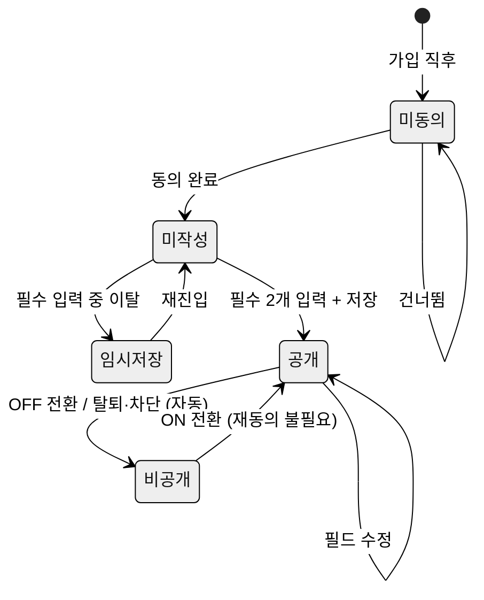

# 11. PR 카드 — 자기 PR 카드 v2 · 공개 범위 · 갤러리 · 편집

> **범위**: PR 카드 필드 정의, 작성 위저드(온보딩/편집), 공개 범위와 동의 모델, 갤러리(SCR-WS-02)·카드 상세(SCR-PRF-01)·편집(SCR-MY-02) 화면 구성.
> 카드가 팀 빌딩 세션에서 소비되는 방식(추천 점수화·지원·스카우트)은 [12-team-building.md](12-team-building.md) 소관 — 이 문서는 카드 데이터 생산 측을 다룬다.
> 액터·용어: [00-overview.md](00-overview.md) §2·§3. 여정: [01-e2e-flows.md](01-e2e-flows.md) §3. 화면 ID: [02-information-architecture.md](02-information-architecture.md) §3.

---

## 1. 목적과 배경

### 1.1 무엇을 왜

PR 카드는 수강생이 처음 만나는 동기들에게 자신을 소개하는 **구조화된 프로필 문서**다. 팀 빌딩 매칭의 원자재이며, "누가 어떤 역할을 원하고 어느 시간에 일할 수 있는가"를 카드 한 장으로 파악할 수 있게 한다.

벤치마크: 프로그래머스 BE4+ 과정 운영 문서 「자기 PR 작성」이 이미 Notion으로 수동 운영 중인 프로세스(PR 작성 기간 → 공개 → 기간제 팀 빌딩, 역할 최소 2개 선택, 강점·협업 스타일·목표 어필, 포트폴리오 링크 첨부)를 이 문서가 제품화한다.

### 1.2 As-Is와 결함

**있는 것 (재활용 가능한 자산)**:
- BE `Account` 엔티티: `mbti`, `disposition`, `preferWorkstyle`, `dislikeWorkstyle`, `introduction`, `portfolio`, `profileImageUrl` 필드 완비 [재활용]
- `UserHashtag` / `UserHashtagList` (최대 20개) + 자동완성 검색 API (`GET /api/users/hashtags/search`) [재활용]
- FE `ProfileEditPage`: 전 필드 편집, 실 API 연동 완료 [변경 — 카드 v2 구조로 재편]
- FE `ProfileSummaryCard.tsx`: MBTI + 해시태그 3개 미니 카드 [변경]

**결함 (이 문서가 해결할 대상)**:
- 희망 역할·주간 가용 시간·목표 온도 필드 부재 → 매칭 불가 [신규 필드 필요]
- 추천 API (`GET /api/users/recommend`)가 워크스페이스 무관 전 회원 노출 → 프라이버시 결함 (`AccountRepository.findRecommendedTeamMembers`) — 카드 공개 범위 설계로 해소
- FE `User` 타입: `bio`/`introduction`, `portfolio`/`portfolioUrl`, 프로필 이미지 필드 3종 병존 → 타입 정리 [변경]
- 공개 범위 동의 플래그 없음 → 동의 없이 전 회원 프로필 노출 중 [신규 필드 필요]

---

## 2. 액터와 권한

| 액터 | 권한 |
|---|---|
| 워크스페이스 멤버 | 자기 카드 작성·수정 (SCR-MY-02). 같은 워크스페이스의 공개 카드 열람 (SCR-WS-02, SCR-PRF-01). 자기 카드 비공개 전환 |
| 워크스페이스 매니저·개설자 | 멤버 권한 전부 + 미작성 현황 열람 (대시보드 — [13](13-workspace-admin.md)). 카드 강제 수정 불가 (자기 결정 원칙) |
| 시스템 관리자 | 신고된 카드 비공개 처리 ([17](17-policy-operations.md)) |
| 비인증 사용자 / 워크스페이스 비소속 | 카드 열람 불가 (00 §5-6 프라이버시 기본값) |

---

## 3. 유저 스토리

| ID | 스토리 | 수용 기준 |
|---|---|---|
| US-11-01 | 수강생 S로서, 5분 안에 내 카드를 갤러리에 올리고 싶다 — 첫 팀 빌딩 기회를 놓치지 않기 위해 | 필수 2개(희망 역할, 주간 가용 시간)만 입력 후 "작성 완료"가 가능. 선택 항목은 나중에 추가 가능 |
| US-11-02 | 수강생 S로서, 내 성향 데이터가 같은 워크스페이스 외부에 노출되지 않는다고 확인하고 싶다 | 동의 화면에서 공개 범위를 "이 워크스페이스 멤버에게만"으로 명시. 다른 워크스페이스 조회 API에서 미포함 검증 |
| US-11-03 | 수강생 S로서, MBTI를 카드에 표시하지 않을 수 있으면 좋겠다 | MBTI 입력란에 "카드에 표시 안 함" 옵션 존재. 선택 시 갤러리·상세에서 MBTI 미노출 |
| US-11-04 | 수강생 S로서, 동기들의 카드를 역할과 가용 시간으로 필터해서 빠르게 살펴보고 싶다 | 갤러리에서 역할(다중 선택) + 가용 시간대 + 태그 필터 조합 가능. 결과 0건 시 빈 상태 메시지 |
| US-11-05 | 강사 K로서, 카드를 아직 작성하지 않은 멤버가 몇 명인지 한눈에 보고 싶다 | 대시보드(SCR-DSH-01)에 "카드 작성률 N/전체" 위젯. 미작성자 리마인드 일괄 발송 버튼 [13 참조] |

---

## 4. 화면 구성

### 4.1 필드 체계 (카드 v2)

종합 스펙 §5.3(a) 표를 상세화한다. 필드는 **필수 2개 + 선택** 구조.

#### 4.1.1 필드 정의

| 필드명 | 화면 표기 | 상태 | 타입/제약 | 매칭 가중치 | 비고 |
|---|---|---|---|---|---|
| `desiredRole1` | 희망 역할 1순위 | **필수** | enum (§4.1.2) | 최상위 | [신규] |
| `desiredRole2` | 희망 역할 2순위 | **필수** | enum (§4.1.2), 1순위와 달라야 함 | 상위 | [신규] |
| `weeklyAvailableHours` | 주간 가용 시간 | **필수** | enum: 10h미만 / 10~20h / 20~30h / 30h이상 | 상위 | [신규] |
| `availableTimeSlots` | 선호 시간대 | 선택 | 다중 선택: 오전·오후·저녁·주말 | 상위 | [신규] |
| `goalTemperature` | 목표 온도 | 선택 | 5점 척도: 1(완주 지향) ~ 5(수상 지향) | 중위 | [신규] |
| `hashtags` | 기술 스택·강점 태그 | 선택 | 최대 20개, `UserHashtag` 재활용 | 중위 | [재활용] |
| `preferWorkstyle` | 선호 협업 스타일 | 선택 | enum 다중 선택 + 자유 서술 (§4.1.3) | 하위 | [변경 — 구조화] |
| `dislikeWorkstyle` | 피하고 싶은 스타일 | 선택 | enum 다중 선택 + 자유 서술 | 하위 | [변경 — 구조화] |
| `introduction` | 자기소개 | 선택 | 최대 500자 | 없음 | [재활용] (기존 `bio` 필드 통합) |
| `portfolio` | 포트폴리오 링크 | 선택 | URL 형식 검증 | 없음 | [재활용] (기존 `portfolioUrl` 통합) |
| `mbti` | MBTI | 선택 | 16유형 enum + "표시 안 함" | 최하위 또는 0 | [재활용 — 격하] |
| `profileImageUrl` | 프로필 사진 | 선택 | 이미지 업로드 | 없음 | [재활용] |
| `cardVisible` | 카드 공개 여부 | 시스템 | boolean, 기본 `false` → 동의·필수 입력 완료 후 `true` 가능 | — | [신규] |
| `consentGivenAt` | 동의 시각 | 시스템 | timestamp | — | [신규] |

> **FE 타입 정리**: `bio` → `introduction`, `portfolioUrl` → `portfolio`로 단일화. 프로필 이미지는 `profileImageUrl` 하나로. [변경]

#### 4.1.2 역할 enum

```
BACKEND      백엔드
FRONTEND     프론트엔드
FULLSTACK    풀스택
PM           PM·기획
DESIGN       디자인
INFRA        인프라·DevOps
AI_DATA      AI·데이터
OTHER        기타 (자유 입력)
```

#### 4.1.3 협업 스타일 선택지

```
ASYNC_FIRST      비동기 우선 (메시지 중심)
SYNC_PREFERRED   동기 선호 (실시간 소통)
DETAIL_ORIENTED  꼼꼼한 문서화 선호
SPEED_FIRST      빠른 실행 우선
STRUCTURED       계획 중심 진행
FLEXIBLE         유연한 진행
```

선택지 1~3개 체크 + 자유 서술 100자 (선택).

### 4.2 SCR-ONB-01 — 온보딩 위저드 (카드 작성)

URL: `/ws/:wsId/onboarding`. 신규 가입 후 첫 진입 시 자동 진입. 상태: **신규**.

**3단계 위저드 (소요 목표 5분)**:

```
[1단계] 동의              [2단계] 필수 입력        [3단계] 선택 입력
────────────────          ──────────────────        ──────────────────
공개 범위 안내 +          희망 역할 1·2순위         기술 스택 태그
수집 항목 고지  →         주간 가용 시간       →    협업 스타일
동의 버튼                                          목표 온도
                                                   자기소개·포트폴리오
                                                   MBTI (표시 여부 선택)
                          [필수 2개 입력 후         [나중에 → 홈 이동]
                           다음 단계 활성화]         [완료 → 갤러리]
```

**단계 이탈 처리**:
- 1단계(동의) 이탈: 카드 미작성 상태 유지. 홈에 "카드 작성 유도 배너" 상시 노출.
- 2단계(필수) 입력 중 이탈: 임시저장 (브라우저 localStorage). 재진입 시 "이어서 작성하기" 복원.
- 3단계(선택) "나중에" 클릭: 필수 2개로 카드 즉시 공개. 편집은 SCR-MY-02에서.

#### 텍스트 와이어프레임 — 위저드 1단계 (동의)

```
┌─────────────────────────────────────────────────────────┐
│  Pick Team에 오신 걸 환영합니다 👋                        │
│  [워크스페이스명]에서 팀을 찾는 여정을 시작해요.          │
│                                                         │
│  PR 카드를 만들기 전에 확인해 주세요.                     │
│                                                         │
│  📌 수집하는 정보                                        │
│     희망 역할, 가용 시간, 기술 스택, 협업 스타일 외       │
│                                                         │
│  🔒 공개 범위                                            │
│     이 워크스페이스([워크스페이스명])에 소속된            │
│     멤버에게만 공개됩니다.                                │
│     워크스페이스 탈퇴·차단 시 즉시 비공개됩니다.          │
│                                                         │
│  개인정보 처리방침 [링크]                                 │
│                                                         │
│  [ 동의하고 카드 만들기 ]    [나중에 하기]                │
└─────────────────────────────────────────────────────────┘
```

#### 텍스트 와이어프레임 — 위저드 2단계 (필수 입력)

```
┌─────────────────────────────────────────────────────────┐
│  2 / 3단계  ──●──●──○──                                 │
│                                                         │
│  어떤 역할을 맡고 싶나요? (필수)                         │
│  역할을 2개 선택하세요.                                  │
│                                                         │
│  1순위  ○백엔드  ○프론트엔드  ○풀스택  ○PM·기획          │
│         ○디자인  ○인프라·DevOps  ○AI·데이터  ○기타       │
│                                                         │
│  2순위  ○백엔드  ○프론트엔드  ○풀스택  ○PM·기획          │
│         ○디자인  ○인프라·DevOps  ○AI·데이터  ○기타       │
│                                                         │
│  ────────────────────────────────────────────────       │
│  주간에 얼마나 투자할 수 있나요? (필수)                  │
│                                                         │
│  ○ 10시간 미만     ○ 10~20시간                          │
│  ○ 20~30시간      ○ 30시간 이상                         │
│                                                         │
│                             [ 다음 → ]                  │
└─────────────────────────────────────────────────────────┘
```

### 4.3 SCR-MY-02 — 내 PR 카드 편집

URL: `/me/card`. 상태: **개편** (기존 `ProfileEditPage` → 카드 v2 구조로 재편).

편집 화면은 위저드 형태가 아닌 **단일 폼**. 섹션별 펼침 구조(accordion).

#### 텍스트 와이어프레임 — 카드 편집

```
┌─────────────────────────────────────────────────────────┐
│  내 PR 카드 편집                          [저장]  [취소] │
│  ─────────────────────────────────────────────────────  │
│  ▼ 기본 정보                                            │
│    프로필 사진  [변경]                                   │
│    이름: _______________  (변경 불가 — 계정 설정에서)    │
│                                                         │
│  ▼ 희망 역할 ★필수                                      │
│    1순위 [드롭다운]   2순위 [드롭다운]                   │
│                                                         │
│  ▼ 가용성 ★필수                                         │
│    주간 가용 시간  ○10h미만 ○10~20h ○20~30h ○30h이상   │
│    선호 시간대    □오전  □오후  □저녁  □주말             │
│                                                         │
│  ▼ 목표 온도                                            │
│    완주 지향 [1]─[2]─[3]─[4]─[5] 수상 지향              │
│                                                         │
│  ▼ 기술 스택·강점 태그                                   │
│    [태그 입력... ↵]   (최대 20개)                        │
│    [React ×] [Spring Boot ×] [MySQL ×]                  │
│                                                         │
│  ▼ 협업 스타일                                          │
│    선호  □비동기우선 □동기선호 □꼼꼼한문서화 □빠른실행   │
│    피함  □비동기우선 □동기선호 □꼼꼼한문서화 □빠른실행   │
│    자유 서술  _________________________ (100자)          │
│                                                         │
│  ▼ 자기소개·포트폴리오                                   │
│    자기소개  [____________________________] (500자)      │
│    포트폴리오 링크  [https://...]                        │
│                                                         │
│  ▼ MBTI (선택)                                          │
│    [드롭다운: INTJ / ENFP / … / 표시 안 함]             │
│                                                         │
│  ▼ 공개 설정                                            │
│    이 워크스페이스에서 내 카드 공개  ● ON  ○ OFF         │
│    (OFF 시 갤러리·추천에서 숨겨집니다)                   │
└─────────────────────────────────────────────────────────┘
```

### 4.4 SCR-WS-02 — 멤버 카드 갤러리

URL: `/ws/:wsId/members`. 상태: **신규** (기존 `HomePage` 멤버 프리뷰 모달 승격).

#### 텍스트 와이어프레임 — 갤러리

```
┌─────────────────────────────────────────────────────────┐
│  멤버 카드  (전체 32명 · 작성 완료 28명)  [내 카드 편집]  │
│  ─────────────────────────────────────────────────────  │
│  역할 [백엔드▾] [프론트엔드▾]  가용 [10~20h▾]            │
│  태그 [React ×] [Spring ×]     [필터 초기화]              │
│  ─────────────────────────────────────────────────────  │
│                                                         │
│  ┌──────────┐ ┌──────────┐ ┌──────────┐ ┌──────────┐  │
│  │ [아바타] │ │ [아바타] │ │ [아바타] │ │ [아바타] │  │
│  │ 박재현   │ │ 김민지   │ │ 이승우   │ │ 최수연   │  │
│  │ 백엔드   │ │ 프론트   │ │ 풀스택   │ │ PM·기획  │  │
│  │ 프론트   │ │ 디자인   │ │ 백엔드   │ │ 프론트   │  │
│  │ ⏰20~30h │ │ ⏰10~20h │ │ ⏰30h+   │ │ ⏰10~20h │  │
│  │ 🌡️4/5   │ │ 🌡️3/5   │ │ 🌡️5/5   │ │ 🌡️2/5   │  │
│  │[React]   │ │[Figma]   │ │[Java]    │ │[기획]    │  │
│  └──────────┘ └──────────┘ └──────────┘ └──────────┘  │
│                                                         │
│  ┌──────────┐ ┌──────────────────────────────────────┐ │
│  │ [아바타] │ │  카드 미작성                          │ │
│  │ 홍길동   │ │  [프로필 사진]  홍00                  │ │
│  │ 카드 없음│ │  아직 PR 카드를 작성하지 않았어요.    │ │
│  │ (⚠️11-D3)│ │  (⚠️ 11-D3: 미작성자 표시 방식 논의) │ │
│  └──────────┘ └──────────────────────────────────────┘ │
│                                                         │
│  [더 보기 ↓]                                            │
└─────────────────────────────────────────────────────────┘
```

**카드 요약형 정보 위계 (갤러리 그리드)**:
- 1순위: 이름 + 아바타
- 2순위: 희망 역할 1·2순위 (뱃지)
- 3순위: 주간 가용 시간 (⏰ 아이콘)
- 4순위: 목표 온도 (🌡️ 숫자/5)
- 5순위: 태그 최대 3개

**필터**: 역할(다중), 가용 시간(단일), 태그(다중). 필터 조합 AND 연산. 초기화 버튼.

### 4.5 SCR-PRF-01 — 카드 상세 (타인)

URL: `/ws/:wsId/members/:accountId`. 상태: **개편** (기존 `UserProfilePage` demo 데이터 폐기, 워크스페이스 스코프로 이동).

```
┌─────────────────────────────────────────────────────────┐
│  ← 멤버 카드                                            │
│  ─────────────────────────────────────────────────────  │
│  [프로필 사진 大]                                        │
│  박재현                             INTJ (본인 동의 시) │
│  백엔드 1순위  ·  프론트엔드 2순위                      │
│                                                         │
│  ─────────────────────────────────────────────────────  │
│  가용성                                                 │
│  주간 가용  20~30시간  ·  선호 시간대: 저녁·주말         │
│                                                         │
│  목표 온도  ●●●●○  (수상 지향)                          │
│                                                         │
│  기술 스택·강점                                          │
│  [React] [TypeScript] [Java] [Spring Boot] [MySQL]      │
│                                                         │
│  협업 스타일                                            │
│  선호: 빠른 실행, 비동기 우선                            │
│  피함: 지나친 형식 절차                                  │
│  "아이디어를 빠르게 검증하는 팀을 좋아합니다."           │
│                                                         │
│  자기소개                                               │
│  "백엔드 2년 경험의 수강생입니다. ..."                   │
│                                                         │
│  포트폴리오  [github.com/...↗]                          │
│  ─────────────────────────────────────────────────────  │
│  [스카우트 제안]  ← 팀 빌딩 세션 OPEN + 내가 팀 소속일 때│
│  (비활성 조건·상세는 12-team-building.md 참조)          │
└─────────────────────────────────────────────────────────┘
```

**행동 버튼 슬롯 규칙**:
- 팀 빌딩 세션 OPEN 상태 + 내가 팀에 소속된 경우 → "스카우트 제안" 버튼 활성 (12 참조)
- 본인 카드 조회 시 → "편집" 버튼으로 대체

---

## 5. 인터랙션·상태·엣지 케이스

### 5.1 카드 작성 상태 머신



### 5.2 공개 범위 모델

| 조건 | 카드 상태 | 갤러리·추천 노출 여부 |
|---|---|---|
| 동의 + 필수 입력 완료 + `cardVisible=true` | **공개** | 소속 워크스페이스 멤버에게 노출 |
| `cardVisible=false` (본인 OFF) | **비공개** | 미노출 |
| 워크스페이스 탈퇴 (LEFT) | 해당 WS 스코프 **비공개** | 해당 WS에서 미노출 |
| 워크스페이스 차단 (BANNED) | 해당 WS 스코프 **비공개** + 팀 자동 제외 | 해당 WS에서 미노출 (00 §3.2 규칙 4) |
| 계정 삭제 | 즉시 비공개 → 30일 유예 후 하드삭제 | 미노출 (01 F6-f) |

2026-07-04 결정(11-D2): 초기 구현은 `cardVisible` 단일 플래그를 사용한다. 공개 상태가 되면 사용자가 ACTIVE로 소속된 모든 워크스페이스에서 조회 가능하며, 워크스페이스별 독립 공개 제어는 M3 이후 재검토한다.

### 5.3 빈 상태와 에러

| 상황 | 표시 |
|---|---|
| 갤러리 — 필터 조건 결과 0건 | "조건에 맞는 멤버가 없어요. 필터를 바꿔 보세요." + 초기화 버튼 |
| 갤러리 — 카드 작성자 0명 (워크스페이스 개설 직후) | "아직 카드를 작성한 멤버가 없어요. 온보딩을 시작해 보세요." |
| 카드 상세 — 해당 멤버가 비공개 전환 | "이 멤버의 카드는 비공개 상태입니다." (404가 아닌 안내 — 02 §4 규칙) |
| 카드 상세 — 워크스페이스 비소속자 접근 | 404 응답 (프라이버시 원칙 — 카드 존재 자체를 숨김) |
| 편집 저장 중 API 오류 | 인라인 에러 토스트. `alert()` 금지 (00 §5-7) |
| 포트폴리오 URL 형식 오류 | 폼 인라인 에러: "올바른 URL 형식이 아닙니다 (https://...)" |
| 임시저장 복원 실패 (localStorage 만료) | "이전 임시저장을 불러오지 못했습니다. 처음부터 작성해 주세요." |

### 5.4 동시성

- 같은 계정이 2개 탭에서 카드 편집 시: 나중에 저장된 쪽이 덮어씀. 충돌 감지 없음 (MVP 범위). (⚠️ 단순 처리 — 고도화 불필요 판단)
- 관리자가 멤버 차단 → 카드 비공개 전환은 서버 처리. FE는 다음 조회 시 반영.

---

## 6. 데이터·API 요구사항

### 6.1 BE 엔티티 변경

**`Account` 엔티티 [변경]**: 기존 필드 유지 + 아래 필드 추가.

```
desiredRole1       VARCHAR(20)   -- enum: BACKEND|FRONTEND|FULLSTACK|PM|DESIGN|INFRA|AI_DATA|OTHER
desiredRole2       VARCHAR(20)   -- 동일 enum, 1순위와 달라야 함
weeklyAvailableHours VARCHAR(20) -- enum: LT10H|H10_20|H20_30|GT30H
availableTimeSlots VARCHAR(100)  -- JSON array: ["MORNING","EVENING","WEEKEND"]
goalTemperature    TINYINT       -- 1~5, nullable
preferWorkstyleOptions VARCHAR(200) -- JSON array of enum values
dislikeWorkstyleOptions VARCHAR(200) -- JSON array of enum values
cardVisible        BOOLEAN       DEFAULT false  -- 동의 전 false
consentGivenAt     TIMESTAMP     NULL
```

기존 `preferWorkstyle` / `dislikeWorkstyle` (자유 문자열): `preferWorkstyleText` / `dislikeWorkstyleText`로 rename, 자유 서술용으로 유지 [변경].

FE `User` 타입 정리 [변경]:
- `bio` / `introduction` → `introduction` 단일화
- `portfolioUrl` / `portfolio` → `portfolio` 단일화
- 프로필 이미지 필드 3종 → `profileImageUrl` 단일화

### 6.2 API 명세

| 메서드 | 경로 | 태그 | 설명 | 변경 사항 |
|---|---|---|---|---|
| `GET` | `/api/workspaces/:wsId/members` | [변경] | 워크스페이스 멤버 카드 목록 (갤러리용). `?role=BACKEND&hours=H10_20&tags=React` 쿼리 파라미터. `cardVisible=true`만 반환. 인증된 사용자의 소속 워크스페이스만 조회 가능 | 기존 전역 조회 → WS 스코프, 필터 추가 |
| `GET` | `/api/workspaces/:wsId/members/:accountId` | [변경] | 카드 상세 (타인). **워크스페이스 비소속자는 404** (존재 은닉). 소속자가 비공개 카드 조회 시 200 + 최소 정보(이름·비공개 상태)만 반환 — §5.3 안내 표시와 정합 | 기존 전역 URL(`/api/users/:id`) → WS 스코프로 이동 |
| `GET` | `/api/me/card` | [변경] | 내 카드 전체 필드 조회 (As-Is `GET /api/users/me` 경로 개편) | 경로·응답 구조 개편 |
| `PUT` | `/api/me/card` | [변경] | 카드 전체 업데이트 (As-Is `PUT /api/users/me` 개편). 필수 필드 누락 시 400. `consentGivenAt` 최초 저장 시 서버 기록 | 신규 필드 추가 |
| `PATCH` | `/api/me/card/visibility` | [신규] | `{ "cardVisible": true/false }`. 공개 여부 단독 토글 | — |
| `GET` | `/api/users/hashtags/search?q=` | [재활용] | 태그 자동완성 검색 | — |

**폐기 예정**: `GET /api/users/recommend` (전역 추천) → 워크스페이스 스코프 추천 API로 대체 [12-team-building.md에서 정의].

### 6.3 Flyway 마이그레이션

`V2__pr_card_v2.sql` 로 `Account` 신규 컬럼 추가. `ddl-auto: validate` 전환 후 실행. (종합 스펙 M0.3 선행 완료 가정)

---

## 7. 성공 지표

| 지표 | 목표 | 측정 방법 |
|---|---|---|
| **카드 작성 완료율** (온보딩 종료 후 7일 이내) | ≥ 80% | `consentGivenAt IS NOT NULL AND desiredRole1 IS NOT NULL` / 전체 멤버 |
| **위저드 이탈 후 복귀율** (임시저장 → 완료) | ≥ 50% | 임시저장 상태에서 최종 저장 완료 이벤트 |
| **갤러리 필터 사용률** (세션 OPEN 기간 중) | ≥ 60% | 필터 파라미터 포함 갤러리 조회 / 전체 갤러리 조회 |

---

## 8. ⚠️ 논의 필요 항목

> ✅ **2026-07-04 일괄 결정**: 아래 전 항목이 추천안대로 확정됨. 결정 기록: [90-open-questions.md](90-open-questions.md). (D1=지원·스카우트 수신 불가, D2=단일 플래그, D3=흐린 플레이스홀더, D4=가중치 완전 제외, D5=지원 클릭 시 카드 작성 모달)

| ID | 질문 | 선택지·추천안 | 영향도 |
|---|---|---|---|
| 11-D1 | 카드 미작성자의 팀 빌딩 참여를 제한할 것인가? (01-D1 계승) | (a) 지원·스카우트 수신 불가 **[추천 — 카드 없는 매칭은 무의미, 작성 유인]** (b) 열람만 제한 (c) 제한 없음 | 12, 온보딩 이탈율 |
| 11-D2 | 워크스페이스별 공개 ON/OFF 독립 제어를 지원할 것인가? | ✅ 결정: 단일 `cardVisible` 플래그로 전 WS 동시 제어. WS별 공개 레코드는 M3 이후 재검토 | BE 스키마, FE 편집 UI |
| 11-D3 | 갤러리에서 카드 미작성자를 어떻게 표시할 것인가? | (a) 미작성자는 표시 안 함 (b) 흐린 플레이스홀더로 표시 **[추천 — 강사가 작성 독려 근거 파악]** (c) 별도 "미작성" 탭 | 갤러리 UX, 미작성자 프라이버시 |
| 11-D4 | MBTI를 "카드에 표시 안 함" 선택 시 매칭 가중치에서도 제외할 것인가? | (a) 표시 안 함 선택 시 가중치 완전 0 **[추천 — 사용자 의도 존중]** (b) 내부 매칭에는 사용, 화면에만 미표시 | 12 매칭 로직, §3.6 MBTI 리스크 |
| 11-D5 | 온보딩 위저드를 건너뛴 멤버에게 팀 빌딩 참여 시점에 재요구를 하는 방식 | (a) 지원/스카우트 클릭 시 "카드 작성 필요" 모달 + 위저드 열기 **[추천]** (b) 팀 빌딩 홈 진입 시 전면 차단 (c) 카드 없이도 제한 없음 (01-D1과 연동) | 12, 온보딩 전환율 |
