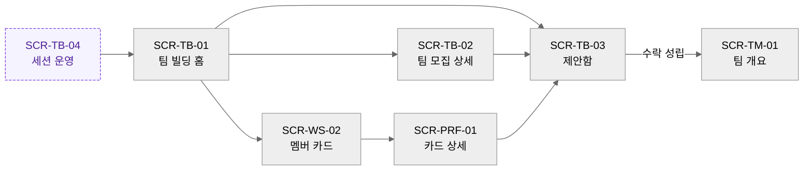
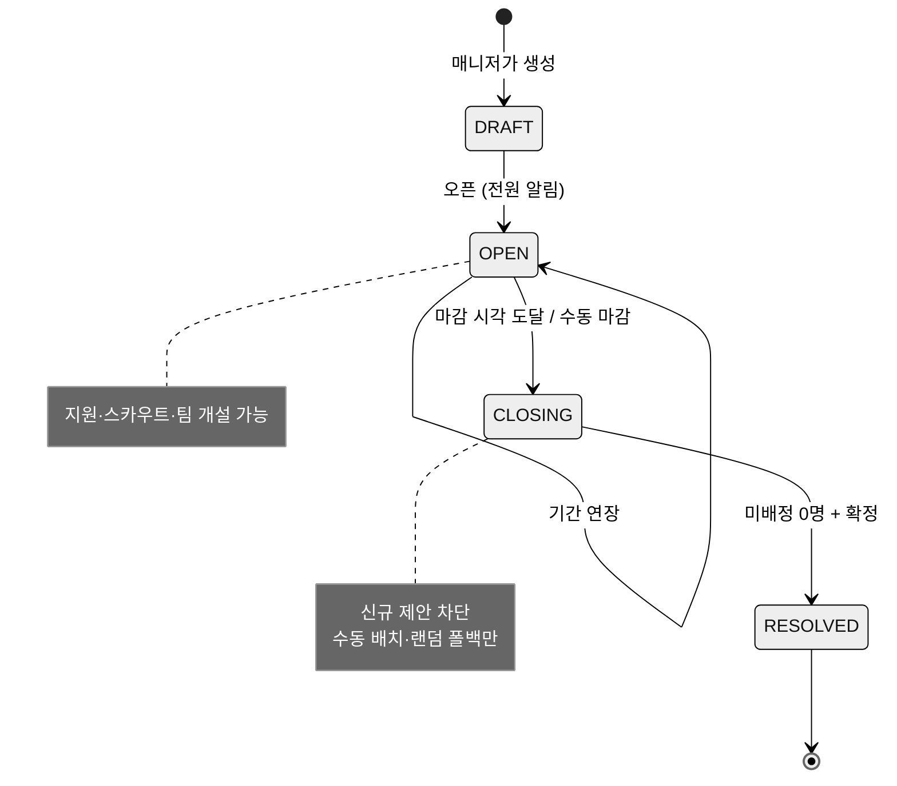
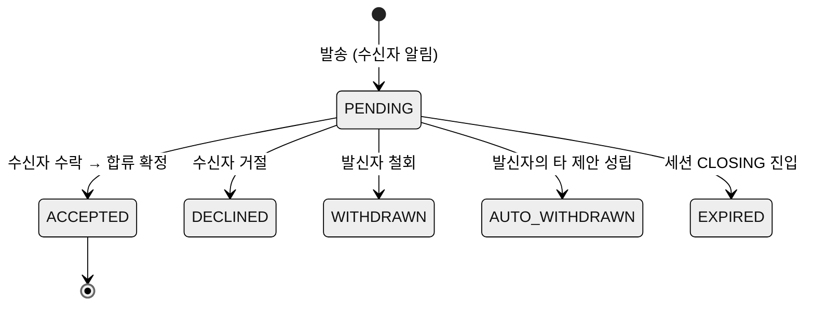

# 12. Team Building — 세션 · 지원/스카우트 · 매칭

> MVP 2.0의 핵심 차별화 기능. [01-e2e-flows.md](01-e2e-flows.md) §4(F3)의 상세이며, 카드 자체의 정의는 [11-profile-pr-card.md](11-profile-pr-card.md), 세션 결과가 흘러가는 팀 스페이스는 [14-collab-tools.md](14-collab-tools.md), 강사 대시보드 연동은 [13-workspace-admin.md](13-workspace-admin.md)를 참조한다.

---

## 1. 목적과 배경

**목적**: 서로 모르는 수강생들이 정해진 기간 안에, 납득 가능한 근거로, 전원 팀을 갖게 만든다. 결성된 팀은 별도 세팅 없이 즉시 협업을 시작한다.

**As-Is (근거)**:
- 성향 기반 추천은 MBTI 동일 여부 OR `disposition` LIKE 한 줄 쿼리이며 워크스페이스 스코프조차 없다 (`AccountRepository.java:48-53`). 서비스 주석은 스스로 "Pick Team의 핵심 기능"이라 부른다 (`UserServiceImpl.java:445`).
- FE 팀 빌딩 허브의 4개 링크(주사위/사다리/투표/관리자)는 라우터 미등록으로 전부 단절 (`TeamFormationStack.tsx:197-215` vs `Router.tsx:32`).
- 지원·수락 같은 결성 플로우를 담는 엔티티·API가 전무하다.
- 기획 단계에서도 「화면별 기능 목록 정의」의 "팀 구성 페이지"는 빈 불릿뿐이었다 — 이 문서가 그 공백을 채우는 최초의 상세 기획이다.

**벤치마크 계승** (Notion 「자기 PR 작성」, 프로그래머스 BE4+ 운영 문서): 실제 교육 현장이 Notion으로 수동 운영하던 프로세스를 제품화한다 — PR 작성 기간과 팀 빌딩 기간의 분리, 전원 PR 공개, 기간 내에만 빌딩 진행(사전 담합 방지), 역할 기반 어필.

**설계 스탠스**:
- 자발적 선택(지원·스카우트·수락)이 기본, 강제 배정은 마감 후 강사의 안전망뿐.
- 추천은 보조 수단이다. 매칭 알고리즘이 팀을 "정해주는" 것이 아니라, 탐색 비용을 줄이고 대화의 시작점을 제공한다. 그래서 **모든 추천에는 사유가 붙는다** (00 §5-3).
- 랜덤(주사위·사다리) 배정은 제품 서사와 충돌하므로 제거하고, CLOSING 단계의 "랜덤 폴백" 하나로 흡수한다 (02 §3.6).

---

## 2. 액터와 권한

| 행동 | 멤버 | 팀장(잠정) | 매니저 | 개설자 | 비고 |
|---|:---:|:---:|:---:|:---:|---|
| 세션 생성·설정·오픈·연장·마감 | – | – | ✅ | ✅ | |
| 팀 개설 (모집 공고) | ✅ | – | ✅ | ✅ | ⚠️ 01-D2 (전원 허용이 추천안) |
| 모집 공고 수정·마감 | – | ✅(자기 팀) | ✅ | ✅ | |
| 지원 (개인→팀) | ✅ | ✅(타 팀에) | – | – | PR 카드 작성자만 (⚠️ 01-D1) |
| 스카우트 (팀→개인) | – | ✅ | – | – | 팀원에게 위임 가능 여부 ⚠️ 12-D1 |
| 지원·스카우트 수락/거절 | ✅(받은 것) | ✅(팀이 받은 지원) | – | – | |
| 미배정자 수동 배치 / 랜덤 폴백 | – | – | ✅ | ✅ | CLOSING 단계 한정 |
| 세션 결과 확정(RESOLVED) | – | – | ✅ | ✅ | |

권한 판정은 전부 서버 강제 (00 §3.2 규칙 5). 매니저·개설자는 지원/스카우트의 **당사자가 될 수 없다** — 심판이 선수를 겸하지 않는다. (강사가 팀에 들어가야 하는 특수 워크스페이스는 팀 빌딩 OFF 모드 사용, §부록)

---

## 3. 유저 스토리

| ID | 스토리 | 수용 기준 |
|---|---|---|
| US-12-01 | 강사로서, 팀 빌딩 기간과 팀 정원을 정해 세션을 열고 싶다. 편성이 자연스럽게 끝나게 하기 위해서다 | 세션 생성→오픈 5분 이내. 오픈 시 전 멤버 알림 발송 |
| US-12-02 | 수강생으로서, 나와 맞는 팀·사람을 근거와 함께 추천받고 싶다. 눈치싸움 없이 접근하기 위해서다 | 추천 목록의 모든 항목에 사유 문장 표시. 워크스페이스 외 인물 미포함 |
| US-12-03 | 수강생으로서, 모집 중인 팀에 한마디와 함께 지원하고 결과를 알림으로 받고 싶다 | 지원→상대 알림→수락/거절→내 알림, 전 과정이 제안함에서 추적 가능 |
| US-12-04 | 팀을 만든 수강생으로서, 부족한 역할의 사람을 찾아 스카우트하고 싶다 | 갤러리 필터(역할)→카드 상세→스카우트 발송 3클릭 이내 |
| US-12-05 | 수강생으로서, 여러 팀에 지원하되 하나가 성사되면 나머지가 자동 정리되면 좋겠다 | 성립 시 잔여 제안 자동 철회 + 상대에게 통지 |
| US-12-06 | 강사로서, 마감 시점에 남은 미배정자를 빠르게 정리하고 싶다 | CLOSING 진입 시 미배정자 목록 제시, 수동 배치(DnD)와 랜덤 폴백 제공, 전원 배정 전 RESOLVED 불가 |
| US-12-07 | 수강생으로서, 팀이 확정되면 바로 팀 공간에서 시작하고 싶다 | RESOLVED 즉시 팀 스페이스 활성(칸반·게시판 자동 생성 [재활용]) + 결과 공지 |

---

## 4. 화면 구성

### 4.1 SCR-TB-01 팀 빌딩 홈 (`/ws/:wsId/team-building`)

세션 단계에 따라 같은 URL이 다른 얼굴을 갖는다 (§5.1 상태별 렌더 규칙).

```
┌─────────────────────────────────────────────────────────────┐
│  팀 빌딩 · 3기 파이널 프로젝트          ⏳ 마감까지 D-3      │
│  내 상태: 미소속 · 보낸 지원 1 · 받은 스카우트 2  [제안함 →] │
├─────────────────────────────────────────────────────────────┤
│  ✨ 추천                                       [멤버 카드 →] │
│  ┌───────────────┐ ┌───────────────┐ ┌───────────────┐      │
│  │ 팀 "코드블루"  │ │ 김OO 카드     │ │ 팀 "달빛"      │      │
│  │ 백엔드 1자리   │ │ 프론트 희망   │ │ 프론트 1자리   │      │
│  │ 사유: 백엔드   │ │ 사유: 저녁    │ │ 사유: 목표     │      │
│  │ 희망+저녁 일치 │ │ 가용 일치     │ │ 온도 근접      │      │
│  │ [상세] [지원]  │ │ [카드] [스카웃]│ │ [상세] [지원]  │      │
│  └───────────────┘ └───────────────┘ └───────────────┘      │
├─────────────────────────────────────────────────────────────┤
│  모집 중인 팀 (5)                        [+ 팀 만들기]       │
│  ▸ 코드블루  3/5 · 모집: BE1 디자인1 · 목표 🔥수상    [지원] │
│  ▸ 달빛      2/4 · 모집: FE1 PM1     · 목표 🌱완주    [지원] │
│  …                                                          │
└─────────────────────────────────────────────────────────────┘
```

- 상단 상태 바: 내 소속 여부·제안 현황·D-day. 이 화면의 모든 분기 판단 기준.
- 추천 레일: 팀 추천과 사람 추천 혼합(내가 미소속이면 팀 추천 위주, 팀 소속이면 사람 추천 위주). 각 카드에 **사유 1줄 필수**.
- `[+ 팀 만들기]`: 모집 공고 작성 모달 — 팀 이름, 소개, 목표 온도, 모집 역할·인원, (선택) 킥오프 예정 시간대.

### 4.2 SCR-TB-02 팀 모집 상세 (`/ws/:wsId/team-building/teams/:teamId`)

```
┌─────────────────────────────────────────────────────────────┐
│  팀 코드블루            3/5 · 모집 중          [지원하기]    │
│  "실서비스 수준까지 가보고 싶습니다"   목표 🔥 수상 지향     │
├──────────────────────────┬──────────────────────────────────┤
│  현재 팀원 (카드 요약)     │  모집 중인 역할                  │
│  ┌────┐ ┌────┐ ┌────┐   │  · 백엔드 1  (지원 2 대기)        │
│  │李PM│ │朴BE│ │崔FE│   │  · 디자인 1 (지원 0)             │
│  └────┘ └────┘ └────┘   │  공통 가용 시간: 평일 저녁·토      │
├──────────────────────────┴──────────────────────────────────┤
│  나와의 적합도: ★★★★☆                                       │
│  "백엔드 희망 역할 일치 · 저녁 가용 겹침 3일 · 목표 온도 근접"│
└─────────────────────────────────────────────────────────────┘
```

- 팀원 카드 요약과 **팀 단위 집계**(공통 가용 시간, 목표 온도)를 함께 보여준다 — 지원 판단 재료.
- `[지원하기]`: 한마디 메시지(선택, 200자) 첨부. 이미 지원했으면 상태 배지로 대체.
- 팀장 시점에는 우측이 "받은 지원 관리" 패널로 바뀐다(수락/거절 + 지원자 카드 열람).

### 4.3 SCR-TB-03 제안함 (`/ws/:wsId/team-building/inbox`)

받은 것/보낸 것 2탭. 모든 지원·스카우트의 단일 추적 지점이며 알림 딥링크의 착지점 (02 §5).

```
[받은 제안 2] [보낸 제안 1]
─ 받은 제안 ────────────────────────────────────────
▸ 스카우트 · 팀 달빛 → 나        "프론트 포지션 어떠세요?"
  받은 지 2시간 · 카드 보기      [수락] [거절]
▸ 지원 · 정OO → 내 팀 코드블루   "백엔드 지원합니다"
  받은 지 1일 · 카드 보기        [수락] [거절]
```

- 수락 확인 다이얼로그에 결과를 명시: "수락하면 팀 합류가 확정되고, 내가 보낸 다른 지원 1건은 자동 철회됩니다."
- 만료·자동 철회 항목은 흐리게 + 사유 표기 (히스토리 보존).

### 4.4 SCR-TB-04 세션 운영 — 관리자 전용 (`/ws/:wsId/team-building/manage`)

```
세션: 3기 파이널  [OPEN]  기간 6/10~6/17  [연장] [지금 마감]
─ 현황 ──────────────────────────────────────────────
전체 32 · 배정 24 · 미배정 8 · 팀 6(정원충족 4)
카드 미작성 3명  [리마인드 발송]
─ 미배정자 (8) ──────────── 팀 보드 ─────────────────
│ 정OO (BE 희망)          │ 코드블루 3/5  [+]        │
│ 한OO (FE 희망)   …드래그→ 달빛     2/4  [+]        │
│                          │ + 새 팀 슬롯             │
─ 마감 처리 ─────────────────────────────────────────
[남은 미배정자 랜덤 배치]  [전원 배정 확인 → 결과 확정]
```

- DRAFT 단계: 설정 폼(기간·팀 정원 min/max·구성 방식·팀 개설 권한). OPEN 중에는 현황 모니터. CLOSING부터 수동 배치(DnD [재활용] `AdminTeamPage` 골격)와 랜덤 폴백 활성화.
- "결과 확정"은 미배정 0명일 때만 활성. 확정 시 되돌릴 수 없음을 명시 (⚠️ 12-D5).

### 4.5 화면 전이



---

## 5. 인터랙션 · 상태 · 엣지 케이스

### 5.1 세션 상태 머신



상태별 렌더 규칙 (SCR-TB-01): DRAFT = 멤버에게 비노출("팀 빌딩 준비 중" 안내). OPEN = §4.1 전체. CLOSING = 제안 버튼 비활성 + "강사가 배정 중" 안내. RESOLVED = 결과 요약(내 팀 링크) 후 일반 메뉴로 강등 (02 §1-3).

### 5.2 제안(Application) 상태 머신 — 지원·스카우트 공용



- 지원과 스카우트는 방향(`direction: APPLY | SCOUT`)만 다른 동일 엔티티. 수락 권한은 항상 수신 측에 있다.
- **성립 시 연쇄 정리**: ACCEPTED 트랜잭션 안에서 ① 발신자(합류자)의 다른 PENDING 전부 AUTO_WITHDRAWN ② 해당 팀이 정원 충족 시 팀의 나머지 받은 지원을 일괄 DECLINED(사유: 정원 마감) ③ 관련자 전원 알림.

### 5.3 매칭 v1 — 규칙 기반 점수 (설명 가능)

대상: 워크스페이스 멤버 중 **카드 공개 동의자**만. 계산은 요청 시점 온디맨드(사전 배치 계산 불필요 — 기수 규모 수십 명).

| 신호 | 가중치 | 계산 | 사유 문구 예 |
|---|:---:|---|---|
| 역할 상보성 | 40 | 팀의 미충원 모집 역할 ∩ 후보의 희망 역할(1순위 만점, 2순위 절반) | "백엔드 희망 — 팀에 필요한 역할" |
| 가용 시간 겹침 | 25 | 주간 시간대 슬롯 교집합 / 팀 공통 슬롯 | "평일 저녁 가용 3일 겹침" |
| 목표 온도 근접 | 20 | 5 − \|후보 온도 − 팀 평균 온도\| 비례 | "목표 온도(완주 지향) 근접" |
| 협업 스타일 | 15 | prefer 태그 교집합 가점, 후보 dislike ∩ 팀 prefer 충돌 감점 | "선호 협업 방식 2개 일치" |
| MBTI | 0 | 계산 미반영, 카드 표시만 | – |

- 사유 생성: 기여도 상위 2개 신호를 문장화해 노출. 점수 숫자 자체는 ★ 5단계로 뭉개서 표시(정밀한 숫자는 서열화 부작용 — ⚠️ 12-D2).
- 가중치는 서버 설정 상수로 두고 파일럿 후 조정 (스펙 Q2 연동). ML·임베딩 도입은 명시적 비채택.
- 사람 추천(팀 시점)과 팀 추천(개인 시점)은 같은 신호를 방향만 바꿔 계산.

### 5.4 엣지 케이스

| # | 상황 | 동작 |
|---|---|---|
| 1 | 정원 1자리에 수락 경합 (동시 수락) | 트랜잭션 선착 1건만 성립. 후착에는 "방금 정원이 찼습니다" + 제안 EXPIRED 처리 |
| 2 | 카드 미작성자가 지원 시도 | 차단 + 카드 작성 위저드로 유도 (⚠️ 01-D1 추천안 기준) |
| 3 | 팀 개설자(잠정 팀장)가 세션 중 이탈 | 팀원 있으면 최선임 팀원에게 잠정 팀장 승계 제안, 없으면 모집 공고 자동 폐기 |
| 4 | OPEN 중 팀 해체 | 소속원 전원 미소속 복귀, 진행 중 제안 전부 EXPIRED, 알림 |
| 5 | 마감 임박(24h) 미배정자 | 자동 리마인드 알림 + 추천 재계산 노출 |
| 6 | 랜덤 폴백 실행 | 역할 분포를 고려한 제약 랜덤(팀별 역할 편중 최소화). 완전 무작위 아님 — "랜덤"이되 설명 가능 |
| 7 | 차단(BANNED)된 멤버 | 카드 비공개·제안 전부 EXPIRED·팀에서 제외 (00 §3.2 규칙 4) |
| 8 | 세션 없이 URL 직접 접근 | 세션 부재 안내 + (매니저에게는) 세션 만들기 CTA. OFF 모드 워크스페이스는 404 (02-D2) |
| 9 | RESOLVED 후 이탈자 발생 | 세션은 재오픈하지 않음. 팀 설정의 위임·강사 수동 이동(⚠️ 01-D3)으로 처리 |

---

## 6. 데이터 · API 요구사항

### 6.1 엔티티

| 엔티티 | 태그 | 핵심 필드 |
|---|---|---|
| `TeamBuildingSession` | [신규] | workspace, name, status(DRAFT/OPEN/CLOSING/RESOLVED), startAt, endAt, teamSizeMin/Max, allowMemberTeamCreate(⚠️ 01-D2), resolvedAt |
| `TeamRecruitment` | [신규] | team(1:1), session, intro, goalTemperature, recruitRoles(역할×인원 JSON 또는 자식 테이블), status(RECRUITING/CONFIRMED/DISBANDED) |
| `TeamApplication` | [신규] | session, direction(APPLY/SCOUT), applicant(Account), targetTeam, message(≤200자), status(§5.2), decidedBy, decidedAt |
| `Team` | [변경] | 세션 산하 팀은 RESOLVED 시점에 정식 활성화. 기존 팀 생성 시 칸반·게시판 자동 생성 로직 [재활용] |
| `Account` 카드 필드 | [재활용/변경] | 11 문서 정의를 따름 (희망 역할·가용 시간·목표 온도 신규 필드 포함) |

### 6.1.1 DB 불변조건과 트랜잭션 가드

| 규칙 | 구현 요구 |
|---|---|
| 워크스페이스당 활성 세션 1개 | `status IN (DRAFT, OPEN, CLOSING)` 세션은 워크스페이스별 1개만 허용. 새 세션 생성 전 기존 세션 RESOLVED 필요 |
| 멤버당 세션 내 활성 팀 1개 | 같은 세션에서 한 계정이 여러 모집 팀에 동시에 소속될 수 없음. 수락 트랜잭션에서 기존 소속·정원 재검증 |
| PENDING 제안 중복 방지 | 같은 세션·방향·발신자·대상팀 조합의 PENDING 중복 생성 금지. 재지원은 기존 제안 종료 후 가능 |
| 정원 초과 방지 | 수락·수동 배치·랜덤 폴백은 모두 동일한 서버 트랜잭션에서 팀 현재 인원과 `teamSizeMax`를 재확인 |
| RESOLVED 이후 불변 | 세션 RESOLVED 후 지원/스카우트/배치 API는 409 반환. 이후 변동은 팀 설정·강사 수동 이동 플로우에서 처리 |

### 6.2 API 스케치

| 엔드포인트 | 태그 | 비고 |
|---|---|---|
| `POST/PATCH /api/workspaces/{wsId}/team-building/sessions` | [신규] | 생성·설정·상태 전이. 매니저+ |
| `GET .../sessions/current` | [신규] | 멤버용 세션 상태+내 현황 요약 |
| `POST .../sessions/{id}/teams` | [신규] | 모집 공고 개설 |
| `GET .../sessions/{id}/teams` | [신규] | 모집 팀 목록(+집계) |
| `GET .../sessions/{id}/recommendations` | [신규] | 매칭 추천(점수·사유 포함). 기존 `GET /api/users/recommend` [폐기] 대체 |
| `POST .../applications` / `PATCH .../applications/{id}` | [신규] | 제안 발송/수락·거절·철회. 연쇄 정리는 서버 트랜잭션 |
| `GET .../applications?box=received\|sent` | [신규] | 제안함 |
| `POST .../sessions/{id}/assign` | [신규] | 수동 배치(매니저+). CLOSING 한정 |
| `POST .../sessions/{id}/resolve` | [신규] | 결과 확정 → 팀 활성화 + 알림 일괄 발송 |

- 알림 이벤트(발생 지점): 세션 오픈/마감 임박/결과, 제안 수신/수락/거절/자동 철회 — 카탈로그 정본은 [16](16-notifications.md).
- 성능: 추천 계산은 멤버 수 N≤수백 전제의 인메모리 점수화로 충분. 워크스페이스 스코프 강제로 기존 전역 노출 결함 해소.

## 7. 성공 지표

| 지표 | 목표(파일럿 기준) |
|---|---|
| 세션 완주율: OPEN→RESOLVED 도달한 세션 비율 | 100% (안전망 설계 검증) |
| 자발 성립률: 강제 배치 없이 지원·스카우트로 배정된 인원 비율 | ≥ 70% |
| 추천 경유율: 성립된 제안 중 추천 레일에서 출발한 비율 | 계측만 (v1 가중치 튜닝 입력, 스펙 Q2) |

## 8. ⚠️ 논의 필요 항목

> ✅ **2026-07-04 일괄 결정**: 아래 전 항목이 추천안대로 확정됨. 결정 기록: [90-open-questions.md](90-open-questions.md). (D1=팀장만, D2=★5단계+사유, D3=카드 전체 공개, D4=상한 3건, D5=재오픈 불가, D6=집계만 공개)

| ID | 질문 | 선택지와 추천안 | 영향 |
|---|---|---|---|
| 12-D1 | 스카우트 발송 권한을 팀장 외 팀원에게도 줄 것인가 | (a) 팀장만(추천 — 창구 단일화, 중복 발송 방지) (b) 팀원 전원 | §2, TB-02 |
| 12-D2 | 적합도 표시 방식 | (a) ★ 5단계+사유(추천 — 서열화 완화) (b) 백분율 점수 (c) 사유만 | §5.3, TB-01/02 |
| 12-D3 | 지원 시 상대 팀에 내 카드 전체가 공개되는가, 요약만인가 | (a) 전체(추천 — 판단 재료 충분히) (b) 요약+수락 후 전체 | 11 공개 범위와 연동 |
| 12-D4 | 동시 PENDING 지원 수 상한 | (a) 3건(추천 — 남발 방지·수신자 피로 감소) (b) 무제한 | §5.2 |
| 12-D5 | RESOLVED 후 세션 재오픈 절대 불가로 할 것인가 | (a) 불가, 재조정은 개별 이동으로(추천 — 상태 단순) (b) 매니저 한정 재오픈 | §5.1, 01-D3 |
| 12-D6 | 목표 온도·가용 시간의 팀 집계값 공개 수위 | (a) 집계만 공개, 개인값 비공개(추천) (b) 팀원 개인값도 공개 | 11, 17 프라이버시 |

---

## 부록: 팀 빌딩 OFF 모드 (F6-d)

세션을 쓰지 않는 워크스페이스(스터디·소모임)의 동작: Context Nav에서 팀 빌딩 항목 숨김. 팀 생성은 자유(기존 `TeamActionModal` 개선판 — 생성/참여 2택, 비밀번호 팀 지원 [재활용]). 카드 갤러리는 유지(서로 알기 용도), 추천·제안은 비활성. 워크스페이스 설정에서 모드 전환 가능하되, OFF→ON 전환 시 기존 팀은 세션 밖 팀으로 유지된다.

## 변경 이력

| 날짜 | 내용 |
|---|---|
| 2026-07-04 | 최초 작성 (Fable 직접) |
