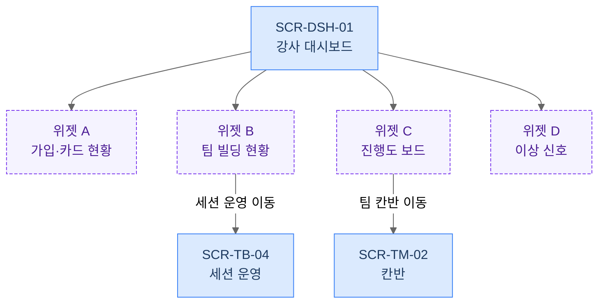
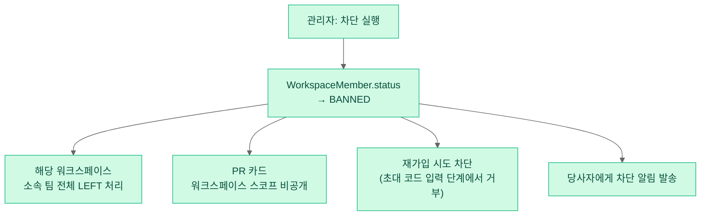
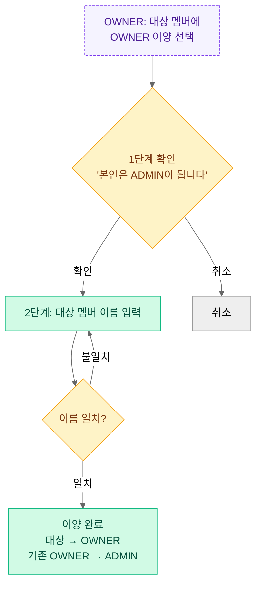

# 13. 워크스페이스 관리자 — 설정·멤버 관리·강사 대시보드

> 워크스페이스의 생성·설정, 멤버 역할/차단/강퇴, 강사 대시보드(감독 루프), 진행도 개입 승인, 아카이브를 다룬다.
> 팀 빌딩 세션 운영 화면(SCR-TB-04)은 [12-team-building.md](12-team-building.md)가 정본 — 여기서는 대시보드에서의 연결(딥링크)만 다룬다.
> 초대 랜딩·합류 플로우(SCR-AUTH-04)는 [10-auth-onboarding.md](10-auth-onboarding.md) 소관 — 초대 정책 발급 UI만 이 문서에 포함한다.
> 액터·권한 정본: [00-overview.md](00-overview.md) §3. 화면 ID: [02-information-architecture.md](02-information-architecture.md) §3.2.

---

## 1. 목적과 배경

### 1.1 다루는 범위

| 기수 단계 | 이 문서가 담당하는 관리 행위 |
|---|---|
| ① 개설 | 워크스페이스 생성, 기수 정보 입력, 초대 링크 발급·정책 설정 |
| ② 모집 | 멤버 합류 확인, 역할 부여, 차단·강퇴 |
| ④~⑤ 팀 빌딩·협업 | 대시보드 감독 루프, 진행도 개입 승인, 이상 신호 대응 |
| ⑥ 종료 | 워크스페이스 아카이브(읽기 전용 전환) |

### 1.2 As-Is 현황과 문제

**워크스페이스 설정** (`WorkspaceSettingsModal.tsx`):
- 모달 형태로 운영. 탭 구성: 초대 / 서버 프로필(`canManage`) / 멤버 관리(`canManage`) / 차단 목록(`canManage`) / 보안(`isOwner`) / 위험 구역(`isOwner`)
- 권한 판정 소스 분열: OWNER는 `workspace.owner.id` 비교, ADMIN은 `members[].role` 참조 (`WorkspaceSettingsModal.tsx:35-36`). 00 §3.2 규칙 3 위반 → [변경] 필수
- 초대 링크: 워크스페이스 생성 시 고정 발급, 만료·재생성 불가(`WorkspaceController.java:132-145`의 주석 처리된 코드). 링크 유출 시 회수 수단 없음 → [변경] 필수

**BE `WorkspaceController` 엔드포인트 9개** [재활용 골격]:
`POST /api/workspaces` 생성 / `POST /join` 초대 코드 참여 / `GET /my` 목록 / `GET /{id}` 상세 / `GET /{id}/members` 멤버 목록 / `POST /{id}/icon` 아이콘 / `PUT /{id}` 수정 / `DELETE /{id}/members/{uid}` 강퇴 / `POST|DELETE /{id}/members/{uid}/ban` 차단·해제 / `GET /{id}/blacklist` 블랙리스트 / `DELETE /{id}` 삭제

**강사 대시보드**: As-Is에 완전 부재. 칸반 완료 요청/승인 API는 BE에 존재([재활용]) — 집계 화면만 없음.

**역할 변경 UI**: As-Is에 없음. MEMBER↔ADMIN 변경, OWNER 이양 UI 신설 필요 [신규].

---

## 2. 액터와 권한

00 §3 명칭을 그대로 사용한다.

| 기능 | 개설자(OWNER) | 매니저(ADMIN) | 멤버(MEMBER) |
|---|---|---|---|
| 워크스페이스 생성 | O | — | — |
| 기본 정보 수정(이름·아이콘) | O | O | — |
| 초대 링크 발급·재발급·만료 설정 | O | O | — |
| 매니저 임명·해제 | O | — | — |
| OWNER 이양 | O | — | — |
| 멤버 강퇴 | O | O | — |
| 멤버 차단·차단 해제 | O | O | — |
| 블랙리스트 조회 | O | O | — |
| 강사 대시보드 열람 | O | O | — |
| 진행도 개입 승인 | O | O | — |
| 워크스페이스 비밀번호 설정 | O | — | — |
| 워크스페이스 아카이브·삭제 | O | — | — |

> 모든 검증은 서버에서 `WorkspaceMember.role`을 기준으로 수행한다(00 §3.2 규칙 3·5).
> 팀 내부 콘텐츠(채팅·게시판 글쓰기·칸반 조작)는 팀 멤버로 참여한 경우에만 접근 가능하다(00 §3.2 규칙 1). (⚠️ 13-D1)

---

## 3. 유저 스토리

| ID | 스토리 | 수용 기준 |
|---|---|---|
| US-13-01 | **강사 K로서**, 워크스페이스를 30분 안에 만들고 초대 링크를 배포하고 싶다 — 개강 전날 부담 없이 준비하기 위해. | 이름만 입력하면 생성, 이후 설정에서 세부 항목 추가 가능. 초대 링크가 즉시 발급·복사 가능. |
| US-13-02 | **강사 K로서**, 초대 링크를 만료시키거나 재발급하고 싶다 — 링크가 외부 유출됐을 때 즉시 차단하기 위해. | 재발급 시 기존 링크 즉시 무효화. 만료일 설정 가능. |
| US-13-03 | **강사 K로서**, 보조 강사를 매니저로 임명하고 싶다 — 운영을 분담하기 위해. | MEMBER를 ADMIN으로 변경 가능. 해제도 가능. 단 OWNER 이양은 별도 확인 절차 포함. |
| US-13-04 | **매니저 A로서**, 부적절한 멤버를 강퇴 또는 차단하고 싶다 — 워크스페이스 분위기를 지키기 위해. | 강퇴: 즉시 LEFT 처리. 차단: BANNED + 팀 자동 제외 + 카드 비공개 + 재가입 차단. |
| US-13-05 | **강사 K로서**, 모든 팀의 진행도를 한 화면에서 보고 싶다 — 주 2회 10분 루틴으로 이상 팀을 파악하기 위해. | 대시보드에서 4개 위젯(가입 현황/팀 빌딩/진행도 보드/이상 신호)이 실데이터로 표시. |
| US-13-06 | **매니저 A로서**, 대시보드에서 칸반 완료 요청을 직접 승인하고 싶다 — 팀장이 응답이 없을 때 개입하기 위해. | 승인 큐에서 태스크 선택 → 승인 → 승인자(매니저) 기록 남음. |
| US-13-07 | **강사 K로서**, 기수가 끝난 워크스페이스를 읽기 전용으로 보관하고 싶다 — 수강생이 나중에 이력을 참조할 수 있게. | 아카이브 처리 시 쓰기 동작 전체 차단, 읽기는 유지. 아카이브 상태 UI 표시. |

---

## 4. 화면 구성

### 4.1 SCR-WS-03 워크스페이스 설정 (풀페이지화) [개편]

> As-Is `WorkspaceSettingsModal`의 탭 구조를 계승하되, 모달에서 풀페이지(`/ws/:wsId/settings`)로 전환(⚠️ 13-D2). 좌측 사이드바 탭 + 우측 콘텐츠 영역 레이아웃.

```
┌──────────────────────────────────────────────────────────────┐
│  ← 뒤로      워크스페이스 설정                               │  Global Header
├────────────────┬─────────────────────────────────────────────┤
│ [일반]         │  ■ 일반 설정                                 │
│ [초대]         │  ─────────────────────────────────────────── │
│ [멤버 관리] ▶  │  워크스페이스 이름                           │
│ [차단 목록]    │  [──────────────────────────] [저장]         │
│ ─────────────  │                                             │
│ [보안]  OWNER  │  아이콘                                      │
│ [위험 구역] ↑  │  [아이콘 미리보기]  [변경]                   │
│                │                                             │
│                │  팀 빌딩 사용  [ON●───────OFF]              │
│                │  설명: OFF 시 팀 빌딩 메뉴 숨김, 자유 팀 생성 모드  │
└────────────────┴─────────────────────────────────────────────┘
```

**탭별 접근 권한**:
- `일반`: 모든 멤버 읽기 / ADMIN 이상 수정
- `초대`: ADMIN 이상
- `멤버 관리`: ADMIN 이상
- `차단 목록`: ADMIN 이상
- `보안`: OWNER 전용
- `위험 구역`: OWNER 전용

---

### 4.2 초대 탭 — 초대 링크 발급·정책 [변경]

```
■ 초대 링크 설정
────────────────────────────────────────────────────────────
현재 초대 링크
[https://pickteam.site/invite/abc123]  [복사]

만료일  [──────────────────] (없음 = 무기한)  (⚠️ 13-D3)
사용 횟수  사용: 14회 / 정원: 30명

[재발급]  ← 클릭 시 확인 다이얼로그: "기존 링크가 즉시 무효화됩니다. 계속하시겠습니까?"

────────────────────────────────────────────────────────────
워크스페이스 비밀번호  (초대 링크와 별개, 링크 클릭 후 입력 요구)
[●●●●●●●●]  [변경]  [제거]          (OWNER 전용)
```

---

### 4.3 멤버 관리 탭 [변경 + 신규 역할 변경 기능]

```
■ 멤버 관리  (총 14명)
────────────────────────────────────────────────────────────
[검색: 이름·이메일]

┌──────────────────────────────────────────────────────────┐
│  아바타  이름     이메일              역할        액션    │
│  ○       김철수   cs@mail.com         멤버  [⋮]  → 역할 변경 / 강퇴 / 차단  │
│  ○       이영희   yh@mail.com         매니저[⋮]  → 매니저 해제 / 강퇴 / 차단  │
│  ★       Park K   k@mail.com          개설자 —               │
└──────────────────────────────────────────────────────────┘

각 행 [⋮] 컨텍스트 메뉴 (OWNER/ADMIN 접근, 자기 자신에게는 비활성):
  - 매니저로 임명   (MEMBER → ADMIN, OWNER만 가능)
  - 매니저 해제     (ADMIN → MEMBER, OWNER만 가능)
  - OWNER 이양      (OWNER만 가능 — 별도 2단계 확인 필수, 하단 §5.3)
  - 강퇴하기
  - 차단하기
```

---

### 4.4 SCR-DSH-01 강사 대시보드 [신규]

> URL: `/ws/:wsId/dashboard`. 개설자·매니저의 기본 진입점(⚠️ 13-D4).



**4종 위젯 레이아웃**:

```
┌─────────────────────────────────────────────────────────────┐
│  강사 대시보드  ·  [워크스페이스명]                          │
├───────────────────┬─────────────────────────────────────────┤
│  ┌─────────────┐  │  ┌──────────────────────────────────┐   │
│  │ A. 가입·카드 │  │  │ B. 팀 빌딩 현황                  │   │
│  │ 가입 14/30  │  │  │ 세션: OPEN  D-3                  │   │
│  │ 카드 작성률  │  │  │ 배정 10명 / 미배정 4명           │   │
│  │  ██████ 71% │  │  │ [세션 운영으로 이동 →]            │   │
│  │ [미작성자   │  │  └──────────────────────────────────┘   │
│  │  리마인드]  │  │                                          │
│  └─────────────┘  │  ┌──────────────────────────────────┐   │
│                   │  │ C. 진행도 보드                    │   │
│                   │  │ 팀A 완료율 60%  승인대기 2건      │   │
│                   │  │ 팀B 완료율 40%  승인대기 0건      │   │
│                   │  │ 팀C 완료율 80%  승인대기 1건      │   │
│                   │  │ [승인 큐 처리 →]                  │   │
│                   │  └──────────────────────────────────┘   │
│  ┌─────────────────────────────────────────────────────┐    │
│  │ D. 이상 신호                                         │    │
│  │ ⚠ 팀B: 7일 무활동    ⚠ 홍길동: 차단 이력 1건        │    │
│  └─────────────────────────────────────────────────────┘    │
└─────────────────────────────────────────────────────────────┘
```

**위젯별 데이터 소스**:

| 위젯 | 데이터 소스 | 태그 |
|---|---|---|
| A. 가입·카드 현황 | `GET /api/workspaces/{id}/members` 멤버 수 집계 + 카드 작성 여부(신규 `profileComplete` 플래그) | [재활용 부분] + [신규 집계] |
| B. 팀 빌딩 현황 | 팀 빌딩 세션 상태·팀별 정원·미배정자 목록 (`GET /api/workspaces/{id}/team-building/summary`) | [신규 집계 API] |
| C. 진행도 보드 | 팀별 칸반 완료율 + 승인 대기 태스크 수 (`GET /api/workspaces/{id}/dashboard/progress`) | [신규 집계 API] |
| D. 이상 신호 | N일 이상 칸반 갱신 없는 팀 + 최근 차단·탈퇴 이력 (`GET /api/workspaces/{id}/dashboard/alerts`) | [신규 집계 API] |

---

### 4.5 진행도 승인 큐 (대시보드 → 인라인 패널)

```
■ 승인 대기 (3건)
────────────────────────────────────────────────────────────
팀A  |  [태스크명] 로그인 API 완성      요청자: 김철수  3일 전
     |  [승인]  [상세 보기 →]

팀C  |  [태스크명] 와이어프레임 완성     요청자: 이영희  1일 전
     |  [승인]  [상세 보기 →]
```

승인 시: `승인자 = 현재 로그인한 매니저/개설자` 로 기록 (00 §3.2 규칙 2). 칸반 태스크 상세(SCR-TM-02)로 이동 버튼 제공.

---

## 5. 인터랙션·상태·엣지 케이스

### 5.1 BANNED 파급 흐름



- **차단된 멤버의 작성물**: 칸반 태스크 담당자·게시글 작성자는 익명("탈퇴한 멤버")으로 표시. 삭제하지 않음 — 팀 기록 무결성 유지. (⚠️ 13-D5)
- **강퇴(kick)**: BANNED 없이 LEFT 처리. 재가입 차단 없음 — 초대 코드 다시 사용하면 합류 가능.

### 5.2 역할 변경 규칙

| 변경 | 주체 | 제약 |
|---|---|---|
| MEMBER → ADMIN (매니저 임명) | OWNER | 제한 없음 |
| ADMIN → MEMBER (매니저 해제) | OWNER | 마지막 ADMIN이더라도 OWNER만 있으면 가능. 단 마지막 매니저 해제 시 경고 표시 (⚠️ 13-D6) |
| MEMBER·ADMIN → OWNER (이양) | OWNER | 2단계 확인: ① "이양 후 본인은 ADMIN이 됩니다" 안내 → ② 이름 직접 입력 확인 |

### 5.3 OWNER 이양 플로우



**OWNER 탈퇴 엣지케이스**: OWNER가 워크스페이스를 탈퇴하려는 경우, 이양 완료 후에만 탈퇴 가능하도록 강제. 이양 대상이 없으면(멤버 0명) 삭제만 허용.

### 5.4 대시보드 기본 진입점 (⚠️ 13-D4)

2026-07-04 결정에 따라 개설자·매니저의 `/ws/:wsId` 진입은 **최초 진입만 대시보드, 이후 마지막 방문 화면 기억**으로 확정한다(02 §6 02-D4 연계).

### 5.5 정원 초과 가입 시도

초대 링크 사용 횟수가 `정원`에 도달하면 참여 API가 `403 WORKSPACE_FULL` 오류 반환. 초대 랜딩(SCR-AUTH-04)에서 "현재 정원이 가득 찼습니다. 관리자에게 문의하세요"로 안내.

### 5.6 빈 상태

- 대시보드 최초 진입(멤버 0명): 위젯 A "아직 멤버가 없습니다. 초대 링크를 공유하세요" + 링크 복사 버튼
- 승인 큐 없음: "현재 처리할 승인 요청이 없습니다"
- 이상 신호 없음: "모든 팀이 정상적으로 진행 중입니다"

---

## 6. 데이터·API 요구사항

### 6.1 엔티티

| 엔티티 | 변경 | 내용 |
|---|---|---|
| `WorkspaceMember` | [재활용] | `role(OWNER/ADMIN/MEMBER)`, `status(ACTIVE/BANNED/LEFT)` 그대로 사용 |
| `Workspace` | [변경] | `inviteCodeExpiredAt(LocalDateTime nullable)` 추가. `teamBuildingEnabled(boolean)` 추가 |
| `WorkspaceMember` | [변경] | 권한 판정 소스를 `workspace.owner.id` 비교에서 `WorkspaceMember.role = OWNER` 로 일원화 (00 §3.2 규칙 3) |
| `KanbanTask` | [변경] | `approvedBy(Long accountId nullable)` — 개입 승인자 기록 컬럼 추가 |

### 6.2 API

| 엔드포인트 | 태그 | 설명 |
|---|---|---|
| `POST /api/workspaces` | [재활용] | 워크스페이스 생성. `teamBuildingEnabled` 필드 추가 |
| `PUT /api/workspaces/{id}` | [변경] | 기본 정보 + `teamBuildingEnabled` 수정 |
| `POST /api/workspaces/{id}/invite-code/refresh` | [신규] | 초대 링크 재발급 (기존 코드 즉시 무효화). `expiredAt` 바디 파라미터 |
| `GET /api/workspaces/{id}/members` | [재활용] | 멤버 목록. `role`, `status` 포함 |
| `PATCH /api/workspaces/{id}/members/{uid}/role` | [신규] | 역할 변경 (`MEMBER↔ADMIN`, `OWNER 이양`). OWNER만 가능 |
| `DELETE /api/workspaces/{id}/members/{uid}` | [재활용] | 강퇴(kick) |
| `POST /api/workspaces/{id}/members/{uid}/ban` | [재활용] | 차단. BANNED 파급은 서버 트랜잭션 내 처리 |
| `DELETE /api/workspaces/{id}/members/{uid}/ban` | [재활용] | 차단 해제 |
| `GET /api/workspaces/{id}/blacklist` | [재활용] | 블랙리스트 조회 |
| `GET /api/workspaces/{id}/dashboard/summary` | [신규] | 가입 현황·카드 작성률 집계 |
| `GET /api/workspaces/{id}/dashboard/progress` | [신규] | 팀별 칸반 완료율·승인 대기 태스크 수 집계 |
| `GET /api/workspaces/{id}/dashboard/alerts` | [신규] | 이상 신호: N일 무활동 팀, 최근 차단·탈퇴 이력 |
| `GET /api/workspaces/{id}/team-building/summary` | [신규] | 팀 빌딩 현황(12 문서와 공유) |
| `POST /api/kanban/cards/{cardId}/completion-approval` | [변경] | 칸반 완료 승인 (As-Is `KanbanController.java:160` [재활용]). 매니저 이상의 개입 승인 허용 + `approvedBy` 기록 추가 |
| `POST /api/workspaces/{id}/archive` | [신규] | 워크스페이스 아카이브 (읽기 전용 전환) |
| `DELETE /api/workspaces/{id}` | [재활용] | 워크스페이스 삭제 (OWNER 전용) |

### 6.3 권한 판정 리팩터링 범위

`WorkspaceSettingsModal.tsx:35-36`의 `isOwner`/`isAdmin` 이중 판정 → 서버 응답에 `currentMemberRole: "OWNER"|"ADMIN"|"MEMBER"` 필드 포함. FE는 이 값 하나로 분기. 서버는 `WorkspaceMember.role`만 참조.

---

## 7. 성공 지표

| 지표 | 목표 | 측정 방법 |
|---|---|---|
| 대시보드 주간 방문율 (개설자·매니저 기준) | ≥ 80% | 세션 로그 |
| 초대 링크 발급→멤버 가입 완료율 | ≥ 85% | 초대 링크 클릭 수 대비 `WorkspaceMember` ACTIVE 전환 수 |
| 승인 큐 평균 처리 시간 | ≤ 24시간 | `approvedAt - requestedAt` 평균 |

---

## 8. ⚠️ 논의 필요 항목

> ✅ **2026-07-04 일괄 결정**: 아래 전 항목이 추천안대로 확정됨. 결정 기록: [90-open-questions.md](90-open-questions.md). (D1=집계만, D2=풀페이지, D3=10-D2 결정 준용(30일+무기한 옵션), D4=최초만 대시보드, D5=익명화 보존, D6=경고 후 허용, D7=세션 강제 종료 후 아카이브)

| ID | 질문 | 선택지·추천안 | 영향도 |
|---|---|---|---|
| 13-D1 | 강사(OWNER/ADMIN)의 팀 내부 콘텐츠(채팅·게시판) 열람 허용 범위 | (a) 집계 정보만(추천 — 프라이버시 보호) (b) 게시판까지 열람 + 고지 (c) 전체 열람 + 고지. 00 §3.2 규칙 1 선택지와 동일(01-D6에서 이관) | 13, 15, 17 |
| 13-D2 | 워크스페이스 설정 풀페이지 전환 여부 | (a) 풀페이지 권장(추천 — 항목 증가로 모달 한계) (b) 모달 유지. 02-D3에서 이관 | 개발량 |
| 13-D3 | 초대 링크 만료일 기본값 — **10-D2와 동일 안건, 결정은 10-D2에서** | 추천안 통일: 기본 30일 + "무기한" 명시 선택 허용 (보안 기본값은 보수적으로, 기수 운영 편의는 옵션으로) | 10 |
| 13-D4 | 개설자·매니저 기본 진입점을 대시보드로 강제할지 여부 | (a) 최초 진입만 대시보드, 이후 마지막 화면(추천) (b) 항상 대시보드. 02-D4에서 이관 | UX |
| 13-D5 | 차단된 멤버의 작성물(칸반 담당, 게시글) 처리 | (a) 익명화 보존(추천 — 팀 기록 무결성) (b) 해당 항목 삭제 (c) 그대로 유지(이름 노출) | 17 |
| 13-D6 | 마지막 매니저 해제 시 동작 | (a) 경고 표시 후 허용(추천) (b) 차단 — OWNER 혼자 관리 가능하므로 차단 불필요 | 운영 |
| 13-D7 | 아카이브 시 팀 빌딩 세션이 OPEN 상태인 경우 처리 | (a) 아카이브 전 세션 강제 종료 후 진행(추천) (b) 경고만 표시하고 허용 | 12 |

---

### 아카이브 상세 설계 (01-D4 추천안 구현)

아카이브는 `Workspace.archived = true` 플래그 전환으로 구현한다. 읽기 전용 전환 원칙:

- **차단**: 멤버 초대, 칸반 생성·수정, 게시글 작성, 채팅 메시지 전송, 일정 생성 — 서버에서 `WORKSPACE_ARCHIVED(403)` 반환
- **허용**: 모든 조회, 칸반 열람, 채팅 히스토리 읽기, 파일 다운로드
- **UI**: 워크스페이스 이름 옆 `[아카이브됨]` 배지. Context Nav 상단 안내 배너 "이 워크스페이스는 읽기 전용으로 보관 중입니다"
- **해제**: OWNER가 아카이브 해제 가능 (⚠️ 추후 삭제 전환 여부는 17 문서와 협의)

---

## 변경 이력

| 날짜 | 내용 |
|---|---|
| 2026-07-04 | 최초 작성 |
