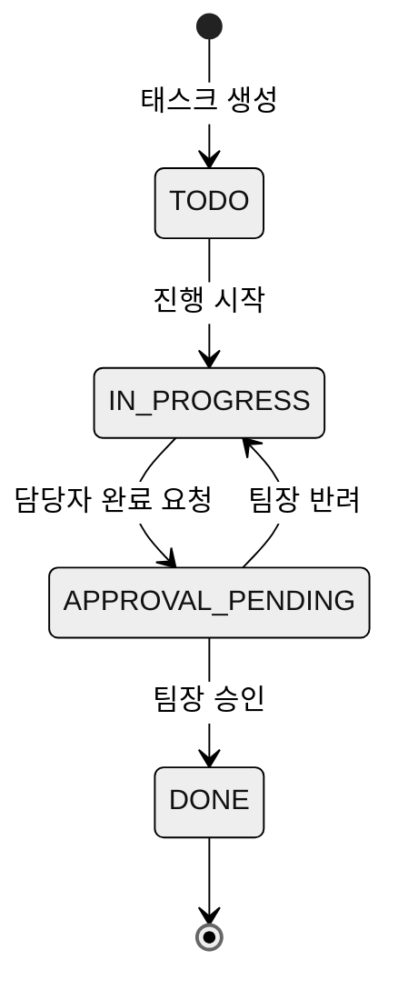
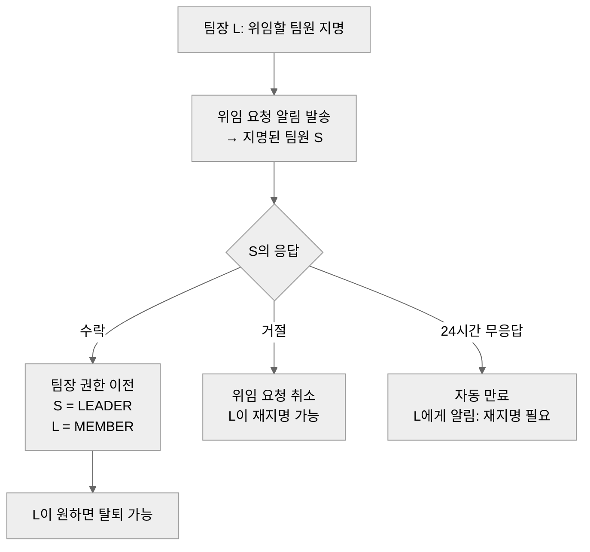

# 14. 협업 도구 — 팀 개요 · 칸반 · 일정 · 게시판 · 공지 · 팀 설정

> 팀 스페이스(SCR-TM-01~06)를 구성하는 협업 도구 전체의 기능 상세 기획.
> 여정 기준: [01](01-e2e-flows.md) §4.3(결성 직후), §5(F4 협업 정착), §7(F6-b 팀장 위임).
> 화면 ID 정본: [02](02-information-architecture.md) §3.4. 용어·액터: [00](00-overview.md) §2·§3.

---

## 1. 목적과 배경

### 1.1 무엇을 왜

팀 스페이스는 Pick Team의 "결성 → 협업 무단절" 약속(종합 스펙 §4.1)이 실현되는 공간이다. 팀 빌딩 세션에서 확정된 팀에게는 칸반·게시판이 자동 생성되며[재활용], 팀원들이 처음 팀 스페이스에 진입하는 순간 도구가 준비돼 있어야 한다.

이 문서가 다루는 6개 화면은 크게 두 유형으로 나뉜다:

- **재문서화 대상**: 칸반(SCR-TM-02), 일정(SCR-TM-03), 게시판(SCR-TM-04), 공지(SCR-TM-05) — 백엔드와 프론트엔드 구현이 존재하지만 알려진 결함 및 신규 요건이 있어 재문서화한다.
- **신규 설계 대상**: 팀 개요(SCR-TM-01), 팀 설정(SCR-TM-06) — 기존 구현 없음, 이 문서에서 처음 정의한다.

### 1.2 As-Is 근거 요약

| 화면 | 백엔드 상태 | 프론트엔드 상태 | 주요 결함 |
|---|---|---|---|
| 팀 개요 | 없음 | 없음 | — |
| 칸반 | 완성 (보드/리스트/태스크/댓글 CRUD + 완료 요청·승인 API) | `TeamKanbanBoard.tsx` 1,902줄 동작 | assignee 불일치 시 조용한 스킵(L1202~1257), 실패 시 `alert()` |
| 일정 | `ScheduleController` 완성. 단 `accountId` 파라미터 인증 우회 — **폐기 대상** | 월간 뷰 단일, 개인 일정 없음, 셀당 3개+N | 인증 우회(보안 결함), 뷰 단일 |
| 게시판 | Post/Comment/첨부 완성 (QueryDSL) | `TeamBulletinBoard` 동작 | 본인 작성물만 수정·삭제 (정상 동작) |
| 공지 | `AnnouncementController` CRUD 완성 | 공지 탭 동작 | 자체 `Map` 응답·`@ExceptionHandler` — `ApiResponse<T>` 미사용, 통일 대상 |
| 팀 설정 | 팀장 위임 없음 (`TeamService.java:230-231` 팀장 탈퇴 시 예외) | 드롭다운 + `prompt()` 확인뿐 | 팀장 탈퇴 불가, `prompt()` UX 원시적 |

미구현 잔재(기능 명세서 Epic 4): 채팅 스레드, 투표, D-Day 표시, 진행도 그래프 — 채택 여부는 §8에서 결정.

---

## 2. 액터와 권한

[00 §3](00-overview.md) 명칭 기준. 이 문서에서 특히 중요한 권한 분기는 아래와 같다.

| 행동 | 팀원 | 팀장 | 워크스페이스 매니저/개설자 |
|---|---|---|---|
| 팀 스페이스 열람 | ✅ | ✅ | 집계 정보만 (00 §3.2 규칙 1) |
| 칸반 태스크 생성·이동 | ✅ | ✅ | — |
| 칸반 완료 요청 | ✅ (담당자) | ✅ | — |
| 칸반 완료 승인 | — | ✅ (1차 주체) | ✅ (개입 승인, 기록 남김) |
| 일정 생성·수정·삭제 | 자신이 생성한 것 | ✅ | — |
| 게시판 글 수정·삭제 | 자신이 작성한 것 | ✅ | — |
| 공지 작성·수정·삭제 | — | ✅ | ✅ |
| 팀 이름·설명·비밀번호 수정 | — | ✅ | — |
| 팀장 위임 (지명) | — | ✅ | — |
| 팀장 위임 수락 | 지명된 팀원만 | — | — |
| 팀 멤버 내보내기 | — | ✅ | ✅ (강제) |
| 팀 삭제 | — | ✅ | ✅ |

---

## 3. 유저 스토리

### 3.1 팀 개요 (SCR-TM-01)

- **팀장 L로서**, 결성 직후 팀원들이 누군지 한눈에 확인하고 역할을 확정하고 싶다. ← 수용: 팀원 PR 카드 요약이 개요 화면 상단에 자동 표시된다.
- **팀원 S로서**, 팀의 진행 상황(칸반 완료율, 다음 일정)을 협업 도구를 일일이 클릭하지 않고 한 화면에서 파악하고 싶다. ← 수용: 진행도 위젯·다음 일정·최근 공지가 개요에 집계 표시된다.
- **팀장 L로서**, 결성 직후 아무것도 없는 빈 화면이 아니라 "지금 무엇을 해야 하는지" 안내가 보이길 원한다. ← 수용: 결성 직후 체크리스트(역할 확정·첫 회의 등록)가 빈 상태 대신 표시된다.

### 3.2 칸반 (SCR-TM-02)

- **팀원 S로서**, 내 태스크가 완료됐을 때 팀장에게 승인 요청을 명시적으로 보내고 싶다. ← 수용: 완료 요청 버튼 → 요청 배지 표시 → 팀장 승인 플로우가 UI 1급 시민으로 제공된다.
- **팀장 L로서**, 승인 대기 중인 태스크를 한 번에 필터링해 처리하고 싶다. ← 수용: "승인 대기" 필터 탭 제공.
- **팀원 S로서**, 담당자로 배정되지 않은 태스크에 완료 요청을 누르면 왜 안 되는지 알고 싶다. ← 수용: 조용한 스킵 → 인라인 에러 메시지로 교체.

### 3.3 일정 (SCR-TM-03)

- **팀원 S로서**, 팀 일정을 월간 외에 주간·리스트 뷰로도 보고 싶다. ← 수용: 월/주/리스트 3뷰 제공.
- **팀원 S로서**, 내 개인 일정을 팀 일정과 겹쳐 보고 싶다("내 일정" 레이어). ← 수용: 개인 일정 신설, 팀 일정과 통합 뷰 제공.

### 3.4 게시판 (SCR-TM-04) · 공지 (SCR-TM-05)

- **팀원 S로서**, 게시판에 파일 첨부가 되고 댓글을 달 수 있으면 좋겠다. ← 수용: 기존 구현 [재활용].
- **팀장 L로서**, 중요한 내용을 공지로 올리면 팀원이 알림을 받았으면 한다. ← 수용: 공지 작성 시 알림 발송 ([16](16-notifications.md) 연동).

### 3.5 팀 설정 (SCR-TM-06)

- **팀장 L로서**, 팀을 떠나야 할 때 후임자에게 팀장을 위임하고 싶다. ← 수용: 팀장 지명 → 수락 → 이전 플로우 신설 (01 §7 F6-b 해소).
- **팀장 L로서**, 팀을 삭제할 때 실수로 누르는 걸 방지하고 싶다. ← 수용: `prompt()` 폐기, 팀 이름 입력 확인 모달로 교체.

---

## 4. 화면 구성

### 4.1 SCR-TM-01 — 팀 개요 [신규]

팀 스페이스의 진입점. 결성 직후에는 온보딩 체크리스트로, 협업 중에는 현황 대시보드로 동작한다.

```
┌─────────────────────────────────────────────────────────────┐
│  [팀 이름]  👥 N명  [탭: 개요 | 칸반 | 일정 | 게시판 | 공지 | ⚙️]  │
├──────────────────────────┬──────────────────────────────────┤
│  팀원 카드 요약 (가로 스크롤)│  진행도 위젯                    │
│  [아바타 | 역할 | 이름]   │  완료 ██████░░░░ 60%             │
│  ×N명                    │  진행중 4  대기 3  승인요청 2      │
├──────────────────────────┴──────────────────────────────────┤
│  다음 일정                                                    │
│  📅 2026-07-10 14:00  스프린트 회의                           │
├─────────────────────────────────────────────────────────────┤
│  최근 공지                                                    │
│  [공지 제목]  [날짜]  →                                       │
├─────────────────────────────────────────────────────────────┤
│  결성 직후 체크리스트 (칸반·일정이 비어 있을 때만 표시)           │
│  ☐ 역할 확정하기  →  팀원 카드 참조                             │
│  ☐ 첫 회의 일정 등록  →  일정 탭                               │
│  ☐ 첫 태스크 추가  →  칸반 탭                                  │
└─────────────────────────────────────────────────────────────┘
```

**팀원 카드 요약**: [11](11-profile-pr-card.md) PR 카드의 축소판. 아바타·이름·희망 역할·강점 태그 3개를 표시. 클릭 시 SCR-PRF-01(카드 상세) 이동.

**진행도 위젯**: 칸반 태스크 상태를 집계(완료율, 상태별 수). 승인 요청 수는 팀장에게만 강조 표시. 데이터 출처는 칸반 API.

**결성 직후 체크리스트**: 칸반 태스크 0개 AND 일정 0개일 때 표시. 체크리스트 항목 완료 시 해당 항목 사라짐. 전부 완료되거나 협업이 시작되면 위젯 블록으로 교체.

---

### 4.2 SCR-TM-02 — 칸반 [변경: 승인 강화]

기존 보드/리스트 뷰를 유지하되, 승인 워크플로를 UI 1급 시민으로 올린다.

```
┌─────────────────────────────────────────────────────────────┐
│  칸반                             [필터: 전체 | 승인 대기 🔴2]  │
├─────────────┬───────────────┬──────────────┬────────────────┤
│  할 일       │  진행 중       │  완료 요청    │  완료(승인)     │
│             │               │  🔴 배지      │               │
│  [태스크 카드]│  [태스크 카드] │  [태스크 카드] │  [태스크 카드]  │
│  담당: S     │  담당: L      │  담당: S ✓    │  승인: L       │
│             │               │  "승인 대기"   │  2026-07-05   │
│  [+ 카드 추가]│               │               │               │
└─────────────┴───────────────┴──────────────┴────────────────┘
```

**승인 워크플로 상태**:



- **APPROVAL_PENDING 컬럼**: 기존 "완료" 컬럼 앞에 명시적 컬럼으로 분리. 카드에 "승인 대기" 배지 표시.
- **승인 필터**: 헤더 필터 탭 "승인 대기 🔴N" — 클릭 시 APPROVAL_PENDING 태스크만 표시. 팀장 진입 시 기본 강조.
- **승인 기록**: 승인 처리 시 승인자(팀장 or 매니저) 이름 + 일시가 태스크 상세에 기록.
- **담당자 배정 실패**: 기존 assignee 불일치 시 조용한 스킵(`TeamKanbanBoard.tsx:1202~1257`) → 인라인 에러 메시지 "담당자가 팀원 목록에 없습니다. 다시 배정해주세요." 로 교체 [변경].

---

### 4.3 SCR-TM-03 — 일정 [변경: 뷰 확장 + 개인 일정]

기존 월간 단일 뷰에서 월/주/리스트 3뷰, 개인 일정 레이어 추가.

```
┌─────────────────────────────────────────────────────────────┐
│  일정    [뷰: 월간 | 주간 | 리스트]  [레이어: 팀 일정 ✅ 내 일정 ☐] │
├─────────────────────────────────────────────────────────────┤
│  ← 2026년 7월 →                          [+ 일정 추가]        │
│                                                             │
│  (월간 뷰: 기존 캘린더 그리드 [재활용], 셀당 3개+N 표시)         │
│  (주간 뷰: 시간대별 세로 레인)                                  │
│  (리스트 뷰: 날짜 그룹 + 일정 목록)                             │
│                                                             │
│  일정 유형 색상 범례:                                           │
│  🟦 MEETING  🟥 DEADLINE  🟨 WORKSHOP  🟩 VACATION  ⬜ OTHER  │
└─────────────────────────────────────────────────────────────┘
```

**개인 일정 레이어**: "내 일정" 토글 ON 시 현재 로그인 사용자의 개인 일정이 팀 일정 위에 겹쳐 표시. 개인 일정은 본인만 수정·삭제 가능. 팀원 A의 개인 일정은 팀원 B에게 표시되지 않는다.

**ScheduleType 5종 유지**: MEETING / DEADLINE / WORKSHOP / VACATION / OTHER. 색상 범례로 구분 [재활용]. (⚠️ 14-D3)

**일정 리마인더**: 일정 생성 시 리마인더 설정 가능. 알림 발송은 [16](16-notifications.md) 연동. `ScheduleController`의 인증 우회(`accountId` 파라미터) 제거 후 JWT `@AuthenticationPrincipal`으로 일원화 [변경].

---

### 4.4 SCR-TM-04 — 게시판 [재활용]

기존 `TeamBulletinBoard` 그대로 유지. 빈 상태·에러 처리만 정비.

```
┌─────────────────────────────────────────────────────────────┐
│  게시판                                     [글 작성]         │
├─────────────────────────────────────────────────────────────┤
│  [글 제목]  작성자  날짜  댓글 수  첨부 📎                      │
│  [글 제목]  작성자  날짜  댓글 수                               │
│  ...                                                        │
├─────────────────────────────────────────────────────────────┤
│  빈 상태: "아직 글이 없습니다. 팀의 첫 글을 작성해보세요!"         │
└─────────────────────────────────────────────────────────────┘
```

글 작성·수정·삭제 권한: 팀원은 자신의 글, 팀장은 전체 글. `alert()` 제거 → 토스트/인라인 에러로 전환 [변경].

---

### 4.5 SCR-TM-05 — 팀 공지 [변경: 응답 규약 통일]

기존 공지 탭 UX 유지. 백엔드 `AnnouncementController`의 자체 `Map` 응답을 `ApiResponse<T>` + 전역 `GlobalExceptionHandler`로 통일 [변경].

```
┌─────────────────────────────────────────────────────────────┐
│  팀 공지                              [공지 작성] (팀장만)     │
├─────────────────────────────────────────────────────────────┤
│  📢 [공지 제목]  팀장 L  2026-07-05                           │
│     공지 내용 첫 줄 미리보기...                                 │
│  ─────────────────────────────────────────────────────────  │
│  빈 상태: "등록된 공지가 없습니다."                              │
└─────────────────────────────────────────────────────────────┘
```

공지 작성 시 팀원 전체에게 알림 발송 ([16](16-notifications.md) 연동).

---

### 4.6 SCR-TM-06 — 팀 설정 [신규]

정식 설정 화면. As-Is의 드롭다운 + `prompt()` 전면 대체.

```
┌─────────────────────────────────────────────────────────────┐
│  팀 설정                                                      │
├─────────────────────────────────────────────────────────────┤
│  기본 정보                                                    │
│    팀 이름    [____________]                                  │
│    팀 설명    [____________]                                  │
│    팀 비밀번호 [____________]  (변경 시 기존 멤버 영향 없음)      │
│    [저장]                                                    │
├─────────────────────────────────────────────────────────────┤
│  팀장 위임 (팀장만 표시)                                        │
│    현재 팀장: L                                               │
│    지명할 팀원 [드롭다운: 팀원 목록]   [위임 요청]               │
│    상태: "S에게 위임 요청 중..." (수락 대기 시)                  │
├─────────────────────────────────────────────────────────────┤
│  멤버 관리                                                    │
│    [팀원 아바타] 이름  역할  [내보내기] (팀장만)                  │
├─────────────────────────────────────────────────────────────┤
│  위험 구역                                                    │
│    [팀 삭제]  →  확인 모달: "팀 이름을 입력하세요"               │
└─────────────────────────────────────────────────────────────┘
```

---

## 5. 인터랙션 · 상태 · 엣지 케이스

### 5.1 팀 개요

- **아카이브 워크스페이스**: 읽기 전용. 체크리스트 숨김, 칸반·일정·게시판·공지 탭도 읽기 전용 배너 표시. (⚠️ 14-D4)
- **팀원 0명**: 팀장만 남은 경우 팀원 카드 영역에 "팀원이 없습니다" 안내 + 팀 빌딩 탭 링크.

### 5.2 칸반 엣지 케이스

- **승인자 부재**: 팀장이 탈퇴 중(위임 플로우 진행 중)이면 "승인 대기 중인 태스크가 있습니다. 위임 완료 후 승인을 진행하세요." 배너 표시. 위임 완료 전까지 신규 완료 요청은 가능하되 승인 처리는 보류.
- **마감 지난 태스크**: DEADLINE 일정이 지난 태스크는 카드에 "⚠️ 마감 초과" 배지 표시. 상태 변경은 자유롭게 가능.
- **동시 편집 충돌**: 동일 태스크를 두 명이 동시 수정 시 마지막 저장 우선(Last Write Wins). 충돌 발생 시 "다른 팀원이 방금 수정했습니다. 새로고침해주세요." 토스트 표시. (⚠️ 14-D5: 낙관적 잠금 도입 여부)
- **담당자 없는 태스크 완료 요청**: "담당자를 먼저 배정해야 완료 요청이 가능합니다." 인라인 에러. 조용한 스킵 금지.
- **에러 처리**: 모든 칸반 API 실패 → 토스트 에러. `alert()` 전면 금지.

### 5.3 일정 엣지 케이스

- **개인 일정 공유 시도**: 개인 일정은 생성자 본인에게만 표시. 타인의 개인 일정 조회 API 요청 시 403 반환.
- **ScheduleController 인증 우회 제거**: M0(인증 일원화 0.2) 완료 이후 적용. 마이그레이션 전까지는 기존 `accountId` 파라미터 유지, 단 FE에서는 헤더/토큰으로 전송 방식 통일 선행.

### 5.4 팀 설정 — 팀장 위임 플로우



- 위임 요청 중 팀장이 탈퇴를 시도하면 "위임 수락을 기다리는 중입니다. 수락 후 탈퇴할 수 있습니다." 안내.
- 팀원이 1명(팀장만)인 경우 위임 대상이 없으므로 팀장 탈퇴 = 팀 해체로 처리. 별도 확인 모달.

### 5.5 팀 삭제

- `prompt()` 폐기 [변경]. 확인 모달: 팀 이름을 직접 입력해야 삭제 버튼 활성화.
- 팀 삭제 시 칸반·게시판·일정·공지 데이터 함께 소프트 삭제(기존 `BaseSoftDeleteSupportEntity` [재활용]).
- 아카이브 워크스페이스에서는 팀 삭제 불가 (읽기 전용 상태). (⚠️ 14-D4)

---

## 6. 데이터 · API 요구사항

### 6.1 팀 개요

| 항목 | 태그 | 비고 |
|---|---|---|
| `GET /api/teams/{teamId}/overview` | [신규] | 팀원 카드 요약 목록 + 칸반 진행도 집계 + 다음 일정 1건 + 최근 공지 1건 반환. 팀 멤버에게만 접근 허용 |
| 칸반 진행도 집계 | [신규] | 기존 칸반 API에서 상태별 count 추가 또는 별도 집계 엔드포인트 |

### 6.2 칸반

| 항목 | 태그 | 비고 |
|---|---|---|
| `GET /api/kanban/team/{teamId}` + tasks/lists/comments CRUD | [재활용] | 기존 `KanbanController`(`/api/kanban/**`) 골격 그대로 |
| `POST /api/kanban/cards/{cardId}/completion-request` | [재활용] | 완료 요청 API 존재 (`KanbanController.java:149`) — FE에서 UI 1급 시민으로 노출 필요 |
| `POST /api/kanban/cards/{cardId}/completion-approval` | [재활용] | 승인 API 존재 (`KanbanController.java:160`) |
| 승인자 기록 필드 | [변경] | 승인 처리 시 `approvedBy` (accountId), `approvedAt` (timestamp) 저장 — 기존 엔티티에 필드 추가 또는 확인 |
| assignee 검증 | [변경] | 태스크 담당자 배정 시 팀원 여부 서버 검증 추가. 불일치 시 400 + 에러 메시지 반환 |
| APPROVAL_PENDING 상태 | [변경] | 칸반 리스트 상태 값에 `APPROVAL_PENDING` 추가 또는 기존 완료 요청 상태와 매핑 정의 확인 |

### 6.3 일정

| 항목 | 태그 | 비고 |
|---|---|---|
| `ScheduleController` 기존 CRUD | [재활용] | ScheduleType 5종 유지 |
| `accountId` 파라미터 제거 | [변경] | JWT `@AuthenticationPrincipal` 일원화 (M0 의존) |
| 개인 일정 엔티티 | [신규] | `PersonalSchedule` or `Schedule` 엔티티에 `isPersonal` 플래그 + `visibleToTeam=false` 기본값 |
| `GET /api/teams/{teamId}/schedules?personal=true` | [신규] | 개인 일정 레이어 포함 조회. 본인 개인 일정만 포함 |

### 6.4 게시판

| 항목 | 태그 | 비고 |
|---|---|---|
| `PostController`, `CommentController`, `PostAttachController` | [재활용] | 기존 CRUD |
| `accountId` 파라미터 제거 | [변경] | JWT 일원화 (M0 의존) |
| 에러 응답 | [변경] | `alert()` 제거 → `ApiResponse<T>` 에러 코드 반환, FE 토스트 처리 |

### 6.5 공지

| 항목 | 태그 | 비고 |
|---|---|---|
| `AnnouncementController` 기존 CRUD | [재활용] | |
| 응답 형식 통일 | [변경] | 자체 `Map` 응답 + `@ExceptionHandler` → `ApiResponse<T>` + `GlobalExceptionHandler` |
| 공지 알림 발송 | [변경] | 공지 생성 시 팀원 전체 알림 트리거 ([16](16-notifications.md) 연동) |

### 6.6 팀 설정

| 항목 | 태그 | 비고 |
|---|---|---|
| 팀 정보 수정 (`TeamController` 기존 수정 엔드포인트) | [재활용] | 팀 이름·설명·비밀번호 수정 — As-Is 존재, UI만 신설 |
| `POST /api/teams/{teamId}/delegate` | [신규] | 팀장 위임 요청. body: `{ targetAccountId }` |
| `POST /api/teams/{teamId}/delegate/accept` | [신규] | 위임 수락 |
| `POST /api/teams/{teamId}/delegate/reject` | [신규] | 위임 거절 |
| `DELETE /api/teams/{teamId}/members/{accountId}` | [재활용 or 신규 확인] | 멤버 내보내기 |
| `DELETE /api/teams/{teamId}` | [재활용] | 팀 삭제. 소프트 삭제 적용 |
| `TeamService.java:230-231` 팀장 탈퇴 예외 | [변경] | 예외 던지기 → 위임 플로우 안내로 교체 |

---

## 7. 성공 지표

1. **협업 정착률**: 팀 결성 후 7일 이내 "칸반 태스크 1개 이상 완료 승인" 상태에 도달한 팀 비율 ≥ 70% (North Star Metric 보조, 종합 스펙 §4.4).
2. **승인 워크플로 사용률**: 태스크 완료 처리 중 승인 플로우를 거친 비율 ≥ 80% (기존 `alert()` + 조용한 스킵 교체 효과 검증).
3. **팀장 위임 완주율**: 팀장 탈퇴 시도 중 위임 플로우로 정상 이전한 비율 ≥ 95% (운영 결함 해소 검증).

---

## 8. ⚠️ 논의 필요 항목

> ✅ **2026-07-04 일괄 결정**: 아래 전 항목이 추천안대로 확정됨. 결정 기록: [90-open-questions.md](90-open-questions.md). (D1=D-Day 채택·M3 후순위, D2=진행도 그래프 제외, D3=ScheduleType 5종 유지, D4=전체 읽기 전용, D5=Last Write Wins+토스트, D6=투표 제외)

| ID | 질문 | 선택지와 추천안 | 영향도 |
|---|---|---|---|
| 14-D1 | 칸반 D-Day 표시(태스크 마감일 카운트다운) 채택 여부 | (a) 채택 — 마감 초과 태스크 배지와 연계, 진행 긴박감 제공 (b) 제외 — 마감 초과 배지만으로 충분, 구현 비용 절감 **(추천: a, M3 후순위)** | SCR-TM-02 |
| 14-D2 | 칸반 진행도 그래프(번다운 차트 등) 채택 여부 | (a) 채택 — Epic 4 잔재, 강사 대시보드와 연계 가치 있음 (b) 제외 — 팀 개요 진행도 위젯(완료율 바)으로 충분, M3까지 후순위 **(추천: 제외/M3 이후 재검토)** | SCR-TM-01, SCR-DSH-01 |
| 14-D3 | ScheduleType 5종 유지 vs 간소화 | (a) 5종 유지 — 기존 데이터 호환 **(추천)** (b) 3종으로 통합(MEETING/DEADLINE/OTHER) — UI 단순화 | SCR-TM-03 |
| 14-D4 | 아카이브 워크스페이스에서 팀 스페이스 접근 범위 | (a) 전체 읽기 전용(추천 — 01-D4와 연동) (b) 일부 화면만 접근 (c) 접근 차단 | 13, 17 |
| 14-D5 | 칸반 동시 편집 충돌 처리 방식 | (a) Last Write Wins + 토스트(추천 — 구현 단순, 충돌 빈도 낮음) (b) 낙관적 잠금(버전 필드 + 409 반환) — 정확성 높으나 FE 재시도 로직 필요 | SCR-TM-02 |
| 14-D6 | 투표 기능(기능 명세서 Epic 4 의사결정 도구) 채택 여부 | (a) 제외 **(추천)** — 지원/수락 플로우가 팀 빌딩 의사결정을 대체, MVP 2.0 범위 초과 (b) M3 선택 과제로 이관 | 전반 |

---

## 변경 이력

| 날짜 | 내용 |
|---|---|
| 2026-07-04 | 최초 작성 |
