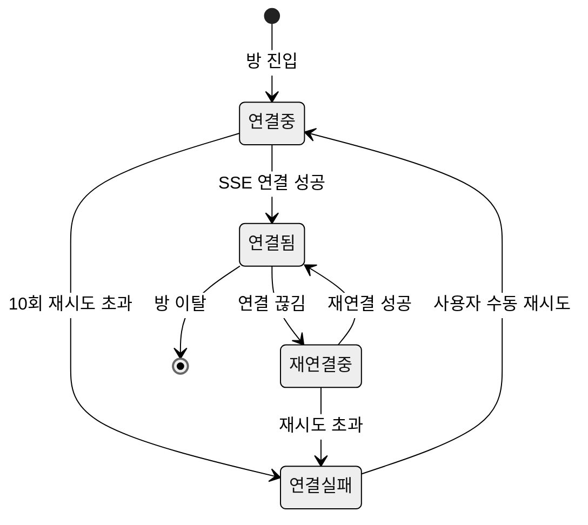
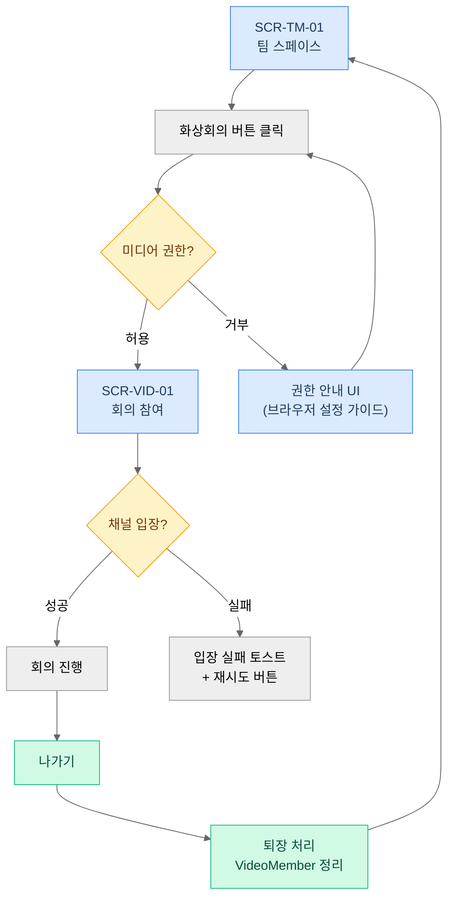

# 15. 커뮤니케이션 — 채팅 · 화상회의

> **설계 원칙 (이 문서 지배 원칙)**: "충분히 좋은" 경계 — 채팅과 화상회의는 신규 투자 최소, 미완 구간 수리·안정화까지만.
> Zoom·Slack과 품질 경쟁하지 않는다 (00 §5-5, 종합 스펙 §3.8 위험 가정 3).
> 알림 발송 자체는 [16-notifications.md](16-notifications.md) 소관. 이 문서는 이벤트 발생 지점만 명시한다.

---

## 1. 목적과 배경

### 1.1 범위

채팅(DM·그룹)과 화상회의. 두 기능 모두 **기존 자산을 살린다**. 신규 기능보다 미완·결함 해소가 우선이다.

### 1.2 As-Is 현황

**채팅 BE** (`ChatRoomController`, `ChatRoomServiceImpl`):

- [재활용] 완성: 방 목록·생성·제목 변경·삭제·메시지 전송·조회(페이징)·멤버 추가·조회
- [변경] **미완 3종**:
  - `getChatRoomDetails()` — null 반환 (`ChatRoomServiceImpl.java:196-199`)
  - `enableChatRoomNotification()` / `disableChatRoomNotification()` — 빈 메서드 (`ChatRoomServiceImpl.java:205-213`)
  - 채팅 검색 — TODO 주석만 (`ChatMessageService.java:63`)

**채팅 FE** (`sseService.ts` 718줄, `ChatContext.tsx`):

- [재활용] SSE 기반: 등록→구독 2단계, 하트비트 8 s, 재연결 10회 지수 백오프, 메시지 배치 처리
- [변경] **핸들러 미구현**: `CHAT_MEMBER_JOINED` / `CHAT_MEMBER_LEFT` TODO (`ChatContext.tsx:454, 459`)
- [변경] **에러 UX**: 전송 실패 시 `alert()` — 폐기 대상 (00 §5-7)

**화상회의** (`VideoConferenceController`, `VideoConferencePage.tsx`):

- [재활용] 완성: LiveKit 자체 호스팅, 채널 CRUD·참여·퇴장·토큰 발급·Webhook, `@PreAuthorize` 적용
- [변경] **보안 결함**: `auth_token`을 WebSocket URL 쿼리 파라미터로 전달 (`VideoConferencePage.tsx:167`)
- [신규] 권한 거부 시 안내 UI 없음 (현재 무반응)

**기존 Epic 4 미구현 잔재 (컷)**:

- 채팅 스레드(댓글), 메시지 반응 이모지 — 현 구현에 없고, 부트캠프 규모에서 과잉 (⚠️ 15-D1)

---

## 2. 액터와 권한

| 액터 | 채팅 권한 | 화상회의 권한 |
|---|---|---|
| 워크스페이스 멤버 | 소속 채팅방 읽기·쓰기, DM 생성 | 채널 참여·생성, 토큰 발급 |
| 팀원 | 팀 채팅방 읽기·쓰기 | 팀 채널 참여 |
| 팀장 | 팀 채팅방 관리(제목·멤버 추가·방 설정) | 동일 |
| 워크스페이스 매니저·개설자 | 집계 정보만 열람 가능(15-D2 확정) — 메시지 내용 접근 없음 | 채널 삭제 권한 |

> 권한 판정은 서버 `@PreAuthorize`가 단일 소스다. 클라이언트 분기는 UX 편의이며 보안 경계가 아님 (00 §3.2 규칙 5).

---

## 3. 유저 스토리

| ID | 스토리 | 수용 기준 |
|---|---|---|
| US-15-01 | 수강생으로서, 팀원에게 DM을 보내 빠르게 소통하고 싶다 | 카드 상세(SCR-PRF-01)에서 "DM 시작" 버튼 → 기존 DM 방이 있으면 해당 방으로, 없으면 신규 생성 후 진입 |
| US-15-02 | 팀원으로서, 팀 채팅방에서 멤버가 들어오고 나가는 것을 실시간으로 알고 싶다 | CHAT_MEMBER_JOINED/LEFT 이벤트 수신 시 멤버 목록 갱신 + 인라인 안내문 노출 |
| US-15-03 | 팀원으로서, 메시지 전송이 실패했을 때 재전송을 시도하고 싶다 | 전송 실패 시 해당 메시지 옆에 재전송 버튼 노출, alert() 없음 |
| US-15-04 | 팀원으로서, 채팅방별로 알림을 켜고 끌 수 있어야 한다 | 방별 알림 ON/OFF 설정이 저장되고, 알림 16 문서의 필터링 로직에 반영됨 |
| US-15-05 | 팀원으로서, 채팅에서 키워드로 메시지를 검색하고 싶다 | 방 내 검색창 → 결과 목록 → 해당 메시지 위치로 이동 |
| US-15-06 | 팀원으로서, 팀 화상회의에 원클릭으로 참여하고 싶다 | 팀 스페이스(SCR-TM-01) 상단 "회의 참여" 버튼 → SCR-VID-01 진입 |
| US-15-07 | 팀원으로서, 카메라/마이크 권한을 거부한 경우 무엇을 해야 하는지 알고 싶다 | 권한 거부 감지 시 안내 UI(브라우저 권한 재허용 방법) 표시 |

---

## 4. 화면 구성

### 4.1 채팅 — SCR-CHAT-01

**현황**: [유지] `ChatPage` (SSE). URL `GET /ws/:wsId/chat/:chatId`.

```
┌──────────────────────────────────────────────────────┐
│ 채팅방 이름          [🔍 검색]  [⚙️ 방 설정]           │ h-14
├──────────────┬───────────────────────────────────────┤
│ 채팅방 목록   │  메시지 영역                            │
│ (Context Nav │                                       │
│  커뮤니케이션  │  ┌─────────────────────────────────┐  │
│  섹션)        │  │  2026-07-04                     │  │
│              │  │  [아바타] 홍길동  12:30            │  │
│  ● 팀채팅방   │  │  메시지 내용                      │  │
│  ● DM - 김씨  │  │                   [전송 실패] 🔄 │  │
│  + 새 채팅방  │  └─────────────────────────────────┘  │
│              │                                       │
│              ├───────────────────────────────────────┤
│              │  [입력창 ────────────────────] [전송]   │
└──────────────┴───────────────────────────────────────┘
```

**방 설정 패널** (⚙️ 클릭 시 오른쪽 드로어):

- 멤버 목록 (현재 참여 인원, 역할 표시)
- 멤버 추가 (팀원 검색)
- 방별 알림 ON/OFF 토글
- 방 제목 변경 (팀장·방 생성자)
- 방 나가기·삭제

> As-Is `getChatRoomDetails()` null 반환 수리가 이 패널의 전제 조건이다. [변경]

**읽지 않은 메시지 배지**:

- Context Nav 채팅방 항목에 미읽음 카운트 배지 표시
- 해당 방 진입 시 일괄 읽음 처리 → 알림 16 문서의 배지 카운트와 정합
- 읽음 기준: 방에 진입하거나 메시지가 뷰포트에 노출된 시점 (서버 읽음 API 호출)

**DM 시작 진입점**:

- SCR-PRF-01 카드 상세 하단 "DM 시작" 버튼 [신규]
- 팀 개요(SCR-TM-01) 멤버 아바타 클릭 → 컨텍스트 메뉴에 "DM 보내기" [신규]

### 4.2 채팅 검색 UX [변경]

- 트리거: 방 상단 🔍 아이콘 클릭
- 검색 범위: **현재 방** 내 메시지만 (워크스페이스 전체 검색은 과잉 — 부트캠프 규모에서 방 내 검색으로 충분)
- 검색 방식: 키워드 포함 메시지 목록 표시 → 항목 클릭 시 해당 메시지 위치로 스크롤
- 구현 대상: `ChatMessageService.java:63` TODO 완성 (페이징 지원, `LIKE %keyword%`)

### 4.3 화상회의 — SCR-VID-01

**현황**: [유지] `VideoConferencePage` (LiveKit + STOMP). URL `GET /ws/:wsId/video/:channelId`.

```
┌──────────────────────────────────────────────────────┐
│ 화상회의: 팀 채널명    [참여자 N명]      [나가기 ✕]     │
├──────────────────────┬───────────────────────────────┤
│                      │  사이드 채팅                   │
│  원격 비디오 트랙      │  (STOMP /sub/chat/{roomId})   │
│                      │                               │
│  ┌──────────────┐    │  [메시지 영역]                 │
│  │  로컬 미리보기 │    │                               │
│  └──────────────┘    │  [입력창]          [전송]      │
├──────────────────────┴───────────────────────────────┤
│  [🎤 마이크] [📷 카메라] [🖥️ 화면공유(선택)] [참여자 목록]│
└──────────────────────────────────────────────────────┘
```

**원클릭 진입 (01 §5 F4)**:

- 팀 스페이스(SCR-TM-01) 상단 탭에 "화상회의" 버튼 [변경]
- 워크스페이스 홈(SCR-WS-01) Context Nav 커뮤니케이션 섹션 → 채널 목록 → 클릭

---

## 5. 인터랙션 · 상태 · 엣지 케이스

### 5.1 채팅 상태 흐름



**전송 실패 처리 [변경]**:

- `alert()` 전면 폐기 (00 §5-7)
- 실패 메시지에 회색 처리 + "전송 실패 · 재전송" 인라인 버튼
- 재전송 시 동일 메시지 재발송, 성공 시 정상 메시지로 교체

**멤버 입/퇴장 실시간 반영 [변경]**:

- `CHAT_MEMBER_JOINED` → 멤버 목록에 추가 + 채팅창에 "[홍길동]이 참여했습니다" 안내문
- `CHAT_MEMBER_LEFT` → 멤버 목록에서 제거 + "[홍길동]이 나갔습니다" 안내문
- (`ChatContext.tsx:454, 459` TODO 구현)

**빈 상태**:

- 채팅방이 없을 때: "아직 채팅방이 없습니다 — 팀 채팅방을 만들어보세요" + 생성 버튼
- 메시지가 없을 때: "첫 메시지를 보내보세요" 일러스트

### 5.2 팀 확정 시 채팅방 자동 생성 (⚠️ 15-D3)

팀 빌딩 세션 RESOLVED 전환 시(01 §4.1, 12 문서) 팀 채팅방을 자동 생성한다.

- **추천**: 자동 생성 (팀 스페이스에 칸반·게시판이 자동 생성되는 것과 동일 원칙 — 00 §5-2 "결성→협업 무단절")
- 채팅방 이름: `[팀 이름] 채팅방` (팀장이 이후 변경 가능)
- 팀원 전원이 멤버로 자동 추가

### 5.3 강사 열람권 (결정: 집계 정보만)

2026-07-04 통합 안건 A/15-D2 결정으로, 강사(개설자·매니저)는 채팅방의 집계 정보만 볼 수 있고 메시지 내용에는 접근하지 않는다. 아래 표는 채택안과 폐기된 대안의 영향 기록이다.

| 시나리오 | 화면 변경 사항 |
|---|---|
| (a) 집계 정보만 (추천안) | 강사 대시보드(SCR-DSH-01)에 채팅방 목록과 멤버 수만 표시. 메시지 내용 접근 없음. SCR-CHAT-01 변경 없음 |
| (b) 게시판까지 열람 | 해당 없음 (채팅과 무관) |
| (c) 채팅 전체 열람 + 고지 | SCR-CHAT-01에 "강사가 열람 가능한 채팅방" 배너 노출 필수. Context Nav에 강사용 채팅방 목록 섹션 추가. 반드시 수강생에게 사전 고지 필요 |

시나리오 (c) 선택 시 16 알림 문서와 17 정책 문서에도 영향이 있다.

### 5.4 화상회의 상태 흐름



**퇴장 처리 [변경]**:

- "나가기" 버튼 클릭 → LiveKit Room disconnect + STOMP 구독 해제 + `VideoMember` DB 정리 API 호출
- 현재 As-Is에서 퇴장 시 `VideoMember` 레코드가 남는지 검증 필요

**동시 접속 한계** (⚠️ 15-D4): 종합 스펙 Q5 — LiveKit 온프레미스의 동시 회의 한계 미측정. 파일럿 기수 전 부하 테스트 검증 항목.

---

## 6. 데이터 · API 요구사항

### 6.1 채팅 [변경·완성]

> 경로 표기 주의: As-Is 실경로는 `POST/GET /api/workspaces/{workspaceId}/chat-rooms/**` (워크스페이스 중첩). 아래 표는 리소스 축약 표기이며, 실제 경로 체계 유지·개편 여부는 구현 시 As-Is 중첩 구조 유지를 기본으로 한다.

| 엔드포인트 | 태그 | 설명 |
|---|---|---|
| `GET /api/chat-rooms/{id}` | [변경] | `getChatRoomDetails()` null 반환 수리 — 멤버 목록 + 방 설정 응답 |
| `POST /api/chat-rooms/{id}/mute` / `DELETE .../mute` | [변경] | As-Is 빈 메서드 `enable/disableChatRoomNotification()`을 이 API로 구현. 저장 모델·엔드포인트 정본은 [16](16-notifications.md) §7의 `ChatRoomMuteStatus` — 이 문서는 UI 트리거(방 설정 패널 토글)만 정의 |
| `GET /api/chat-rooms/{id}/messages/search` | [신규] | 키워드 검색, `?keyword=&page=&size=`. `ChatMessageService.java:63` TODO 완성 |
| `POST /api/chat-rooms/{id}/read` | [신규] | 읽음 처리. 16 문서의 배지 카운트 차감 이벤트 발행 |
| `POST /api/chat-rooms` (DM 자동 생성) | [재활용] | DM 방 기존 존재 여부 확인 후 선택적 생성 — 클라이언트가 사전 확인 쿼리 추가 |

**SSE 이벤트 (채팅, 발행 지점)**:

| 이벤트 | 발행 지점 | 16 연동 |
|---|---|---|
| `CHAT_MESSAGE_RECEIVED` | 메시지 저장 후 | 멘션 포함 시 16 알림 발행 |
| `CHAT_MEMBER_JOINED` | 멤버 추가 API 성공 후 | 해당 방 멤버에게 발행 |
| `CHAT_MEMBER_LEFT` | 멤버 나가기 처리 후 | 해당 방 멤버에게 발행 |

### 6.2 화상회의 [변경·동결]

> 경로 표기 주의: As-Is 실경로는 `/api/workspaces/{workspaceId}/video-channels/**` (`VideoConferenceController`). 아래 표는 축약 표기.

| 엔드포인트 | 태그 | 설명 |
|---|---|---|
| `POST /api/video/token` | [변경] | `auth_token` 쿼리 파라미터 방식 폐기 → **토큰을 POST body로 전달하거나 BE가 LiveKit 토큰 발급 후 응답 body로 반환** |
| `POST /api/video/channels/{id}/join` | [재활용] | 참여 처리 (`@PreAuthorize` 유지) |
| `POST /api/video/channels/{id}/leave` | [재활용] | 퇴장 처리, `VideoMember` 정리 검증 |
| Webhook 수신 | [재활용] | LiveKit 이벤트 수신 유지 |

**토큰 전달 방식 수리 상세** (⚠️ 15-D5):

- 현재: `ws://…?token=<jwt>` — URL 로그·브라우저 히스토리에 토큰 노출
- 권고: BE `GET /api/video/channels/{id}/livekit-token` 에서 LiveKit 액세스 토큰(단기 유효)을 발급·반환 → FE는 이 토큰으로 LiveKit SDK에 직접 연결
- STOMP URL의 `auth_token` 파라미터 (`VideoConferencePage.tsx:167`)도 동일하게 정리 필요

---

## 7. 성공 지표

| 지표 | 측정 방법 | 목표 |
|---|---|---|
| 채팅 미완 3종 수리 완료율 | 수용 기준 테스트 통과(상세조회·알림 ON/OFF·검색 동작) | M1.4 완료 시 100% |
| 메시지 전송 오류 후 재전송 성공률 | FE 에러 로그 → 재전송 시도 대비 성공 비율 | 90% 이상 |
| 화상회의 입장 성공률 | 권한 거부·연결 실패 화면 노출 건수 / 전체 입장 시도 | 에러 시 안내 UI 노출 100% |

---

## 8. ⚠️ 논의 필요 항목

> ✅ **2026-07-04 일괄 결정**: 아래 항목 중 **D4를 제외한 전 항목**이 추천안대로 확정됨. 결정 기록: [90-open-questions.md](90-open-questions.md). (D1=스레드 컷·반응 이모지 M3 선택, D2=집계만, D3=자동 생성, D5=M1 조기 수리, D6=로컬 볼륨 유지)
> **15-D4(LiveKit 부하 테스트)는 검증 과제로 존속** — M1 완료 후, 파일럿 전 수행.

| ID | 질문 | 선택지와 추천안 | 영향 | 마일스톤 |
|---|---|---|---|---|
| 15-D1 | 채팅 스레드·메시지 반응 이모지 채택 여부 | (a) 반응 이모지만 M3 선택 채택 (추천 — 가볍고 참여감 향상) (b) 스레드도 구현 (c) 둘 다 컷 (추천 기본: 컷 — 부트캠프 규모 과잉) | BE 신규 엔티티, FE UI | M3 선택 |
| 15-D2 | 강사(매니저·개설자)의 채팅 열람권 | ✅ 결정: 집계 정보만. 메시지 내용 접근 없음 | §5.3 화면 분기, 17 정책 | 확정 |
| 15-D3 | 팀 확정 시 팀 채팅방 자동 생성 여부 | (a) 자동 생성 (추천 — 결성→협업 무단절, 00 §5-2) (b) 수동 생성만 | 12 팀 빌딩 RESOLVED 처리, BE 채팅방 생성 API 호출 | M2 |
| 15-D4 | LiveKit 온프레미스 동시 접속 한계 부하 테스트 | 파일럿 기수 전 k6 등으로 동시 룸 한계치 측정 (종합 스펙 Q5) | 화상회의 안정성 보장 기준 | M1 완료 후 |
| 15-D5 | 화상회의 토큰 전달 방식 수리 시점 | (a) M1.4와 함께 처리 (추천 — 보안 결함이므로 조기 수리) (b) M2 이후 | 보안, BE VideoConferenceController | M1 |
| 15-D6 | 파일 첨부 (채팅 내) 지원 여부 | 현재 로컬 볼륨 업로드 (S3 미구현). (a) 로컬 볼륨 그대로 유지 (추천 — '충분히 좋은' 원칙) (b) S3 연동 (M3 이후) (c) 채팅 내 첨부 비활성화 | 종합 스펙 §2.2 파일 저장 항목 | 결정 후 17 문서 반영 |
