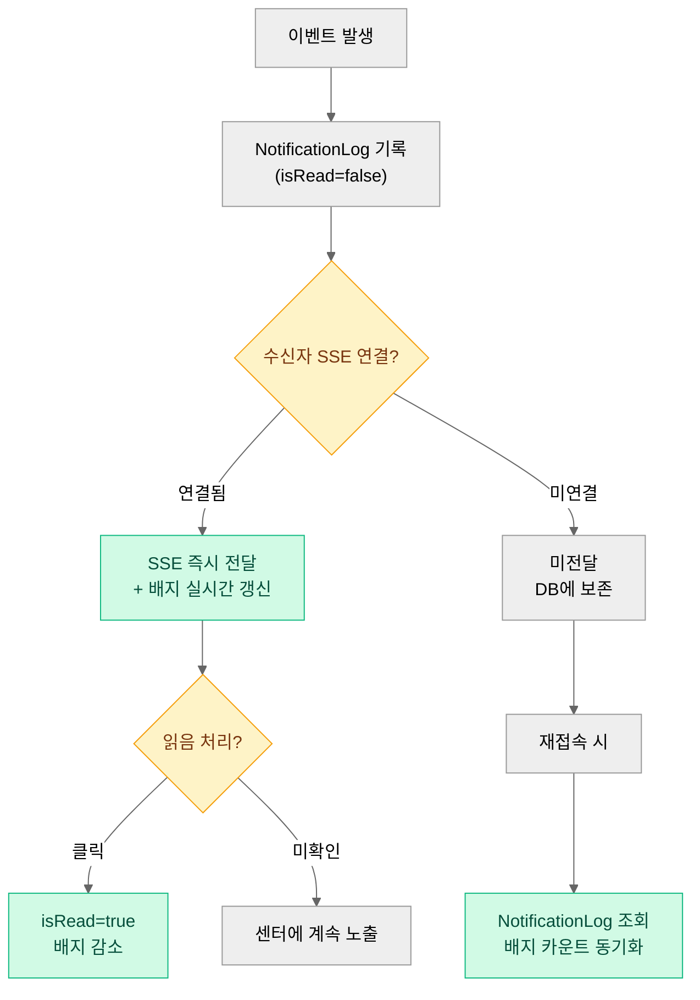
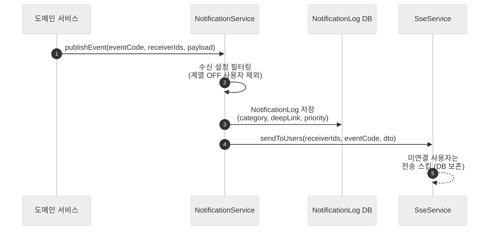

# 16. 알림 — 이벤트 카탈로그 · 알림 센터 · 수신 설정 · 전달 채널

> 이 문서는 Pick Team MVP 2.0에서 **어떤 이벤트가 알림을 만들고, 어떻게 전달되며, 사용자가 어떻게 제어하는가**의 정본이다.
> 10~15번 문서는 각 기능의 "알림 발생 지점"만 언급하고, 이벤트 수신자·딥링크·채널·우선순위의 정의는 이 문서가 최종 기준이다.
> 화면 ID·URL·딥링크 착지 규약은 [02](02-information-architecture.md) §5와 반드시 일치해야 한다.

---

## 1. 목적과 배경

### 1.1 As-Is 상태 (근거 인용)

**프론트엔드**: `NotificationsPage.tsx` 전체가 하드코딩 목업이다. 실데이터 API 호출이 없고, "카카오톡으로 알림 받기" 토글은 `alert("목업 기능")`을 호출한다. 알림 목록 4건은 생성 시각이 `Date.now() - N`으로 고정된 더미다.

**백엔드**: SSE 인프라는 완성 상태다(`SseController`, `SseService`, `SseSessionRepository`). `NotificationLog` 엔티티도 존재한다(`content`, `isRead`, `account` FK — `BaseSoftDeleteSupportEntity` 상속). 기존 SSE 이벤트 타입 4종(`SseEventType`: `NEW_CHAT_MESSAGE`, `CHAT_MESSAGE_DELETED`, `CHAT_MEMBER_JOINED`, `CHAT_MEMBER_LEFT`)은 채팅에만 연결된 상태이며, 알림 센터와는 미연결이다.

**결론**: 인프라는 준비됐으나 연결이 끊긴 상태. 종합 스펙 §3.3에서 "협업 툴에서 알림 부재는 리텐션 직결 결함"으로 평가됨. M1.3이 이 연결 작업의 타이밍이다(종합 스펙 §6 M1.3).

### 1.2 Notion 「기술력 체크」 결론 계승

- 카카오톡 알림: 기업회원 전용 API — **채택 불가**, 목업 UI 전면 제거 대상
- FCM vs SSE: 채팅·인앱 알림은 SSE 채택(이미 인프라 존재). 브라우저 종료 시 푸시는 FCM 웹푸시가 유력 후보 — **M3 선택 과제** (⚠️ 16-D1)
- 인앱 알림 센터: SSE 실연결 + `NotificationLog` 기반 회수가 M1.3의 범위

---

## 2. 액터와 권한

| 액터 | 알림 수신 | 알림 설정 | 비고 |
|---|---|---|---|
| 멤버 (MEMBER) | 자신에게 해당하는 이벤트 전량 | 계열별 ON/OFF, 채팅방 음소거 | 기본값 전부 ON |
| 팀장 (LEADER) | 멤버 권한 + 완료 승인 요청 | 동일 | |
| 매니저·개설자 (ADMIN/OWNER) | 팀장 권한 + 세션 상태·미배정 경고 | 동일 | |
| 시스템 관리자 (UserRole.ADMIN) | 신고 접수 등 시스템 알림 | 동일 | M3 신고 기능과 연동 |

**알림 설정 변경 권한**: 본인 계정에 한함. 타인의 수신 설정 열람·수정 불가.

---

## 3. 유저 스토리

| ID | 스토리 | 수용 기준 |
|---|---|---|
| US-16-01 | 멤버로서, 내가 오프라인인 동안 발생한 알림을 재접속 후 알림 센터에서 확인하고 싶다 | 미접속 기간 `NotificationLog` 기록이 재접속 시 알림 센터에 표시되고 배지가 동기화됨 |
| US-16-02 | 팀장으로서, 태스크 완료 요청이 들어오면 즉시 알림을 받고 싶다 | 완료 요청 시 SSE 즉시 전달, 오프라인이면 `NotificationLog` 기록 후 재접속 시 배지 표시 |
| US-16-03 | 수강생으로서, 지원·스카우트 결과를 알림으로 받고 싶다 | 수락/거절 이벤트 발생 시 수신자에게 알림 전달, 딥링크로 제안함(SCR-TB-03) 진입 가능 |
| US-16-04 | 멤버로서, 채팅 알림이 너무 많은 채팅방은 음소거하고 싶다 | 방별 음소거 설정 후 해당 방 메시지 알림 미수신 (채팅방 배지는 별도 제어 — §5 참조) |
| US-16-05 | 멤버로서, 팀 빌딩·칸반처럼 계열이 다른 알림을 구분해서 끌 수 있고 싶다 | 수신 설정에서 계열 단위 ON/OFF 후 해당 계열 이벤트 미수신 |
| US-16-06 | 수강생으로서, 알림을 눌렀을 때 관련 화면으로 바로 이동하고 싶다 | 모든 알림 항목에 딥링크가 있고, 클릭 시 02 §5 착지 화면 진입 |

---

## 4. 화면 구성

### 4.1 전역 헤더 — 알림 벨 드롭다운

```
[🔔 N]  ← 전역 벨 배지: 워크스페이스 전체 미확인 수
  │
  └─ 드롭다운 (클릭 시 오픈)
      ┌─────────────────────────────────────┐
      │ 최근 알림 (최대 5개, 최신순)            │
      │ ─────────────────────────────────── │
      │ [●] 김팀원이 지원을 수락했습니다   2분 전  │
      │ [●] 칸반 태스크 완료 승인 요청      1시간  │
      │     새 공지: "주간 회의..."        어제   │  ← 읽음 항목 dim
      │ ─────────────────────────────────── │
      │         [모두 보기 →]               │  → SCR-NOTI-01
      └─────────────────────────────────────┘
```

- 드롭다운 항목 클릭 → 읽음 처리 + 딥링크 이동
- "모두 보기" → SCR-NOTI-01 (알림 센터 전체 목록)
- 벨 배지: 전역 미확인 알림 수. 0이면 배지 숨김

### 4.2 SCR-NOTI-01 — 알림 센터 [개편]

```
알림 센터
─────────────────────────────────────────────────────
[전체] [팀 빌딩] [칸반] [일정] [공지·게시판] [채팅]   ← 계열 필터 탭
                                         [모두 읽음]
─────────────────────────────────────────────────────
오늘
  [●] 새 지원: 김팀원이 FE 개발자 팀에 지원했습니다      14:23
      → 제안함 바로가기
  [●] 태스크 완료 승인 요청: "API 설계" (김팀원)        13:05
      → 칸반 바로가기

어제
      새 공지가 등록됐습니다: "주간 회의 일정 안내"      16:30
      → 공지 바로가기
─────────────────────────────────────────────────────
          [더 보기 (페이지네이션)]
─────────────────────────────────────────────────────
빈 상태: "알림이 없습니다. 활동이 생기면 여기에 표시됩니다."
```

- URL: `/notifications` (전역, 워크스페이스 스코프 외)
- [재활용] `NotificationLog` 엔티티 기반 목록 조회
- 계열 필터 탭: 계열 단위 조회 파라미터로 구현 (`?category=TEAM_BUILDING` 등)
- 읽음 처리: 항목 클릭 시 개별 읽음, "모두 읽음" 버튼으로 전체 처리
- 삭제: 항목별 삭제 지원 (`NotificationLog` 소프트 삭제 활용) — [재활용]
- 페이지네이션: 20건 단위 (무한 스크롤 또는 "더 보기" 버튼)

### 4.3 수신 설정 (SCR-MY-03 계정 설정 내 탭)

```
알림 수신 설정
─────────────────────────────────────────────────────
인앱 알림 (SSE)        [전체 ON/OFF 마스터 스위치]
─────────────────────────────────────────────────────
계열별 설정
  팀 빌딩               ● ON  ○ OFF
  칸반                  ● ON  ○ OFF
  일정·리마인더          ● ON  ○ OFF
  공지·게시판            ● ON  ○ OFF
  채팅 (멘션·DM)         ● ON  ○ OFF
  멤버십·관리            ● ON  ○ OFF   (매니저·개설자만 표시 ⚠️ 16-D2)
─────────────────────────────────────────────────────
채팅방별 음소거
  [방 이름]   음소거 해제  ← 음소거된 방 목록 (15 문서 연동)
─────────────────────────────────────────────────────
웹푸시 (브라우저 알림)    [M3 선택 — 채택 시 활성화] (⚠️ 16-D1)
─────────────────────────────────────────────────────
```

---

## 5. 이벤트 카탈로그 (정본)

각 기능 문서(10~15)는 발생 지점만 언급하며, 수신자 규칙·딥링크·채널·우선순위는 이 표가 기준이다.

### 5.1 팀 빌딩 계열 [신규]

| 이벤트 코드 | 발생 조건 | 수신자 | 딥링크 착지 | 기본 채널 | 우선순위 |
|---|---|---|---|---|---|
| `TB_APPLICATION_RECEIVED` | 수강생이 내 팀에 지원 | 팀장 (LEADER) | SCR-TB-03 (받은 지원 포커스) | 인앱 | 높음 |
| `TB_SCOUT_RECEIVED` | 팀이 나에게 스카우트 제안 | 수신 대상 멤버 | SCR-TB-03 (받은 스카우트 포커스) | 인앱 | 높음 |
| `TB_APPLICATION_ACCEPTED` | 내 지원이 수락됨 | 지원자 | SCR-TB-03 | 인앱 | 높음 |
| `TB_APPLICATION_REJECTED` | 내 지원이 거절됨 | 지원자 | SCR-TB-03 | 인앱 | 보통 |
| `TB_SCOUT_ACCEPTED` | 내 스카우트 제안이 수락됨 | 스카우트 발신 팀장 | SCR-TB-03 | 인앱 | 높음 |
| `TB_SCOUT_REJECTED` | 내 스카우트 제안이 거절됨 | 스카우트 발신 팀장 | SCR-TB-03 | 인앱 | 보통 |
| `TB_SESSION_OPENED` | 팀 빌딩 세션 OPEN | 워크스페이스 전 멤버 | SCR-TB-01 | 인앱 | 높음 |
| `TB_SESSION_CLOSING_SOON` | 세션 마감 24시간 전 (⚠️ 16-D3) | 미배정 멤버 | SCR-TB-01 | 인앱 | 높음 |
| `TB_SESSION_RESOLVED` | 팀 확정·결과 발표 | 워크스페이스 전 멤버 | SCR-TM-01 (소속 팀) | 인앱 | 높음 |
| `TB_UNASSIGNED_WARNING` | 마감 임박 미배정 상태 | 미배정 멤버 | SCR-TB-01 | 인앱 | 높음 |

### 5.2 칸반 계열 [변경 — 기존 미연결 상태에서 연결]

| 이벤트 코드 | 발생 조건 | 수신자 | 딥링크 착지 | 기본 채널 | 우선순위 |
|---|---|---|---|---|---|
| `KANBAN_TASK_ASSIGNED` | 태스크가 나에게 배정됨 | 배정 대상자 | SCR-TM-02 (해당 태스크) | 인앱 | 보통 |
| `KANBAN_TASK_COMPLETION_REQUESTED` | 완료 요청 발생 | 팀장 (LEADER) | SCR-TM-02 (해당 태스크) | 인앱 | 높음 |
| `KANBAN_TASK_COMPLETION_APPROVED` | 완료 승인 완료 | 요청자 | SCR-TM-02 | 인앱 | 보통 |
| `KANBAN_TASK_COMPLETION_REJECTED` | 완료 승인 거절 | 요청자 | SCR-TM-02 | 인앱 | 보통 |

### 5.3 일정·리마인더 계열 [변경 — Epic 5 계승]

| 이벤트 코드 | 발생 조건 | 수신자 | 딥링크 착지 | 기본 채널 | 우선순위 |
|---|---|---|---|---|---|
| `SCHEDULE_REMINDER` | 일정 시작 N분 전 (⚠️ 16-D4) | 일정 참여자 | SCR-TM-03 (해당 일정) | 인앱 | 높음 |
| `SCHEDULE_CREATED` | 팀 일정 신규 등록 | 팀 전 멤버 | SCR-TM-03 | 인앱 | 보통 |
| `SCHEDULE_UPDATED` | 팀 일정 수정 | 팀 전 멤버 | SCR-TM-03 | 인앱 | 낮음 |

### 5.4 공지·게시판 계열 [변경 — 기존 미연결]

| 이벤트 코드 | 발생 조건 | 수신자 | 딥링크 착지 | 기본 채널 | 우선순위 |
|---|---|---|---|---|---|
| `ANNOUNCEMENT_CREATED` | 공지 등록 | 공지 대상(워크스페이스 또는 팀 전원) | SCR-TM-05 또는 SCR-WS-01 (해당 공지) | 인앱 | 높음 |
| `POST_COMMENT_ADDED` | 내 게시글에 댓글 등록 | 원글 작성자 | SCR-TM-04 (해당 글) | 인앱 | 보통 |
| `POST_MENTION` | 게시글·댓글에서 멘션 | 멘션 대상자 | SCR-TM-04 (해당 글) | 인앱 | 높음 |

### 5.5 채팅 계열 [재활용 + 변경]

| 이벤트 코드 | 발생 조건 | 수신자 | 딥링크 착지 | 기본 채널 | 우선순위 |
|---|---|---|---|---|---|
| `NEW_CHAT_MESSAGE` | 새 채팅 메시지 | 채팅방 멤버 (음소거 제외) | SCR-CHAT-01 (해당 방) | 인앱 | 보통 |
| `CHAT_MENTION` | 채팅에서 `@멘션` | 멘션 대상자 (음소거 무시) | SCR-CHAT-01 (해당 방·메시지) | 인앱 | 높음 |
| `CHAT_MEMBER_JOINED` | 채팅방 멤버 합류 | 채팅방 기존 멤버 | SCR-CHAT-01 | 인앱 | 낮음 |
| `CHAT_MEMBER_LEFT` | 채팅방 멤버 퇴장 | 채팅방 기존 멤버 | SCR-CHAT-01 | 인앱 | 낮음 |
| `CHAT_MESSAGE_DELETED` | 메시지 삭제 | 채팅방 멤버 | SCR-CHAT-01 | 인앱 | 낮음 |

> `NEW_CHAT_MESSAGE`, `CHAT_MEMBER_JOINED`, `CHAT_MEMBER_LEFT`, `CHAT_MESSAGE_DELETED`는 기존 `SseEventType` 4종 [재활용]. `CHAT_MENTION`은 [신규] 추가.

### 5.6 멤버십·관리 계열 [변경 + 신규]

| 이벤트 코드 | 발생 조건 | 수신자 | 딥링크 착지 | 기본 채널 | 우선순위 |
|---|---|---|---|---|---|
| `WS_MEMBER_JOINED` | 새 멤버 워크스페이스 합류 | 매니저·개설자 | SCR-DSH-01 | 인앱 | 낮음 |
| `WS_MEMBER_BANNED` | 멤버 차단 처리 | 차단 대상자 | SCR-WS-04 (무소속 랜딩) | 인앱 | 높음 |
| `TEAM_LEADER_DELEGATED` | 팀장 위임 발생 | 신규 팀장 | SCR-TM-01 | 인앱 | 높음 |
| `TEAM_LEADER_DELEGATION_REQUESTED` | 팀장 위임 요청 | 위임 대상 멤버 | SCR-TM-01 | 인앱 | 높음 |

---

## 6. 인터랙션·상태·엣지 케이스

### 6.1 전달 보장 수준



- SSE는 **접속 중에만** 실시간 전달. 미접속 기간 이벤트는 `NotificationLog`에 보존되며, 재접속 시 알림 센터 배지가 동기화된다.
- `NotificationLog`가 단일 회수 지점(01 §7 F6-g 정의와 일치).
- 웹푸시(FCM)는 M3 선택 과제 — 브라우저 종료 시 푸시가 필요한지 파일럿 피드백 후 결정 (⚠️ 16-D1).

### 6.2 배지 규칙 정본

| 배지 위치 | 카운팅 대상 | 리셋 조건 |
|---|---|---|
| 전역 벨 (Global Header) | `NotificationLog.isRead = false` 전체 수 | 개별 읽음 처리 또는 "모두 읽음" |
| WS 레일 워크스페이스별 배지 | 해당 워크스페이스 스코프 미확인 알림 수 | 해당 워크스페이스 진입 후 해소 (⚠️ 16-D5) |
| Context Nav 채팅 항목 배지 | 음소거되지 않은 채팅방의 미확인 메시지 수 | 해당 채팅방 진입 |
| 채팅방별 배지 | 내가 마지막으로 읽은 이후 수신된 메시지 수 | 해당 채팅방 포커스 시 (15 문서 정합) |
| Context Nav 팀 빌딩 D-day 배지 | 세션 OPEN 중 미확인 지원·스카우트 수 | SCR-TB-03 진입 |

> 채팅방별 배지와 채팅 계열 알림 배지는 별도다. 채팅방 배지는 메시지 수 카운트(15 문서 범위), 알림 벨 배지는 `NotificationLog` 기반이다. 음소거된 방의 메시지는 `NotificationLog`에 기록되지 않으며, 채팅방 배지도 표시되지 않는다 (⚠️ 16-D6).

### 6.3 폭주 제어 (digest 처리)

- **채팅 메시지 묶음**: 같은 채팅방에서 1분 내 연속 메시지가 발생하면 `NotificationLog`는 1건으로 묶음 처리("N개의 새 메시지"). SSE 실시간 이벤트는 건별 전달하되, 알림 센터 표시는 집계.
- **팀 빌딩 지원 묶음**: 동일 세션 내 복수 지원이 단기간 집중될 경우 "N명이 지원했습니다"로 집계(⚠️ 16-D7).
- **알림 무감각화 방지 원칙**: 낮음 우선순위 이벤트(`CHAT_MEMBER_JOINED`, `SCHEDULE_UPDATED` 등)는 기본 채널에서만 기록하고, 드롭다운 프리뷰 5개 슬롯은 높음·보통 우선순위 이벤트가 우선 점유한다.

### 6.4 엣지 케이스

| 케이스 | 처리 |
|---|---|
| 다중 탭·기기 동기화 | SSE는 `accountId → Set<sessionId>` 구조로 다중 세션 지원 [재활용 `SseService`]. 한 탭에서 읽음 처리 시 DB 업데이트 → 다른 탭은 다음 API 호출 또는 SSE `NOTIFICATION_READ` 이벤트 수신으로 동기화 (⚠️ 16-D8) |
| 딥링크 대상 삭제됨 | 칸반 태스크, 게시글, 채팅방 등이 삭제된 상태에서 딥링크 진입 시: 해당 자원 404 응답 → FE에서 "삭제된 항목입니다" 토스트 + 해당 화면 상위(팀 개요 등)로 리다이렉트. `alert()` 사용 금지 |
| 차단 사용자의 알림 | 차단(BANNED) 처리된 사용자가 보낸 메시지·댓글·지원 등으로 생성된 기존 알림은 유지하되, 이후 발생 이벤트는 알림 생성 제외 |
| 탈퇴 사용자 관련 알림 | 계정 소프트 삭제 후 30일 유예 중 `NotificationLog`는 유지. 하드 삭제 시 함께 삭제. 탈퇴 사용자로부터의 이벤트는 발생 차단 |
| 수신 설정 OFF 계열 이벤트 | `NotificationLog` 기록도 생략 (사용자가 원하지 않은 데이터를 DB에 쌓지 않음). `CHAT_MENTION`·`WS_MEMBER_BANNED` 등 높음 우선순위 이벤트는 계열 OFF 설정에서도 기록 유지 (⚠️ 16-D9) |
| 세션 CLOSING 중 지원 이벤트 | 세션 CLOSING 단계에서는 신규 지원·스카우트 차단(12 문서). 관련 알림 이벤트도 생성되지 않음 |

---

## 7. 데이터·API 요구사항

### 7.1 엔티티

| 엔티티 | 상태 | 변경 내용 |
|---|---|---|
| `NotificationLog` | [변경] | `category`(계열 ENUM) 컬럼 추가, `deepLink`(String) 컬럼 추가, `priority`(ENUM: HIGH/MEDIUM/LOW) 컬럼 추가. 기존 `content`, `isRead`, `account` FK 유지 |
| `SseEventType` | [변경] | `CHAT_MENTION`, `KANBAN_*`, `TB_*`, `SCHEDULE_*`, `ANNOUNCEMENT_*`, `WS_*` 등 §5 카탈로그 코드 추가. 기존 4종 유지 |
| `NotificationSetting` | [신규] | `account`(FK), `category`(ENUM), `enabled`(Boolean). 계열별 ON/OFF 저장. 없으면 기본값 ON |
| `ChatRoomMuteStatus` | [신규] | `account`(FK), `chatRoom`(FK), `mutedUntil`(Timestamp — null이면 영구 음소거). 15 문서와 연동 |

### 7.2 API 엔드포인트

| 메서드 | 경로 | 설명 | 상태 |
|---|---|---|---|
| `GET` | `/api/notifications` | 알림 목록 (페이지네이션, 계열 필터 `?category=`, 읽음 여부 `?read=`) | [신규] |
| `PATCH` | `/api/notifications/{id}/read` | 개별 읽음 처리 | [신규] |
| `PATCH` | `/api/notifications/read-all` | 전체 읽음 처리 | [신규] |
| `DELETE` | `/api/notifications/{id}` | 알림 삭제 (소프트 삭제) | [신규] |
| `GET` | `/api/notifications/unread-count` | 미확인 배지 카운트 (재접속 시 동기화용) | [신규] |
| `GET` | `/api/notifications/settings` | 수신 설정 조회 | [신규] |
| `PUT` | `/api/notifications/settings` | 수신 설정 변경 (계열별 ON/OFF) | [신규] |
| `POST` | `/api/chat-rooms/{chatRoomId}/mute` | 채팅방 음소거 설정 | [신규] |
| `DELETE` | `/api/chat-rooms/{chatRoomId}/mute` | 채팅방 음소거 해제 | [신규] |
| `POST` | `/api/sse/register` | SSE 연결 준비 등록 | [재활용] |
| `GET` | `/api/sse/subscribe` | SSE 실시간 연결 | [재활용] |

### 7.3 알림 발행 흐름



- `NotificationService`는 [신규] 추가. 도메인 서비스(TeamBuildingService, KanbanService 등)에서 직접 SSE를 호출하지 않고, NotificationService를 통해 일관된 흐름 유지.

### 7.4 마일스톤 배분

| 범위 | 마일스톤 |
|---|---|
| `NotificationLog` 기반 알림 센터 실연결, 기존 채팅 SSE 이벤트 연결 | **M1.3** |
| 팀 빌딩 알림 이벤트 (`TB_*`), `NotificationService` 추가 | **M2.3** (팀 빌딩 세션과 함께) |
| 칸반·공지·일정 알림 이벤트 전체 | **M2** 각 에픽과 함께 |
| 웹푸시 FCM | **M3.6** (선택) |

---

## 8. 성공 지표

1. **알림 클릭률**: 발생한 알림 중 사용자가 클릭해 딥링크로 이동한 비율 ≥ 50%
   - 낮으면 알림이 너무 많거나(폭주 제어 재검토) 딥링크 착지가 잘못된 것
2. **미확인 배지 해소율**: 재접속 후 24시간 내 미확인 알림을 전부 읽음 처리한 사용자 비율
   - 알림 센터를 실제로 열어보는지의 리텐션 지표
3. **알림 설정 변경률**: 수신 설정을 1회 이상 수정한 사용자 비율 (목표: ≤ 20%)
   - 너무 높으면 기본값이 잘못 설계된 것 (기본 전부 ON 가정 검증)

---

## 9. ⚠️ 논의 필요 항목

> ✅ **2026-07-04 일괄 결정**: 아래 항목 중 **D1을 제외한 전 항목**이 추천안대로 확정됨. 결정 기록: [90-open-questions.md](90-open-questions.md). (D2=매니저·개설자만 표시, D3=24시간 전, D4=5분 전, D5=진입 시 즉시 리셋, D6=기록 안 함, D7=1시간 집계, D8=SSE NOTIFICATION_READ, D9=멘션·차단은 계열 OFF 무시)
> **16-D1(웹푸시 FCM)은 검증 과제로 존속** — 파일럿 피드백에서 오프라인 알림 수요 확인 후 M3에서 결정.

| ID | 질문 | 선택지·추천안 | 영향도 |
|---|---|---|---|
| 16-D1 | 웹푸시(FCM) 채택 기준 | (a) 파일럿 피드백에서 "오프라인 알림 필요" 요청이 명확할 때 채택(추천 — 무료 한도 확인 선행) (b) M2에서 선제 채택 (c) 채택 안 함 | 전달 채널 설계 전체 |
| 16-D2 | 멤버십·관리 계열 수신 설정을 일반 멤버에게도 노출할지 | (a) 매니저·개설자에게만 표시(추천 — 무관 설정 노출 방지) (b) 전체 표시 | 수신 설정 UI |
| 16-D3 | 세션 마감 임박 알림 기준 시간 | (a) 24시간 전(추천) (b) 12시간 전 (c) 6시간 전 | `TB_SESSION_CLOSING_SOON` 스케줄러 |
| 16-D4 | 일정 리마인더 타이밍 | (a) 5분 전(Epic 5 계승, 추천) (b) 10분 전 (c) 사용자 설정(복잡도 증가) | `SCHEDULE_REMINDER` 스케줄러 구현 |
| 16-D5 | WS 레일 워크스페이스별 배지 리셋 시점 | (a) 워크스페이스 진입 시 즉시 0(추천 — 직관적) (b) 해당 알림 각각 읽음 처리 시 (c) 서버 동기화 |  WS 레일 배지 로직 |
| 16-D6 | 음소거 채팅방: NotificationLog 기록 여부 | (a) 기록 안 함(추천 — 사용자 의도 존중, DB 부담 감소) (b) 기록하되 배지만 숨김(알림 센터에서 볼 수 있게) | 채팅·알림 연동 |
| 16-D7 | 팀 빌딩 지원 묶음 처리 기준 시간 | (a) 1시간 내 복수 지원을 1건으로 집계(추천) (b) 묶음 없이 건별 | `TB_APPLICATION_RECEIVED` 로직 |
| 16-D8 | 다중 탭 읽음 동기화 방식 | (a) SSE `NOTIFICATION_READ` 이벤트 발행(추천 — 실시간) (b) 탭 포커스 시 API 폴링 (c) 탭 간 미동기화 허용 | 다중 기기 UX |
| 16-D9 | 높음 우선순위 이벤트의 계열 설정 무시 여부 | (a) `CHAT_MENTION`·`WS_MEMBER_BANNED` 등은 계열 OFF 무시(추천 — 사용자 안전·참여 핵심 정보) (b) 계열 설정 완전 존중 | 수신 설정 적용 범위 |

---

## 변경 이력

| 날짜 | 내용 |
|---|---|
| 2026-07-04 | 최초 작성 |
