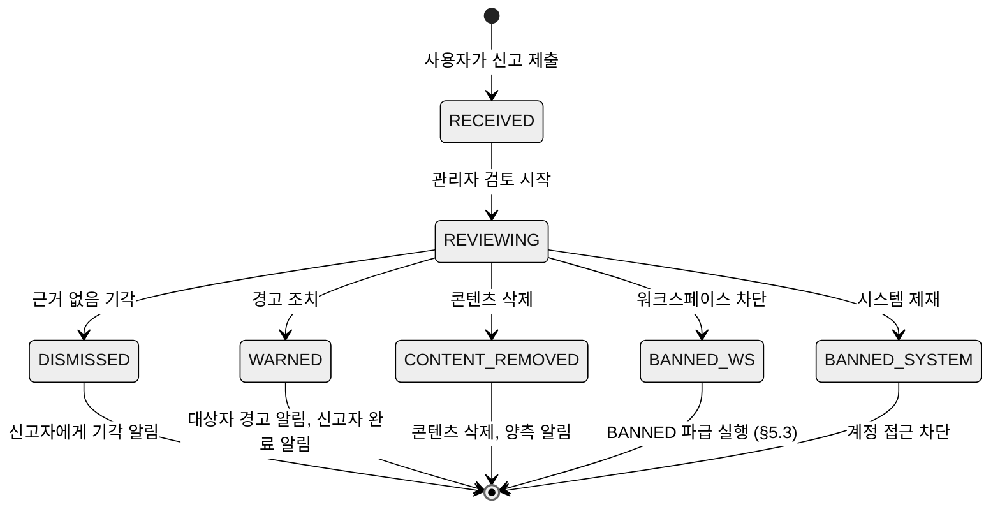
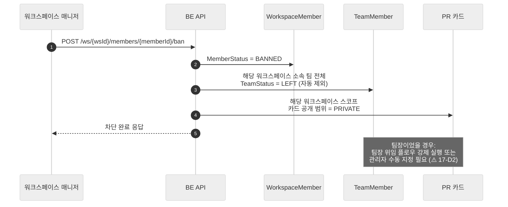
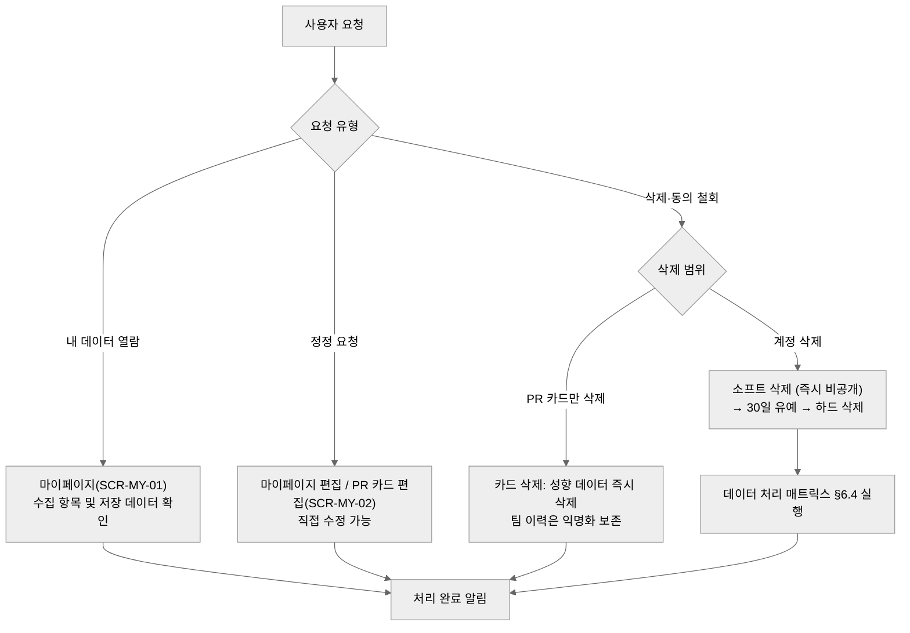

# 17. 정책·운영 — 신고·차단·제재 / 개인정보 / 보안 사고 대응 / 운영 요건

> **이 문서가 채우는 기획 공백**: 종합 스펙 §2.5는 "운영·비용·온보딩·법적 요건을 다룬 문서가 Notion 전체에 존재하지 않음"을 명시한다. 이 문서는 기존 어떤 Notion 기획 문서에도 없던 영역을 처음으로 정의하는 문서다. 기능 상세 문서(10~16)가 "무엇을 만드는가"를 다룬다면, 이 문서는 "어떻게 안전하게 운영하는가"를 다룬다.
>
> 상위 문서: [`../pick-team-renewal-spec.md`](../pick-team-renewal-spec.md) §3.4(`.env` 노출 오판 정정), §3.6(개인정보·MBTI 리스크)
> 연관 문서: [00 §3.2](00-overview.md)(BANNED 파급 규칙), [01 §7](01-e2e-flows.md)(F6-c 차단, F6-f 계정 삭제, 01-D5·01-D6)

---

## 1. 목적과 배경

### 1.1 As-Is 현황

| 영역 | 현재 상태 | 근거 |
|---|---|---|
| 신고 시스템 | **전무** — API·엔티티·UI 모두 없음 | 종합 스펙 §2.2 (`신고/차단 ⚠️ 부분`) |
| 차단·강퇴 | 워크스페이스 수준 API 존재 [재활용] | BE 워크스페이스 블랙리스트 엔드포인트 확인 |
| 계정 삭제 | 소프트 삭제 + 30일 유예 하드삭제 스케줄러(`AccountCleanupScheduler`) [재활용] | 종합 스펙 §2.4 |
| 개인정보 동의 | 수집·처리 동의 전무 — MBTI·성향·협업스타일 등 프로파일링성 필드가 동의 없이 저장 | 종합 스펙 §3.6 High |
| 시크릿 관리 | ✅ **2026-07-04 조치 완료** — `.env`는 git 히스토리 어디에도 커밋된 적 없음(전체 브랜치·오브젝트 재검증). `.gitignore`·`application.properties`·`docker-compose.yml`·`deploy.yml` 전부 정상(플레이스홀더/Secrets 주입). `.env.example` + README 가이드 신설로 온보딩 공백만 해소. 로컬 `.env`의 실 시크릿은 여전히 평문 존재 — 새 리포 이관 시 실수 유입 주의 | 종합 스펙 §3.4 (정정), §7 런북 |
| 백업·모니터링 | 정책 없음 — 로컬 파일 볼륨 사용, 백업 자동화 부재 | 종합 스펙 §3.6 Medium (Q8) |
| 이메일 발송 한도 | Gmail SMTP(일 발송 한도 존재), 한도 초과 대응 계획 없음 | 종합 스펙 §7 Q6 |

### 1.2 문서 범위

이 문서는 세 개의 축으로 구성된다.

1. **트러스트&세이프티**: 신고 시스템(신규), 차단·제재(기존 API 재문서화 + 파급 규칙)
2. **개인정보·법적 요건**: 수집 항목 인벤토리, 동의 설계, 열람·삭제권, 처리방침 목차, 데이터 처리 매트릭스
3. **운영·보안**: `.env` 사고 대응 런북, 백업·모니터링 정책, Gmail 한도 대응, 비용 개요

---

## 2. 액터와 권한

액터 명칭은 [00 §3](00-overview.md)을 따른다.

| 액터 | 신고·제재 | 개인정보 | 운영·보안 |
|---|---|---|---|
| 시스템 관리자 (`UserRole.ADMIN`) | 신고 처리(검토·조치), 시스템 수준 제재(계정 정지·삭제) | 전체 수집 항목 접근, 삭제 요청 처리 | 런북 실행, 백업·모니터링 전담, 예방적 시크릿 위생 |
| 워크스페이스 개설자/매니저 (`MemberRole.OWNER/ADMIN`) | 워크스페이스 범위 신고 1차 수신, 강퇴·차단 | 해당 없음 | 해당 없음 |
| 일반 사용자 (`UserRole.USER`) | 신고 제출, 자신의 데이터 열람·정정·삭제 요청 | 동의 철회 요청 | 해당 없음 |

**관할 구분 원칙**: 워크스페이스 매니저는 자신의 워크스페이스 범위 내 행위만 제재할 수 있다. 시스템 수준 제재(계정 정지·영구 차단·데이터 삭제)는 시스템 관리자 전용이다.

---

## 3. 유저 스토리 (관리자 관점)

| ID | 스토리 | 수용 기준 |
|---|---|---|
| US-17-01 | 시스템 관리자로서, 접수된 신고를 목록으로 확인하고 상태(접수/검토중/조치완료)를 관리하고 싶다 | 신고 목록 조회, 상태 전환, 조치 내역 기록 |
| US-17-02 | 워크스페이스 매니저로서, 내 워크스페이스 내 규칙 위반 사용자를 차단(BANNED)하고 그 효과를 즉시 확인하고 싶다 | 차단 즉시 해당 워크스페이스의 모든 팀에서 자동 제외 |
| US-17-03 | 사용자로서, 내가 신고한 내역이 처리됐는지 결과를 알고 싶다 (신고자 익명 보장) | 신고 처리 완료 알림 수신, 상대에게 신고자 정보 미노출 |
| US-17-04 | 사용자로서, 내 계정을 삭제하면 어떤 데이터가 어떻게 처리되는지 삭제 전에 확인하고 싶다 | 삭제 전 데이터 처리 안내 화면 제공 |
| US-17-05 | 시스템 관리자로서, `.env` 시크릿 노출 사고 발생 시 표준 절차에 따라 빠르게 대응하고 싶다 | 런북 존재, 단계별 체크리스트 |

---

## 4. 화면 구성

### 4.1 신고 관련 화면

신고 기능은 M3 로드맵(3.5 신고 기능 + 운영 도구)에 속한다. 화면 ID는 2026-07-04 결정에 따라 02 문서 인벤토리에 `SCR-SYS-01`(`/admin/reports`)로 등재됐다(17-D1).

```
[신고 제출 — 콘텍스트 메뉴 진입]
┌────────────────────────────────────┐
│ 신고                               │
│ 신고 대상: [사용자 이름 / 메시지 / 게시글] │
│ 신고 사유: ○ 욕설·혐오 표현          │
│            ○ 스팸·반복 도배          │
│            ○ 개인정보 침해           │
│            ○ 기타 (직접 입력)        │
│ 추가 설명: [___________________]   │
│                    [취소] [신고 제출] │
└────────────────────────────────────┘
  ↳ 제출 후: "신고가 접수되었습니다. 검토 후 조치합니다." 토스트
```

```
[신고 처리 — 시스템 관리자 전용, /admin/reports]
┌──────────┬──────────┬──────────┬──────────┬──────────┐
│ 신고 ID  │ 대상     │ 사유     │ 접수일   │ 상태     │
├──────────┼──────────┼──────────┼──────────┼──────────┤
│ R-001   │ 사용자 A │ 욕설     │ 07-04   │ 접수     │
│ R-002   │ 메시지 B │ 스팸     │ 07-03   │ 검토중   │
└──────────┴──────────┴──────────┴──────────┴──────────┘
  ↳ 상세 클릭: 신고 내용 원문, 조치 선택(경고/차단/콘텐츠 삭제/기각), 처리 메모 입력
```

### 4.2 개인정보 동의 화면

카드 작성 위저드(SCR-ONB-01) 첫 스텝에 인라인으로 삽입한다. 가입 화면(SCR-AUTH-02)에는 최소 동의(서비스 이용약관, 개인정보 처리방침)만 받는다.

```
[SCR-ONB-01 첫 스텝 — PR 카드 작성 동의]
┌──────────────────────────────────────────────┐
│ 내 PR 카드를 작성하기 전에                     │
│                                              │
│ [필수] ☐ 성향·협업 스타일 정보 수집에 동의합니다  │
│          → 이 워크스페이스 멤버에게만 공개됩니다   │
│                                              │
│ [선택] ☐ MBTI 정보 수집에 동의합니다            │
│          → 아이스브레이킹 용도, 언제든 삭제 가능  │
│                                              │
│ 자세한 내용: [개인정보 처리방침 보기]            │
│                                              │
│                    [동의하고 카드 작성 시작하기]  │
└──────────────────────────────────────────────┘
```

---

## 5. 인터랙션·상태·엣지 케이스

### 5.1 신고 처리 상태 흐름



**신고자 보호**: 신고자 식별 정보는 어떤 경우에도 피신고자에게 공개하지 않는다. 처리 결과 알림은 "신고하신 내용이 처리되었습니다"로만 발송.

### 5.2 신고 대상 분류

| 대상 유형 | 예시 | 처리 주체 |
|---|---|---|
| 사용자 (계정) | 반복 욕설, 스팸, 개인정보 침해 | 워크스페이스 매니저(워크스페이스 내 차단) 또는 시스템 관리자(계정 수준 제재) |
| 메시지 (채팅) | 단일 부적절 메시지 | 워크스페이스 매니저 1차, 시스템 관리자 에스컬레이션 |
| 게시글 / 댓글 | 게시판 부적절 콘텐츠 | 워크스페이스 매니저 1차 |
| PR 카드 | 허위·음란 정보 | 시스템 관리자 |

### 5.3 차단(BANNED) 파급 실행 시퀀스 [변경]

00 §3.2 규칙 4("BANNED의 파급")를 API 수준으로 정의한다. 기존 차단 API가 MemberStatus만 변경하던 것을 확장한다.



**워크스페이스 차단 vs 시스템 수준 제재 구분**:

| 구분 | 워크스페이스 차단 (BANNED) | 시스템 제재 |
|---|---|---|
| 처리 주체 | 워크스페이스 매니저 이상 | 시스템 관리자 |
| 효과 범위 | 해당 워크스페이스 접근 불가, 소속 팀 자동 제외, 카드 비공개 | 서비스 전체 로그인 불가 |
| API | POST `/ws/{wsId}/members/{memberId}/ban` [재활용] | POST `/admin/accounts/{accountId}/suspend` [신규] |
| 재가입 차단 | 해당 워크스페이스 초대 링크 사용 불가 | 이메일·OAuth 계정 매핑으로 재가입 차단 |

---

## 6. 데이터·API 요구사항

### 6.1 개인정보 수집 항목 인벤토리

| 항목 | 필수/선택/민감 | 수집 시점 | 공개 범위 | 삭제 방식 |
|---|---|---|---|---|
| 이메일 | 필수 | 가입 | 비공개 (인증 용도) | 계정 삭제 시 즉시 삭제 |
| 비밀번호 해시 | 필수 | 가입 | 비공개 | 계정 삭제 시 즉시 삭제 |
| 이름(닉네임) | 필수 | 가입 | 워크스페이스 멤버 |  계정 삭제 30일 후 삭제 |
| 프로필 이미지 | 선택 | 가입/마이페이지 | 워크스페이스 멤버 | 계정 삭제 시 즉시 삭제 |
| 자기소개 | 선택 | PR 카드 작성 | 워크스페이스 멤버 | 계정 삭제 30일 후 삭제 |
| 희망 역할 | 선택 | PR 카드 작성 | 워크스페이스 멤버 | 카드 삭제 또는 계정 삭제 |
| 기술 스택·해시태그 | 선택 | PR 카드 작성 | 워크스페이스 멤버 | 카드 삭제 또는 계정 삭제 |
| 가용 시간·목표 온도 | 선택 | PR 카드 작성 | 워크스페이스 멤버 | 카드 삭제 또는 계정 삭제 |
| 협업 스타일 (`preferWorkstyle`/`dislikeWorkstyle`) | **민감** (프로파일링성) | PR 카드 작성 | 워크스페이스 멤버 (별도 동의 필요) | 카드 삭제 또는 계정 삭제 |
| MBTI | **민감** (프로파일링성) | PR 카드 작성 (선택 동의) | 워크스페이스 멤버 (선택 동의자만 공개) | 카드 삭제 또는 계정 삭제 |
| OAuth 연동 정보 (Google/Kakao 식별자) | 필수 (소셜 가입자) | OAuth 가입 | 비공개 | 계정 삭제 시 즉시 삭제 |

**공개 범위 원칙**: 모든 프로파일링성 데이터는 워크스페이스 스코프 공개가 최대 범위다. 전역 공개는 없다(00 §5-6). 추천 API는 카드 공개 동의자만 대상으로 한다(종합 스펙 §5.3(c) 결함 해소).

### 6.2 동의 시점 설계

가입 시점과 카드 작성 시점을 분리한다. 가입 시 성향 동의를 강제하면 이탈이 증가하고, 동의 목적 설명도 어렵다.

| 동의 항목 | 시점 | 화면 | 필수 여부 |
|---|---|---|---|
| 서비스 이용약관 동의 | 가입 (SCR-AUTH-02) | 가입 폼 | 필수 |
| 개인정보 처리방침 동의 | 가입 (SCR-AUTH-02) | 가입 폼 | 필수 |
| 성향·협업 스타일 수집 동의 | PR 카드 작성 시작 (SCR-ONB-01) | 동의 스텝 | 필수 (카드 작성 조건) |
| MBTI 수집 동의 | PR 카드 작성 시작 (SCR-ONB-01) | 동의 스텝 | 선택 |
| 마케팅·알림 수신 동의 | 마이페이지 (SCR-MY-03) | 알림 설정 | 선택 |

[11-profile-pr-card.md](11-profile-pr-card.md)의 카드 작성 위저드와 연동한다.

### 6.3 열람·정정·삭제권 처리 흐름



### 6.4 계정 삭제 시 데이터 처리 매트릭스

(01-D5: 팀 이력 처리 방침, [01 §10](01-e2e-flows.md) 01-D5 참조)

| 데이터 유형 | 처리 방식 | 시점 | 근거 |
|---|---|---|---|
| 이메일·비밀번호·OAuth 식별자 | 즉시 삭제 | 삭제 요청 시 | 복원 불필요, 인증 목적 한정 |
| PR 카드 (성향·MBTI 포함) | 즉시 비공개 → 30일 후 하드 삭제 | 소프트 삭제 플로우 | 유예 기간 내 복원 지원 |
| 프로필 이미지 파일 | 즉시 삭제 | 삭제 요청 시 | 로컬 볼륨 또는 추후 스토리지 |
| 워크스페이스 멤버십 기록 | 익명화 보존 (`accountId` → NULL) | 30일 유예 후 | 워크스페이스 이력 무결성 |
| 팀 멤버십·칸반 담당자 기록 | 익명화 보존 (`accountId` → NULL) | 30일 유예 후 | 팀 기록 무결성 (01-D5 추천안 (a)) |
| 채팅 메시지 | 발신자 익명화, 내용 보존 | 30일 유예 후 | 대화 맥락 유지 |
| 게시글·댓글 | "탈퇴한 사용자" 표시, 내용 보존 | 30일 유예 후 | 팀 기록 무결성 |
| 알림 로그 | 30일 유예 후 삭제 | 유예 후 | 참조 관계 소멸 |

### 6.5 신고 시스템 API [신규]

| 엔드포인트 | 설명 | 대상 역할 |
|---|---|---|
| `POST /reports` | 신고 제출 | 인증된 사용자 |
| `GET /admin/reports` | 신고 목록 조회 | 시스템 관리자 |
| `GET /admin/reports/{reportId}` | 신고 상세 조회 | 시스템 관리자 |
| `PUT /admin/reports/{reportId}/status` | 신고 상태 전환(조치) | 시스템 관리자 |

**신고 엔티티 필드 초안** [신규]:

| 필드 | 타입 | 설명 |
|---|---|---|
| `id` | Long | PK |
| `reporterAccountId` | Long | 신고자 (노출 금지) |
| `targetType` | Enum | USER / MESSAGE / POST / CARD |
| `targetId` | Long | 대상 자원 ID |
| `reason` | Enum | ABUSE / SPAM / PRIVACY / OTHER |
| `reasonDetail` | String | 기타 사유 상세 |
| `status` | Enum | RECEIVED / REVIEWING / DISMISSED / ACTED |
| `actionType` | Enum | null / WARNED / CONTENT_REMOVED / BANNED_WS / BANNED_SYSTEM |
| `adminMemo` | String | 처리 메모 (내부용) |

### 6.6 차단 API [재활용 + 변경]

| 엔드포인트 | 기존 상태 | 변경 사항 |
|---|---|---|
| `POST /ws/{wsId}/members/{memberId}/ban` | 존재 — MemberStatus=BANNED | [변경] 팀 자동 제외 + 카드 비공개 파급 추가 |
| `DELETE /ws/{wsId}/members/{memberId}/ban` | 존재 — 차단 해제 | [재활용] |
| `GET /ws/{wsId}/blacklist` | 존재 — 블랙리스트 조회 | [재활용] |
| `POST /admin/accounts/{accountId}/suspend` | 없음 | [신규] 시스템 수준 계정 정지 |

### 6.7 개인정보 처리방침 목차 초안

⚠️ 법률 자문 없이 작성하는 한계가 있다(17-D3). 표준 템플릿 기반으로 작성하고, 면책 고지를 포함한다.

1. 수집하는 개인정보 항목
2. 개인정보의 수집 및 이용 목적
3. 개인정보의 보유 및 이용 기간
4. 개인정보의 제3자 제공 (제공 없음 원칙)
5. 개인정보 처리 위탁 (해당 없음 또는 외부 서비스 명시)
6. 정보주체의 권리·의무 및 행사 방법 (열람·정정·삭제·동의 철회)
7. 개인정보의 안전성 확보 조치 (암호화, 접근 통제)
8. 개인정보 자동 수집 장치의 설치·운영 (쿠키, 세션)
9. 개인정보 보호 책임자
10. 개인정보 처리방침의 변경

### 6.8 이용약관 필요 조항 목차 (핵심 발췌)

⚠️ 법률 자문 없이 작성하는 한계가 있다(17-D3).

1. **서비스 제공 범위**: 워크스페이스·팀 빌딩·협업 도구의 범위와 가용성 수준
2. **콘텐츠 권리**: 사용자가 생성한 PR 카드·게시글·메시지의 소유권과 Pick Team의 이용 권한
3. **제재 근거**: 이용약관 위반 시 경고·차단·계정 삭제 조치의 법적 근거 명시
4. **서비스 중단·변경**: 점검·장애·종료 시 사전 고지 원칙
5. **책임 한계**: 솔로 운영 서비스의 SLA 한계, 데이터 손실에 대한 책임 범위

---

## 7. 보안 사고 대응 런북 (`.env` 취급) [신규 챕터 — 2026-07-04 재검증 후 갱신]

### 7.1 사고 재검증 결과

**최초 감사(종합 스펙 §3.4)의 결론은 부정확했다.** 당시 "`.env`가 git 히스토리에 평문 커밋됨(Critical)"으로 기록했으나, 2026-07-04 재검증에서 다음을 실측 확인했다:

- `git rev-list --objects --all` (모든 브랜치·모든 오브젝트, `pick-team-backend`·`pick-team-frontend` 양쪽 리포) — `.env` 계열 파일이 **어떤 커밋에도 존재하지 않음**
- `git ls-files` — `.env`는 현재도 추적 대상 아님
- `.gitignore` — `.env`/`.env.*`/`**/.env` 이미 정상 커버
- `application.properties`, `docker-compose.yml` — 전부 `${VAR}` 플레이스홀더만 사용, 하드코딩 값 없음
- `.github/workflows/deploy.yml` — GitHub Actions Secrets에서 `.env`를 생성해 배포 시점에 주입하는 정상 패턴

**결론**: 이 리포에서 시크릿이 git을 통해 유출된 적은 없다. 실제 문제는 **`.env.example` 부재로 인한 온보딩 공백**뿐이었다.

**조치 완료 (2026-07-04)**:
- [x] `pick-team-backend/.env.example` 생성 (전 키 이름 + 안전한 placeholder, 실값 없음)
- [x] README에 로컬 개발 환경 설정 섹션 추가 (`.env.example` 복사 안내 + 커밋 금지 경고)
- [x] `.gitignore` 커버리지 재확인 (백엔드·프론트엔드 양쪽 정상)

**남은 조치 (사용자 직접 수행 필요 — 외부 콘솔 접근이 필요해 에이전트가 대행 불가)**:

이 문서 §7.2는 원래 "긴급 사고 대응"이었으나, 노출 이력이 없으므로 **긴급성은 없다.** 다만 로컬 `.env`에는 여전히 실서비스 시크릿이 평문으로 존재하고, 새 리포로 이관하거나 서브에이전트가 이 워크스페이스에서 작업할 때 실수로 복사·커밋될 위험은 남아 있다. 아래는 예방적 위생 조치로 권장하되 필수는 아니다.

### 7.2 예방적 위생 조치 (권장, 비긴급)

- [ ] (선택) DB·Gmail 앱 비밀번호·JWT 시크릿·OAuth 클라이언트 시크릿·Docker Hub PAT를 주기적으로 로테이션 — 노출 때문이 아니라 일반적인 시크릿 위생으로
- [ ] **pre-commit 시크릿 스캐너 적용**: `gitleaks`를 `.pre-commit-config.yaml`에 추가. 새 리포 초기 설정 시 처음부터 포함 권장
- [ ] **GitHub push protection 활성화**: 리포 Settings → Code security → Push protection ON
- [ ] **새 리포로 이관 시 주의**: 루트 디렉터리를 통째로 새 리포에 복사·`git add -A`를 실행하기 전, `pick-team-backend/.env`가 포함되지 않는지 반드시 확인 (`.gitignore`가 새 리포에도 동일하게 적용되는지 우선 확인)
- [ ] 주기적 시크릿 감사: 분기 1회 정도, 현재 사용 중인 시크릿 목록 점검

### 7.3 히스토리 정리는 수행하지 않음

`git filter-repo`/BFG 등 히스토리 재작성은 **제거할 대상이 없으므로 수행하지 않는다.** 향후 실제로 시크릿이 커밋되는 사고가 발생하면 그때 아래 판단 기준을 재사용한다:

| 방법 | 절차 요약 | 소요 | 부작용 |
|---|---|---|---|
| `git filter-repo` | `pip install git-filter-repo` → `git filter-repo --path .env --invert-paths` → force-push | 30분~1시간 | 전체 커밋 SHA 재작성, 포크·클론 재동기화 필요 |
| BFG Repo-Cleaner | `java -jar bfg.jar --delete-files .env` → force-push | 20~40분 | 병합 커밋 처리 주의 |
| 신규 커밋 + force-push | `.env` 삭제 커밋 → push --force | 10분 | 히스토리에 시크릿 잔존 — 로테이션 완료 시에만 유효 |

---

## 8. 운영 요건

### 8.1 백업 정책 제안

현재 백업 정책이 전무한 상태(종합 스펙 §7 Q8)에서 최소한의 자동화를 정의한다.

| 대상 | 방식 | 주기 | 보존 기간 | 검증 |
|---|---|---|---|---|
| DB (MySQL/MariaDB) | `mysqldump` 스크립트 → cron | 일 1회 (새벽 3시) | 최근 7일분 보존 | 주 1회 복원 테스트 |
| 업로드 파일 볼륨 | `rsync` 또는 디렉터리 압축 → 외부 경로 | 일 1회 | 최근 3일분 | 월 1회 복원 확인 |
| 백업 실패 알림 | cron 실패 시 이메일/채널 알림 | 즉시 | — | — |

백업 스토리지: 온프레미스 서버 내부 볼륨은 서버 장애 시 같이 소실됨. 최소한 별도 경로(외장 드라이브, 다른 서버, 클라우드 스토리지)로 오프사이트 보관을 권고한다. (⚠️ 17-D4)

### 8.2 업타임 모니터링

| 도구 | 대상 | 목적 |
|---|---|---|
| UptimeRobot (무료 티어) | 서비스 메인 도메인, API 헬스체크 엔드포인트 | 5분 주기 가용성 확인, 장애 시 이메일/Slack 알림 |
| 서버 로그 집계 | Spring Boot 액세스 로그, 에러 로그 | 오류 패턴 추적 |
| GitHub Actions 배포 알림 | 배포 성공/실패 | 배포 후 이상 조기 감지 |

### 8.3 Gmail SMTP 발송 한도 대응 (개강일 시나리오)

Gmail SMTP의 일 발송 한도는 앱 비밀번호 기준 500통 수준이다(종합 스펙 §7 Q6).

**시나리오 분석**:

| 이벤트 | 예상 발송량 | 비고 |
|---|---|---|
| 기수 1개 개강, 이메일 가입 인증 | 1회당 1통 × 가입자 수 | 100명 기수 → 100통 (여유 있음) |
| 기수 1개 개강, 이메일 + 알림 동시 발생 | 가입 인증 + 팀 빌딩 오픈 알림 | 200명 × 2 = 400통 근접 |
| 복수 기수 동시 개강 | 기수 3개 × 200명 | 일 한도 초과 가능성 |

**대응 단계**:

- **단기 (현재)**: 이메일 인증 외 알림은 앱 내 SSE 알림 중심으로 운영. Gmail을 이메일 인증 전용으로 한정.
- **중기 (복수 기수 운영 전)**: AWS SES(월 62,000통 무료 티어, EC2 외부 발송 시 유료) 또는 SendGrid(무료 100통/일, 유료 플랜)로 전환. 전환 기준: 동시 활성 기수 2개 이상 또는 일 발송량 300통 초과 예상 시.

### 8.4 비용 개요

현재 파악된 비용 항목 나열 수준이다. 정확한 단가는 사용량 측정 후 갱신 필요.

| 항목 | 유형 | 현재 상태 | 비고 |
|---|---|---|---|
| 온프레미스 서버 | 전기료·장비 | 운영 중 | LiveKit 자체 호스팅 포함 |
| Cloudflare Tunnel | 무료 | 운영 중 | |
| GitHub Actions | 무료 티어 (월 2,000분) | 운영 중 | |
| Gmail SMTP | 무료 (한도 있음) | 운영 중 | §8.3 참조 |
| 로컬 파일 스토리지 | 0원 (현재) | 서버 볼륨 의존 | 장애 시 손실 위험 |
| SES/SendGrid | 유료 전환 시 발생 | 미전환 | §8.3 전환 기준 참조 |
| 클라우드 오프사이트 백업 | 소액 (S3/GCS 등) | 미도입 | §8.1 권고 |

---

## 9. ⚠️ 논의 필요 항목

> ✅ **2026-07-04 일괄 결정**: 아래 전 항목이 추천안대로 확정됨. 결정 기록: [90-open-questions.md](90-open-questions.md). (D1=/admin/reports 신설·02 등재 완료, D2=최장 가입 팀원 임시 승계, D3=템플릿+면책 고지 우선 게시, D4=클라우드 스토리지 최소 티어, D5=영업일 3일 내 1차 검토, D6=14세 미만 차단+연령 확인, D7=집계만)

| ID | 질문 | 선택지·추천안 | 영향도 |
|---|---|---|---|
| 17-D1 | 신고 처리 화면(관리자)의 화면 ID·URL | ✅ 결정: `/admin/reports` 신설, 02 문서에 `SCR-SYS-01`로 등재 완료 | 02, 13 |
| 17-D2 | 차단(BANNED) 대상이 팀장이었을 경우 팀장 자리 처리 | (a) 자동으로 활성 팀원 중 최장 가입자 임시 팀장 지정(추천) (b) 관리자 수동 지정 (c) 팀 임시 잠금 | 12, 13 |
| 17-D3 | 개인정보 처리방침·이용약관을 법률 자문 없이 표준 템플릿으로 작성하는 것의 리스크 수용 여부 | (a) 템플릿 기반 + 면책 고지로 우선 게시(추천 — MVP 단계) (b) 법률 자문 후 작성 (지연 발생) | M2 출시 게이트 |
| 17-D4 | 오프사이트 백업 대상 인프라 | (a) 클라우드 스토리지(S3/GCS 최소 티어)(추천) (b) 외장 드라이브 (수동) (c) 추후 판단 | 운영 |
| 17-D5 | 신고 처리 SLA 정의 여부 | (a) 영업일 3일 내 1차 검토(추천 — 솔로 운영 현실 반영) (b) 24시간 (c) 비정의 | M3 신고 기능 |
| 17-D6 | 미성년자 가입 허용 여부 및 별도 동의 처리 | (a) 14세 미만 가입 차단 + 가입 폼에 연령 확인(추천) (b) 전체 허용 (c) 추후 판단 | 10, 법적 |
| 17-D7 | 01-D6: 강사의 팀 내부 콘텐츠(채팅·게시판) 열람권 | (a) 집계 정보만 열람 가능(추천 — 프라이버시 우선) (b) 게시판까지 열람 가능 (고지 필수) (c) 전체 열람 (고지 필수) | 13, 15 |

---

## 변경 이력

| 날짜 | 내용 |
|---|---|
| 2026-07-04 | 최초 작성 |
